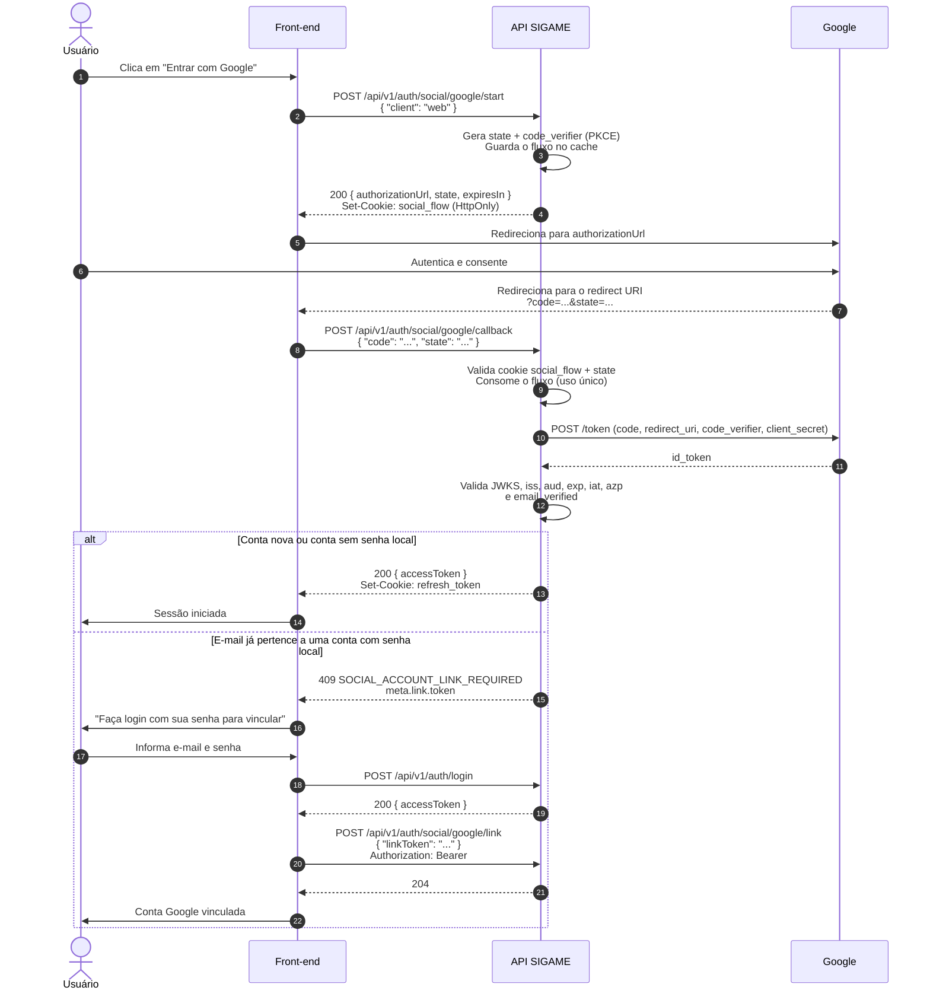
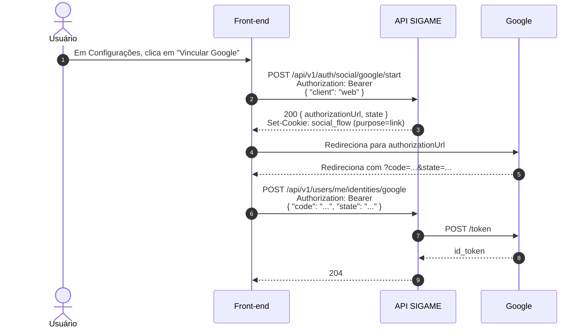
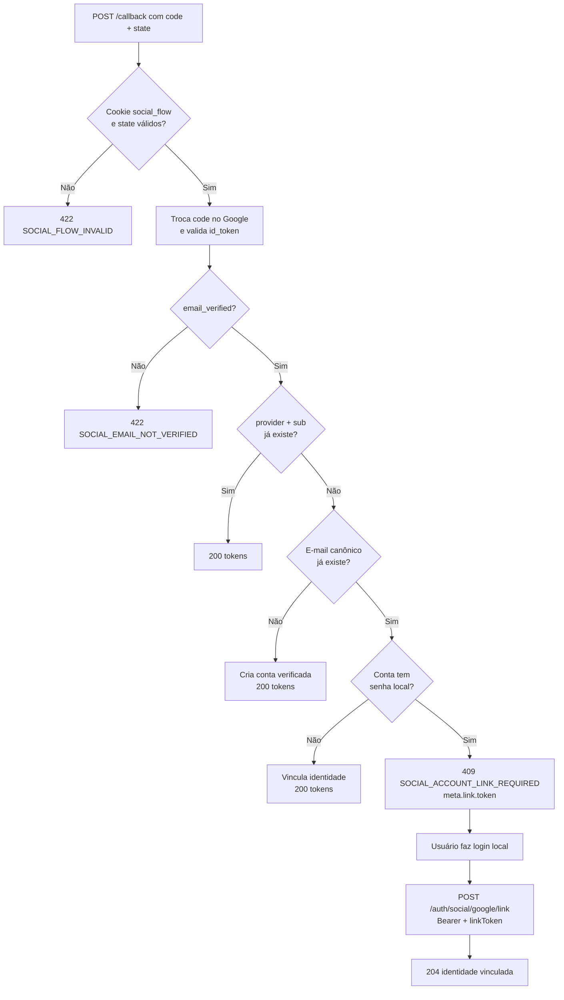

# SIGAME — Autenticação e conta

> **Última atualização:** 2026-11-06
>
> **Implementação:** `src/Identity/Application/UseCase/`, `src/Identity/Infrastructure/Security/`, `src/Identity/Infrastructure/Social/` e `src/Identity/Presentation/Http/Controller/`

Este documento descreve o contrato de autenticação da API: tokens, cookies, endpoints, códigos de erro, rate limiting, verificação de e-mail, recuperação de senha e o fluxo de login com Google.

## 1. Modelo de tokens

O SIGAME **não usa "JWT duplo"**. Apenas o access token é JWT; o refresh token é uma credencial opaca de alta entropia. Verificação de e-mail e reset de senha usam **tokens de uso único** persistidos apenas como hash.

| Token | Formato | Duração | Persistência | Onde trafega |
|---|---|---|---|---|
| Access token | JWT HS256 | 15 minutos | Nenhuma (stateless) | `Authorization: Bearer <token>` |
| Refresh token | `rt_` + 64 caracteres hexadecimais | 7 dias, renovados a cada rotação | SHA-256 no banco | Cookie `HttpOnly` |
| Verificação de e-mail | 64 caracteres hexadecimais | 24 horas | SHA-256 em `identity_tokens` | Link enviado por e-mail |
| Reset de senha | 64 caracteres hexadecimais | 30 minutos | SHA-256 em `identity_tokens` | Link enviado por e-mail |

### 1.1 Access token

Claims:

```json
{
  "iss": "sigame",
  "aud": "sigame-api",
  "sub": "uuid-do-usuario",
  "typ": "access",
  "jti": "uuid-do-token",
  "iat": 1760000000,
  "nbf": 1760000000,
  "exp": 1760000900
}
```

| Campo | Uso |
|---|---|
| `iss` | Emissor (`ACCESS_TOKEN_ISSUER`) |
| `aud` | Audiência (`ACCESS_TOKEN_AUDIENCE`) |
| `sub` | UUID do usuário (`UserId`) |
| `typ` | Precisa ser `access` |
| `jti` | Identificador único do token |
| `iat` / `nbf` / `exp` | Janela de validade |

O access token é validado a cada requisição. O usuário é recarregado do banco, então uma suspensão passa a valer imediatamente. Não existe lista de access tokens revogados; eles expiram em até 15 minutos.

Rotas públicas (`login`, `refresh`, `logout`, `register`, `email`, `password` e `social`) **ignoram** o header `Authorization`. Um access token antigo ou malformado no cliente não impede que essas rotas sejam executadas; apenas rotas protegidas falham com `ACCESS_TOKEN_MISSING`, `ACCESS_TOKEN_INVALID` ou `ACCESS_TOKEN_EXPIRED`.

### 1.2 Refresh token

- Valor bruto: `rt_` + `bin2hex(random_bytes(32))`.
- Banco: apenas SHA-256 do valor bruto.
- Cookie: `HttpOnly`, `Secure` configurável, `SameSite` configurável, path `/api/v1/auth`.
- Cada token pertence a uma **família** (`family_id`), que representa uma sessão/dispositivo.
- No máximo 5 famílias ativas por usuário.

> Requisições autenticadas por cookie (refresh e logout) validam o header `Origin`
> contra `CORS_ALLOW_ORIGINS`. Chamadas sem `Origin` (server-to-server) seguem
> permitidas; origens desconhecidas recebem `403 ORIGIN_NOT_ALLOWED`.

### 1.3 Rotação e detecção de reuso

1. O refresh token atual é revogado e aponta para o substituto (`replaced_by_id`).
2. Um novo token é criado na mesma família.
3. Se um token revogado for reapresentado **fora da janela de graça**, toda a família é revogada.
4. Dentro da janela de graça, o endpoint retorna `REFRESH_TOKEN_ALREADY_ROTATED` sem revogar a família — isso evita falso positivo em requisições concorrentes legítimas.
5. A rotação é serializada por lock com chave derivada do hash do token.

A janela é configurada por `REFRESH_TOKEN_REUSE_GRACE_SECONDS` (padrão: 30 segundos).

### 1.4 E-mail canônico

O e-mail é único no agregado `User` (`users.email`) e é a fonte de verdade para login local, verificação e recuperação de senha. As identidades em `user_identities` guardam o e-mail devolvido por cada provedor; elas não podem gerar uma segunda conta com o mesmo endereço.

`users.email_verified_at` indica se o endereço foi confirmado:

- cadastro local nasce **não verificado**;
- cadastro por provedor social nasce **verificado**, porque o provedor confirmou `email_verified=true`;
- a verificação é registrada em `GET /api/v1/users/me` em `emailVerified`.

### 1.5 Fusos horários

O domínio persiste e compara todos os instantes em **UTC**. Datas exibidas ao usuário
final — inclusive o prazo nos e-mails de verificação e reset — são convertidas para
**America/Sao_Paulo** (UTC-3, sem horário de verão desde 2019) e formatadas como
`dd/mm/aaaa HH:MM`.

A conversão é centralizada em
`src/Identity/Infrastructure/Mailer/MailDateFormatter.php` e coberta por
`SymfonyIdentityMailerTest` e `InstantTest`, incluindo a virada de dia (02:30 UTC
ainda é 23:30 do dia anterior em Brasília).

### 1.6 Variáveis de configuração

| Variável | Padrão | Descrição |
|---|---|---|
| `ACCESS_TOKEN_SECRET` | — | Segredo HS256 com pelo menos 32 caracteres |
| `ACCESS_TOKEN_ISSUER` | `sigame` | Claim `iss` |
| `ACCESS_TOKEN_AUDIENCE` | `sigame-api` | Claim `aud` |
| `ACCESS_TOKEN_TTL` | `900` | Validade do access token em segundos |
| `REFRESH_TOKEN_TTL` | `604800` | Validade do refresh token em segundos |
| `REFRESH_TOKEN_REUSE_GRACE_SECONDS` | `30` | Janela de graça para concorrência |
| `REFRESH_TOKEN_MAX_FAMILIES` | `5` | Máximo de sessões ativas por usuário |
| `REFRESH_COOKIE_NAME` | `refresh_token` | Nome do cookie |
| `REFRESH_COOKIE_PATH` | `/api/v1/auth` | Path restrito do cookie |
| `REFRESH_COOKIE_SECURE` | `1` | Exige HTTPS |
| `REFRESH_COOKIE_SAMESITE` | `lax` | `lax`, `strict` ou `none` |
| `OAUTH_FLOW_TTL` | `600` | Validade do fluxo OAuth em segundos |
| `SOCIAL_LINK_TICKET_TTL` | `600` | Validade do ticket de vínculo em segundos |
| `EMAIL_VERIFICATION_TTL` | `86400` | Validade do token de verificação |
| `PASSWORD_RESET_TTL` | `1800` | Validade do token de reset |
| `PASSWORD_RESET_COOLDOWN` | `60` | Intervalo mínimo entre pedidos de reset da mesma conta |
| `MAILER_DSN` | `null://null` | Transporte de e-mail (dev: Mailpit) |
| `MAILER_FROM_ADDRESS` | `noreply@sigame.com.br` | Remetente |
| `MAILER_FROM_NAME` | `SIGAME` | Nome do remetente |
| `FRONTEND_URL` | `http://localhost:3000` | Base dos links enviados por e-mail |

Em desenvolvimento com front em `http://localhost:3000` e API em outro host, use `REFRESH_COOKIE_SAMESITE=none` com `REFRESH_COOKIE_SECURE=1`. Em produção _same-site_, prefira `strict` ou `lax`.

---

## 2. Endpoints

Todas as rotas de negócio usam o prefixo `/api/v1`.

| Método | Rota | Autenticação |
|---|---|---|
| `POST` | `/api/v1/auth/register` | Pública |
| `POST` | `/api/v1/auth/login` | Pública |
| `POST` | `/api/v1/auth/social/{provider}/start` | Pública (Bearer opcional para vínculo) |
| `POST` | `/api/v1/auth/social/{provider}/callback` | Pública + cookie `social_flow` |
| `POST` | `/api/v1/auth/social/{provider}/link` | Bearer JWT |
| `POST` | `/api/v1/auth/email/verify` | Pública |
| `POST` | `/api/v1/auth/password/forgot` | Pública |
| `POST` | `/api/v1/auth/password/reset` | Pública |
| `POST` | `/api/v1/auth/refresh` | Cookie `refresh_token` |
| `POST` | `/api/v1/auth/logout` | Cookie `refresh_token` |
| `POST` | `/api/v1/auth/logout/all` | Bearer JWT |
| `GET` | `/api/v1/users/me` | Bearer JWT |
| `PATCH` | `/api/v1/users/me/cpf` | Bearer JWT |
| `POST` | `/api/v1/auth/email/verification/resend` | Bearer JWT |
| `POST` | `/api/v1/users/me/password` | Bearer JWT |
| `POST` | `/api/v1/users/me/identities/{provider}` | Bearer JWT |
| `GET` | `/api/health/liveness` | Pública |
| `GET` | `/api/health/readiness` | Pública |

### 2.1 Cadastro

`POST /api/v1/auth/register` — público.

```json
{
  "cpf": "477.051.220-14",
  "email": "user@example.com",
  "name": "John Doe",
  "password": "secret123"
}
```

- `cpf` é opcional e pode vir formatado.
- A resposta `201` traz os dados do usuário.
- O cadastro **não autentica**: chame o login em seguida.
- Um e-mail de confirmação é enviado; o cadastro continua válido mesmo se o envio falhar (use o reenvio).
- Erros: `VALIDATION_ERROR`, `CPF_INVALID`, `EMAIL_INVALID`, `USER_CPF_ALREADY_EXISTS`, `EMAIL_ALREADY_EXISTS`.
- Limite: 5 tentativas por minuto por e-mail + IP.

### 2.2 Login local

`POST /api/v1/auth/login` — público.

```json
{
  "email": "user@example.com",
  "password": "secret123"
}
```

Resposta `200`:

```json
{
  "data": {
    "accessToken": "eyJ0eXAiOiJKV1QiLCJhbGciOiJIUzI1NiJ9...",
    "tokenType": "Bearer",
    "expiresIn": 900
  },
  "meta": { "timestamp": "2026-11-06T12:00:00.000+00:00" }
}
```

O refresh token **não** aparece no corpo. Ele vem em `Set-Cookie: refresh_token=rt_...`.

### 2.3 Renovação

`POST /api/v1/auth/refresh` — sem corpo; lê o cookie `refresh_token`.

Resposta `200` com novo access token e novo cookie. O token anterior é invalidado. O header `Authorization` é ignorado: mesmo que o cliente envie um access token expirado, a renovação depende apenas do cookie.

Erros possíveis:

| Código | HTTP | Quando |
|---|---|---|
| `REFRESH_TOKEN_INVALID` | 401 | Cookie ausente ou token desconhecido |
| `REFRESH_TOKEN_EXPIRED` | 401 | Token expirado |
| `REFRESH_TOKEN_REUSED` | 401 | Token revogado reapresentado fora da janela de graça; família revogada |
| `REFRESH_TOKEN_ALREADY_ROTATED` | 401 | Reapresentação dentro da janela de graça |
| `REFRESH_IN_PROGRESS` | 409 | Outra requisição está rotacionando o token |
| `ACCOUNT_SUSPENDED` | 403 | Conta suspensa |
| `ORIGIN_NOT_ALLOWED` | 403 | O header `Origin` não está em `CORS_ALLOW_ORIGINS` |

Em qualquer falha, o cookie é limpo na resposta. O bloqueio de origem acontece
antes da leitura do cookie: uma origem desconhecida retorna `ORIGIN_NOT_ALLOWED`
mesmo que o cookie esteja ausente ou válido.

### 2.4 Logout

`POST /api/v1/auth/logout` — usa o cookie.

Revoga a família do refresh token apresentado e limpa o cookie. Retorna `204`. É idempotente para um cookie já revogado. Uma origem desconhecida retorna `403 ORIGIN_NOT_ALLOWED` antes de qualquer operação com o cookie.

`POST /api/v1/auth/logout/all` — exige `Authorization: Bearer <accessToken>`.

Revoga todas as famílias do usuário autenticado. Retorna `204`.

### 2.5 Minha conta

`GET /api/v1/users/me` — exige Bearer JWT.

```json
{
  "data": {
    "id": "01a0d4ac-5d8d-7712-a6e3-f44a6cabc55f",
    "cpf": "477.051.220-14",
    "email": "user@example.com",
    "emailVerified": true,
    "name": "John Doe",
    "level": 1,
    "status": "ACTIVE",
    "onboardingStatus": "PENDING",
    "role": "USER",
    "createdAt": "2026-11-06T12:00:00.000+00:00"
  },
  "meta": { "timestamp": "2026-11-06T12:00:00.000+00:00" }
}
```

`PATCH /api/v1/users/me/cpf` — exige Bearer JWT.

```json
{ "cpf": "477.051.220-14" }
```

O CPF é write-once. Erros: `USER_CPF_ALREADY_SET`, `USER_CPF_ALREADY_EXISTS`, `CPF_INVALID`.

### 2.6 Erros do access token

Em rotas protegidas, falhas do access token retornam `401` com um código específico:

| Código | Quando |
|---|---|
| `ACCESS_TOKEN_MISSING` | A requisição não enviou `Authorization: Bearer <token>` (ou o valor está vazio). |
| `ACCESS_TOKEN_INVALID` | Token malformado, assinatura/emisor/audiência/`typ` inválidos, claims obrigatórios ausentes ou usuário inexistente. |
| `ACCESS_TOKEN_EXPIRED` | Token autêntico, mas com `exp` no passado. |

O header `WWW-Authenticate` acompanha a resposta:

- `ACCESS_TOKEN_MISSING`: `Bearer realm="sigame-api"`
- `ACCESS_TOKEN_INVALID` e `ACCESS_TOKEN_EXPIRED`: `Bearer realm="sigame-api", error="invalid_token"`

Conta suspensa continua retornando `403 ACCOUNT_SUSPENDED`, independentemente do estado do token.

### 2.7 Renovação no front-end

O cliente deve tratar `401` de rota protegida assim:

1. Se o código for `ACCESS_TOKEN_MISSING`, `ACCESS_TOKEN_INVALID` ou `ACCESS_TOKEN_EXPIRED`, chamar `POST /api/v1/auth/refresh` uma única vez (single-flight).
2. Se a renovação funcionar, repetir a requisição original uma única vez.
3. Se o refresh retornar `REFRESH_TOKEN_INVALID`, `REFRESH_TOKEN_EXPIRED`, `REFRESH_TOKEN_REUSED` ou `REFRESH_TOKEN_ALREADY_ROTATED`, limpar a sessão local e redirecionar para o login.
4. Nunca renovar a partir de `401` de `/auth/login` nem de `/auth/refresh`; isso evita loop.
5. `403 ACCOUNT_SUSPENDED` não dispara renovação.

O ideal é renovar proativamente perto do fim de `expiresIn` (900 segundos), evitando a maioria dos `401`.

---

## 3. Login com Google

O backend autentica por **authorization code com state e PKCE (S256)**. O front-end nunca envia `redirectUri` nem `codeVerifier`: o backend mantém os dois no servidor e só aceita a resposta de um fluxo que ele próprio iniciou.

### 3.1 Diagrama do fluxo



### 3.2 Vinculação pela tela de configurações

O usuário já autenticado também pode iniciar o vínculo explicitamente. O fluxo nasce com a finalidade `link` e o callback é enviado à rota de identidades:



### 3.3 Regras de vínculo

Ao concluir o callback de login, o backend decide:

| Situação | Ação |
|---|---|
| `(provider, sub)` já existe | Autentica o dono da identidade (403 se suspenso) |
| E-mail canônico existe e a conta **não** tem senha local | Vincula a identidade automaticamente e autentica |
| E-mail canônico existe e a conta **tem** senha local | `409 SOCIAL_ACCOUNT_LINK_REQUIRED` + `meta.link.token`; **não** emite tokens |
| E-mail canônico não existe | Cria a conta (`users.email` + `email_verified_at`) e autentica |

O ticket de vínculo (`meta.link`) contém:

- `meta.link.token`: ticket de uso único, válido por 10 minutos (`SOCIAL_LINK_TICKET_TTL`);
- `meta.link.expiresAt`: instante de expiração em ISO 8601 com milissegundos.

O ticket é vinculado ao e-mail que originou o conflito e exige `Authorization: Bearer` e o **mesmo e-mail canônico** da conta autenticada.

Isso impede o ataque de pré-cadastro: um atacante que registre o e-mail da vítima não consegue transformar a conta em “conta Google da vítima” apenas concluindo o consentimento. O dono da senha local precisa autenticar antes.



### 3.4 Criar as credenciais no Google Cloud

1. Acesse o [Google Cloud Console](https://console.cloud.google.com/) e selecione (ou crie) um projeto.
2. Em **APIs & Services → OAuth consent screen**, configure a tela de consentimento.
   - Em modo **Testing**, adicione em **Test users** todas as contas que farão login.
3. Em **APIs & Services → Credentials → Create credentials → OAuth client ID**:
   - Application type: **Web application**.
   - Em **Authorized redirect URIs**, cadastre **exatamente** as URLs configuradas no backend:

     ```
     https://app.exemplo.com/auth/google/callback       # produção (client: web)
     https://api.sigame.localhost:8443/dev/google-oauth # desenvolvimento (client: dev)
     ```

4. Copie o **Client ID** e o **Client secret**.

> O Google exige que o `redirect_uri` enviado na autorização e na troca do código seja idêntico ao cadastrado. O backend resolve esse valor no servidor a partir do `client` informado; o cliente nunca escolhe a URL.

### 3.5 Configurar o backend

Certifique-se de as variáveis de ambiente em `.env` e/ou `.env.dev` estarem corretas:


```env
# .env

OAUTH_FLOW_TTL=600
SOCIAL_LINK_TICKET_TTL=600
```

```env
# .env.dev

# Redirect URIs por tipo de cliente. O backend escolhe uma delas; o request só
# informa "web" ou "dev".
GOOGLE_REDIRECT_URI_WEB=https://app.exemplo.com/auth/google/callback
GOOGLE_REDIRECT_URI_DEV=https://localhost:8443/dev/google-oauth
```

E depois, coloque as credenciais em `.env.local` (não versionado), nunca em `.env`:

```env
GOOGLE_CLIENT_ID=seu-client-id.apps.googleusercontent.com
GOOGLE_CLIENT_SECRET=seu-client-secret
```

> Em produção, os arquivos `.env` estarão consolidados em um local único, então não se prenda a essa divisão fora do contexto de desenvolvimento.

`client: "dev"` só é aceito fora de produção. Depois de alterar variáveis, limpe o cache:

```bash
docker compose exec php php bin/console cache:clear
```

### 3.6 Fluxo no front-end

1. Chame `POST /api/v1/auth/social/google/start` com `{ "client": "web" }`, usando `credentials: 'include'`.
2. Guarde o `state` retornado e redirecione o navegador para `authorizationUrl`.
3. Ao voltar do Google, confira se o `state` da URL é o mesmo recebido no passo 1.
4. Envie `{ "code": "...", "state": "..." }` para `POST /api/v1/auth/social/google/callback`.
5. Use o access token em `Authorization: Bearer <accessToken>` e renove com `POST /api/v1/auth/refresh`.

```bash
# início
curl -i -X POST 'https://api.sigame.localhost:8443/api/v1/auth/social/google/start' \
  -H 'Content-Type: application/json' \
  -H 'Cookie: social_flow=<valor-do-cookie>' \
  --data '{ "client": "web" }'

# callback (com o cookie retornado pelo start)
curl -i -X POST 'https://api.sigame.localhost:8443/api/v1/auth/social/google/callback' \
  -H 'Content-Type: application/json' \
  -H 'Cookie: social_flow=<valor-do-cookie>' \
  --data '{ "code": "4/0Ab...", "state": "..." }'
```

O front-end precisa chamar a API com credenciais habilitadas: `credentials: 'include'` no `fetch` ou `withCredentials` no axios.

### 3.7 Comportamento do backend

- O fluxo é criado no servidor: `state`, `code_verifier` e `redirect_uri` não são aceitos do cliente.
- O `id_token` é validado contra o JWKS do Google (`iss`, `aud`, `azp`, `exp`, `iat` e assinatura RS256).
- O login só é aceito com `email_verified=true`; caso contrário retorna `SOCIAL_EMAIL_NOT_VERIFIED`.
- O vínculo automático só ocorre quando a conta existente **não** tem senha local.
- Somente `google` está habilitado; outro provedor retorna `SOCIAL_PROVIDER_UNSUPPORTED`.
- O endpoint de callback é limitado a 10 requisições por minuto por provedor + IP (`429` ao exceder).
- Um `kid` desconhecido no JWKS dispara uma renovação de chaves, limitada a uma vez por minuto.

### 3.8 Testando em desenvolvimento

A página `GET /dev/google-oauth` é registrada **somente com `APP_ENV=dev`**. Ela simula o front-end:

1. chama `POST /auth/social/google/start` com `client: "dev"`;
2. redireciona para o Google;
3. ao voltar, envia `code` e `state` para `POST /auth/social/google/callback` e exibe a resposta.

Cadastre `GOOGLE_REDIRECT_URI_DEV` exatamente como *Authorized redirect URI* no Google Cloud Console. A página precisa ser servida **na mesma origem** usada no redirect, para que o cookie `social_flow` chegue ao callback.

> Se o Google recusar o host `*.localhost`, use um host loopback (`http://127.0.0.1:8000`) ou um túnel (`cloudflared`/`ngrok`), sempre mantendo a página e a API na mesma origem, e ajuste `GOOGLE_REDIRECT_URI_DEV`.

> O Playground público (`https://developers.google.com/oauthplayground`) **não** faz parte do fluxo da aplicação. Se for usado para diagnóstico do client OAuth, use um cliente separado e nunca cole o secret de produção em sites de terceiros.

Os e-mails de desenvolvimento são capturados pelo Mailpit:

- SMTP: `smtp://mailer:1025`
- UI: <http://localhost:8025>

### 3.9 Problemas comuns

| Sintoma | Causa provável |
|---|---|
| `redirect_uri_mismatch` no Google | URL não cadastrada no console ou diferente da configurada em `GOOGLE_REDIRECT_URI_*` |
| `invalid_grant` na troca | Código já consumido, expirado ou credenciais de outro cliente OAuth |
| `SOCIAL_FLOW_INVALID` | Cookie `social_flow` ausente, `state` divergente, fluxo expirado ou já usado |
| `SOCIAL_AUTHENTICATION_FAILED` | Client ID/Secret inválidos, code recusado ou `id_token` inválido |
| `SOCIAL_EMAIL_NOT_VERIFIED` | A conta Google não tem e-mail verificado ou o escopo `email` não foi solicitado |
| `SOCIAL_ACCOUNT_LINK_REQUIRED` | Já existe conta com senha local; faça login e use `meta.link.token` |
| `SOCIAL_LINK_EMAIL_MISMATCH` | O ticket foi emitido para outro e-mail/conta |
| `SOCIAL_IDENTITY_ALREADY_LINKED` | A conta Google já pertence a outro usuário |
| `SOCIAL_PROVIDER_UNSUPPORTED` | Provider diferente de `google` na URL |
| Cookie não é enviado no callback | `SameSite`/`Secure` incompatíveis com a origem, ou requisição sem credenciais |
| Erro de CORS no navegador | Origem ausente/incorreta em `CORS_ALLOW_ORIGINS` |

---

## 4. Verificação de e-mail

O cadastro local envia um link para `FRONTEND_URL/auth/verify?token=...`. O front remove o token da URL depois de lê-lo e chama a API.

### 4.1 Confirmar

`POST /api/v1/auth/email/verify` — público.

```json
{ "token": "a1b2c3..." }
```

- `204` quando o e-mail é verificado.
- `EMAIL_VERIFICATION_TOKEN_INVALID` (422) para token inexistente ou já usado.
- `EMAIL_VERIFICATION_TOKEN_EXPIRED` (422) para token vencido.
- O prazo exibido no e-mail é formatado em `America/Sao_Paulo` (`dd/mm/aaaa HH:MM`).
- Limite: 10 tentativas por minuto por IP.

### 4.2 Reenviar

`POST /api/v1/auth/email/verification/resend` — Bearer. Retorna `204`. Apesar do prefixo `/auth`, a rota exige `Authorization`; a confirmação pública continua em `POST /auth/email/verify`.

- Gera um novo token e invalida o anterior.
- Contas já verificadas não recebem novo e-mail.
- Limite: 3 reenvios por minuto por usuário.

---

## 5. Recuperação e troca de senha

### 5.1 Solicitar reset

`POST /api/v1/auth/password/forgot` — público.

```json
{ "email": "user@example.com" }
```

Sempre retorna `204`, exista ou não a conta, para não revelar e-mails cadastrados. Se a conta existir e estiver ativa, um token de 30 minutos é enviado ao e-mail canônico, com o prazo formatado em `America/Sao_Paulo`. Pedidos repetidos para a mesma conta dentro de `PASSWORD_RESET_COOLDOWN` segundos (padrão 60) não geram novo token nem novo e-mail. Limite: 5 tentativas por minuto por e-mail + IP.

### 5.2 Redefinir

`POST /api/v1/auth/password/reset` — público.

```json
{ "token": "a1b2c3...", "password": "new-secret-123" }
```

- Consome o token, grava a nova senha e **revoga todas as sessões**.
- Se o e-mail ainda não estava verificado, ele passa a ser marcado como verificado: receber o token no endereço canônico prova a posse da caixa postal.
- Não autentica automaticamente; o usuário deve fazer login.
- Contas criadas por provedor social passam a ter uma credencial local (o e-mail já é verificado pelo provedor).
- Erros: `PASSWORD_RESET_TOKEN_INVALID`, `PASSWORD_RESET_TOKEN_EXPIRED`, `ACCOUNT_SUSPENDED`.

### 5.3 Trocar a senha autenticado

`POST /api/v1/users/me/password` — Bearer.

```json
{ "currentPassword": "secret123", "newPassword": "new-secret-123" }
```

- Exige a senha atual; retorna `PASSWORD_CURRENT_INVALID` quando não confere.
- Revoga todas as sessões; o cliente precisa autenticar novamente.
- Limite: 5 tentativas por minuto por usuário.

---

## 6. Rate limiting

| Limiter | Política | Limite | Chave |
|---|---|---|---|
| `auth_register` | sliding window | 5/min | e-mail + IP |
| `auth_login` | sliding window | 5/min | e-mail + IP |
| `auth_social_start` | sliding window | 20/min | IP |
| `auth_social_callback` | sliding window | 10/min | provider + IP |
| `auth_social_link` | sliding window | 10/min | `user_id` |
| `auth_refresh` | sliding window | 30/min | IP |
| `auth_email_verify` | sliding window | 10/min | IP |
| `auth_email_resend` | sliding window | 3/min | `user_id` |
| `auth_password_forgot` | sliding window | 5/min | e-mail + IP |
| `auth_password_reset` | sliding window | 10/min | IP |
| `auth_password_change` | sliding window | 5/min | `user_id` |
| `user_cpf` | sliding window | 10/min | `user_id` |

O excesso retorna `429 TOO_MANY_REQUESTS` com `Retry-After` e headers `X-RateLimit-*`.

Os limites são configuráveis pelas variáveis `AUTH_*_RATE_LIMIT` e `USER_CPF_RATE_LIMIT`.

> Com mais de uma instância da API em produção, os pools `cache.rate_limiter` e `cache.social_flow` precisam apontar para armazenamento compartilhado (Redis ou banco). Sem isso, um fluxo iniciado em uma instância pode falhar na outra e o rate limit passa a ser por instância. Isso está registrado como pendência em [implementacao.md](implementacao.md).

---

## 7. Evolução para app nativo

O fluxo implementado é **authorization code + PKCE**. Para o app nativo futuro, o SDK poderá enviar um `id_token`; o backend já possui validação OIDC por JWKS e o mesmo `SocialIdentityProviderInterface`. A evolução consiste em aceitar `id_token` além de `code` no callback e adicionar o adapter do novo provedor.

Apple **não** está implementada nesta entrega. O enum `IdentityProvider` e o registry deixam a extensão pronta sem alterar o handler, o banco ou o controller.

---

## 8. Referências de código e testes

| Assunto | Arquivo |
|---|---|
| Emissão/rotação/revogação | `src/Identity/Application/Service/TokenPairIssuer.php` |
| Geração do access token | `src/Identity/Infrastructure/Security/LcobucciAccessTokenGenerator.php` |
| Geração do refresh opaco | `src/Identity/Infrastructure/Security/OpaqueRefreshTokenGenerator.php` |
| Autenticador Bearer | `src/Identity/Infrastructure/Security/AccessTokenAuthenticator.php` |
| Início do fluxo OAuth | `src/Identity/Application/UseCase/Social/StartSocialFlow/` |
| Conclusão do login social | `src/Identity/Application/UseCase/Social/CompleteSocialLogin/` |
| Vínculo explícito | `src/Identity/Application/UseCase/Social/LinkSocialIdentity/` |
| Provider Google | `src/Identity/Infrastructure/Social/GoogleIdentityProvider.php` |
| Validação do id_token/JWKS | `src/Identity/Infrastructure/Social/IdTokenVerifier.php` e `JwksProvider.php` |
| Cookie de refresh | `src/Identity/Presentation/Http/Response/RefreshTokenCookieFactory.php` |
| Cookie do fluxo OAuth | `src/Identity/Presentation/Http/Response/SocialFlowCookieFactory.php` |
| Verificação de e-mail | `src/Identity/Application/UseCase/EmailVerification/` |
| Senhas | `src/Identity/Application/UseCase/Password/` |
| Envio de e-mail | `src/Identity/Infrastructure/Mailer/` |
| Página de diagnóstico OAuth | `src/Identity/Presentation/Http/Controller/DevOAuthController.php` |
| Testes de rotação | `tests/Unit/Identity/Application/Service/TokenPairIssuerTest.php` |
| Testes HTTP de auth | `tests/Functional/Identity/Presentation/Http/AuthTest.php` |
| Testes do fluxo Google | `tests/Functional/Identity/Presentation/Http/SocialAuthTest.php` |
| Testes de e-mail/senha | `tests/Functional/Identity/Presentation/Http/EmailAndPasswordTest.php` |
| Testes de `/users/me` | `tests/Functional/Identity/Presentation/Http/MeTest.php` |
| Testes de hardening HTTP (401/403/429, cookie e origem) | `tests/Functional/Identity/Presentation/Http/AuthHardeningTest.php` |
| Testes dos use cases de verificação de e-mail | `tests/Unit/Identity/Application/UseCase/EmailVerification/` |
| Testes dos use cases de senha | `tests/Unit/Identity/Application/UseCase/Password/` |
| Testes do vínculo por fluxo | `tests/Unit/Identity/Application/UseCase/Social/LinkWithFlowHandlerTest.php` |
| Testes do mailer, templates e fuso horário | `tests/Unit/Identity/Infrastructure/Mailer/` |
| Testes das stores de OAuth e do JWKS | `tests/Unit/Identity/Infrastructure/Social/` |
| Testes do Origin guard | `tests/Unit/Shared/Presentation/Http/Security/CookieOriginGuardTest.php` |
| Testes do repositório de tokens de uso único | `tests/Integration/Identity/Infrastructure/Persistence/DoctrineIdentityTokenRepositoryTest.php` |
