# SIGAME

## Descrição

Modelo de dados do SIGAME (PostgreSQL 18, schema criado pelas migrations).

## Contextos

| Nome | Descrição |
| ---- | ----------- |
| [Identity](viewpoint-identity.md) | Contas, identidades de login, modalidades e credenciais temporárias. |
| [Groups](viewpoint-groups.md) | Grupos esportivos, participação e transferência de responsabilidade. |
| [Activities](viewpoint-activities.md) | Atividades de grupo, inscrições, presença e remarcações. |
| [Gamification](viewpoint-gamification.md) | Progresso, ledger de XP e conquistas. |
| [Notifications](viewpoint-notifications.md) | Inbox canônico e entregas por canal externo. |
| [Administration](viewpoint-administration.md) | Auditoria administrativa e suspensões de conta. |

## Tabelas

| Nome | Colunas | Comentário | Tipo |
| ---- | ------- | ------- | ---- |
| [public.users](public.users.md) | 15 | Conta do usuário com perfil, papel global, status e projeções de nível. | BASE TABLE |
| [public.user_modalities](public.user_modalities.md) | 3 | Modalidades praticadas pelo usuário (no máximo uma principal). | BASE TABLE |
| [public.user_identities](public.user_identities.md) | 8 | Identidade de login do usuário (credencial local ou social). | BASE TABLE |
| [public.refresh_tokens](public.refresh_tokens.md) | 8 | Refresh tokens opacos por família de sessão (somente hash). | BASE TABLE |
| [public.groups](public.groups.md) | 17 | Raiz do agregado de grupos esportivos. | BASE TABLE |
| [public.group_memberships](public.group_memberships.md) | 14 | Episódio de participação de um usuário em um grupo. | BASE TABLE |
| [public.activities](public.activities.md) | 27 | Raiz do agregado de atividades de grupo (janela e ciclo de vida). | BASE TABLE |
| [public.activity_attendances](public.activity_attendances.md) | 12 | Episódio de inscrição, check-in e presença em uma atividade. | BASE TABLE |
| [public.activity_reschedules](public.activity_reschedules.md) | 9 | Histórico append-only de remarcações de atividade. | BASE TABLE |
| [public.user_progress](public.user_progress.md) | 13 | Progresso agregado do usuário (XP, nível e ofensiva semanal). | BASE TABLE |
| [public.xp_events](public.xp_events.md) | 15 | Ledger append-only de XP; estornos geram lançamentos negativos. | BASE TABLE |
| [public.notification_deliveries](public.notification_deliveries.md) | 8 | Tentativa de entrega de uma notificação em canal externo. | BASE TABLE |
| [public.notifications](public.notifications.md) | 10 | Notificação canônica persistida no inbox do destinatário. | BASE TABLE |
| [public.user_suspensions](public.user_suspensions.md) | 6 | Histórico append-only de suspensão e reativação de conta. | BASE TABLE |
| [public.group_ownership_transfers](public.group_ownership_transfers.md) | 6 | Histórico append-only de transferência de responsabilidade do grupo. | BASE TABLE |
| [public.user_achievements](public.user_achievements.md) | 4 | Conquistas desbloqueadas, registradas uma única vez por código. | BASE TABLE |
| [public.identity_otp_challenges](public.identity_otp_challenges.md) | 8 | Desafio OTP de uso único para verificação de e-mail e reset de senha. | BASE TABLE |
| [public.identity_password_reset_tickets](public.identity_password_reset_tickets.md) | 7 | Ticket temporário de troca de senha emitido após a validação do OTP. | BASE TABLE |
| [public.admin_audit_entries](public.admin_audit_entries.md) | 9 | Auditoria append-only das ações da administração global. | BASE TABLE |

## Relacionamentos

```mermaid
erDiagram

"public.user_modalities" }o--|| "public.users" : "FOREIGN KEY (user_id) REFERENCES users(id) ON DELETE CASCADE"
"public.user_identities" }o--|| "public.users" : "FOREIGN KEY (user_id) REFERENCES users(id) ON DELETE CASCADE"
"public.refresh_tokens" }o--|| "public.users" : "FOREIGN KEY (user_id) REFERENCES users(id) ON DELETE CASCADE"
"public.refresh_tokens" }o--o| "public.refresh_tokens" : "FOREIGN KEY (replaced_by_id) REFERENCES refresh_tokens(id) ON DELETE SET NULL"
"public.group_memberships" }o--|| "public.groups" : "FOREIGN KEY (group_id) REFERENCES groups(id) ON DELETE CASCADE"
"public.activity_attendances" }o--|| "public.activities" : "FOREIGN KEY (activity_id) REFERENCES activities(id) ON DELETE CASCADE"
"public.activity_reschedules" }o--|| "public.activities" : "FOREIGN KEY (activity_id) REFERENCES activities(id) ON DELETE CASCADE"
"public.notification_deliveries" }o--|| "public.notifications" : "FOREIGN KEY (notification_id) REFERENCES notifications(id) ON DELETE CASCADE"
"public.user_suspensions" }o--|| "public.users" : "FOREIGN KEY (actor_id) REFERENCES users(id) ON DELETE RESTRICT"
"public.user_suspensions" }o--|| "public.users" : "FOREIGN KEY (user_id) REFERENCES users(id) ON DELETE CASCADE"
"public.group_ownership_transfers" }o--|| "public.groups" : "FOREIGN KEY (group_id) REFERENCES groups(id) ON DELETE CASCADE"
"public.identity_otp_challenges" }o--|| "public.users" : "FOREIGN KEY (user_id) REFERENCES users(id) ON DELETE CASCADE"
"public.identity_password_reset_tickets" }o--|| "public.users" : "FOREIGN KEY (user_id) REFERENCES users(id) ON DELETE CASCADE"
"public.identity_password_reset_tickets" }o--|| "public.identity_otp_challenges" : "FOREIGN KEY (challenge_id) REFERENCES identity_otp_challenges(id) ON DELETE CASCADE"
"public.activities" }o--|| "public.users" : "created_by"
"public.activities" |o--o| "public.users" : "started_by"
"public.activities" |o--o| "public.users" : "finished_by"
"public.activities" |o--o| "public.users" : "cancelled_by"
"public.activities" |o--o| "public.users" : "invalidated_by"
"public.activity_attendances" |o--o| "public.users" : "validated_by"
"public.activity_attendances" |o--o| "public.users" : "cancelled_by"
"public.activity_reschedules" }o--|| "public.users" : "changed_by"
"public.groups" }o--|| "public.users" : "created_by"
"public.groups" }o--|| "public.users" : "owner_id"
"public.groups" |o--o| "public.users" : "archived_by"
"public.groups" |o--o| "public.users" : "deleted_by"
"public.group_memberships" |o--o| "public.users" : "decided_by"
"public.group_memberships" |o--o| "public.users" : "removed_by"
"public.group_ownership_transfers" }o--|| "public.users" : "previous_owner_id"
"public.group_ownership_transfers" }o--|| "public.users" : "new_owner_id"
"public.group_ownership_transfers" }o--|| "public.users" : "actor_id"
"public.notifications" }o--|| "public.users" : "recipient_id"
"public.admin_audit_entries" }o--|| "public.users" : "actor_id"
"public.group_memberships" }o--|| "public.users" : "Detected Relation"
"public.activities" }o--|| "public.groups" : "Detected Relation"
"public.activity_attendances" }o--|| "public.users" : "Detected Relation"
"public.user_progress" |o--|| "public.users" : "Detected Relation"
"public.xp_events" }o--|| "public.users" : "Detected Relation"
"public.xp_events" }o--o| "public.activities" : "Detected Relation"
"public.user_achievements" }o--|| "public.users" : "Detected Relation"

"public.users" {
  uuid id ""
}
"public.user_modalities" {
  uuid user_id FK ""
}
"public.user_identities" {
  uuid user_id FK ""
}
"public.refresh_tokens" {
  uuid id ""
  uuid user_id FK ""
  uuid replaced_by_id FK ""
}
"public.groups" {
  uuid id ""
  uuid created_by ""
  uuid archived_by ""
  uuid deleted_by ""
  uuid owner_id ""
}
"public.group_memberships" {
  uuid group_id FK ""
  uuid user_id ""
  uuid decided_by ""
  uuid removed_by ""
}
"public.activities" {
  uuid id ""
  uuid group_id ""
  uuid created_by ""
  uuid started_by ""
  uuid finished_by ""
  uuid cancelled_by ""
  uuid invalidated_by ""
}
"public.activity_attendances" {
  uuid user_id ""
  uuid validated_by ""
  uuid cancelled_by ""
  uuid activity_id FK ""
}
"public.activity_reschedules" {
  uuid changed_by ""
  uuid activity_id FK ""
}
"public.user_progress" {
  uuid user_id ""
}
"public.xp_events" {
  uuid user_id ""
  varchar_64_ activity_id ""
}
"public.notification_deliveries" {
  uuid notification_id FK ""
}
"public.notifications" {
  uuid id ""
  uuid recipient_id ""
}
"public.user_suspensions" {
  uuid user_id FK ""
  uuid actor_id FK ""
}
"public.group_ownership_transfers" {
  uuid previous_owner_id ""
  uuid new_owner_id ""
  uuid actor_id ""
  uuid group_id FK ""
}
"public.user_achievements" {
  uuid user_id ""
}
"public.identity_otp_challenges" {
  uuid id ""
  uuid user_id FK ""
}
"public.identity_password_reset_tickets" {
  uuid user_id FK ""
  uuid challenge_id FK ""
}
"public.admin_audit_entries" {
  uuid actor_id ""
}
```

---

> Generated by [tbls](https://github.com/k1LoW/tbls)
