# public.activities

## Descrição

Raiz do agregado de atividades de grupo (janela e ciclo de vida).

## Colunas

| Nome | Tipo | Padrão | Nulo | Filhos | Pais | Comentário |
| ---- | ---- | ------ | ---- | ------ | ---- | ---------- |
| id | uuid |  | false | [public.activity_attendances](public.activity_attendances.md) [public.activity_reschedules](public.activity_reschedules.md) [public.xp_events](public.xp_events.md) |  |  |
| group_id | uuid |  | false |  | [public.groups](public.groups.md) |  |
| created_by | uuid |  | false |  | [public.users](public.users.md) |  |
| title | varchar(100) |  | false |  |  |  |
| description | varchar(500) | NULL::character varying | true |  |  |  |
| starts_at | timestamp(6) with time zone |  | false |  |  |  |
| ends_at | timestamp(6) with time zone |  | false |  |  |  |
| estimated_duration_minutes | integer |  | true |  |  |  |
| meeting_point | varchar(255) |  | false |  |  |  |
| route | varchar(500) |  | false |  |  |  |
| estimated_distance_meters | integer |  | false |  |  |  |
| status | varchar(20) |  | false |  |  |  |
| started_at | timestamp(6) with time zone | NULL::timestamp with time zone | true |  |  |  |
| started_by | uuid |  | true |  | [public.users](public.users.md) |  |
| auto_close_at | timestamp(6) with time zone | NULL::timestamp with time zone | true |  |  |  |
| finished_at | timestamp(6) with time zone | NULL::timestamp with time zone | true |  |  |  |
| finished_by | uuid |  | true |  | [public.users](public.users.md) |  |
| finished_automatically | boolean | false | false |  |  |  |
| cancelled_at | timestamp(6) with time zone | NULL::timestamp with time zone | true |  |  |  |
| cancelled_by | uuid |  | true |  | [public.users](public.users.md) |  |
| cancelled_automatically | boolean | false | false |  |  |  |
| cancellation_reason | varchar(500) | NULL::character varying | true |  |  |  |
| invalidated_at | timestamp(6) with time zone | NULL::timestamp with time zone | true |  |  |  |
| invalidated_by | uuid |  | true |  | [public.users](public.users.md) |  |
| invalidation_reason | varchar(500) | NULL::character varying | true |  |  |  |
| created_at | timestamp(6) with time zone |  | false |  |  |  |
| updated_at | timestamp(6) with time zone |  | false |  |  |  |

## Contextos

| Nome | Definição |
| ---- | ---------- |
| [Activities](viewpoint-activities.md) | Atividades de grupo, inscrições, presença e remarcações. |

## Restrições

| Nome | Tipo | Definição |
| ---- | ---- | ---------- |
| activities_cancelled_automatically_not_null | n | NOT NULL cancelled_automatically |
| activities_created_at_not_null | n | NOT NULL created_at |
| activities_created_by_not_null | n | NOT NULL created_by |
| activities_ends_at_not_null | n | NOT NULL ends_at |
| activities_estimated_distance_meters_not_null | n | NOT NULL estimated_distance_meters |
| activities_finished_automatically_not_null | n | NOT NULL finished_automatically |
| activities_group_id_not_null | n | NOT NULL group_id |
| activities_id_not_null | n | NOT NULL id |
| activities_meeting_point_not_null | n | NOT NULL meeting_point |
| activities_route_not_null | n | NOT NULL route |
| activities_starts_at_not_null | n | NOT NULL starts_at |
| activities_status_not_null | n | NOT NULL status |
| activities_title_not_null | n | NOT NULL title |
| activities_updated_at_not_null | n | NOT NULL updated_at |
| activities_pkey | PRIMARY KEY | PRIMARY KEY (id) |

## Índices

| Nome | Definição |
| ---- | ---------- |
| activities_pkey | CREATE UNIQUE INDEX activities_pkey ON public.activities USING btree (id) |
| idx_activities_group_starts_at | CREATE INDEX idx_activities_group_starts_at ON public.activities USING btree (group_id, starts_at) |
| idx_activities_status_auto_close_at | CREATE INDEX idx_activities_status_auto_close_at ON public.activities USING btree (status, auto_close_at) |
| idx_activities_created_by | CREATE INDEX idx_activities_created_by ON public.activities USING btree (created_by) |

## Relacionamentos

```mermaid
erDiagram

"public.activity_attendances" }o--|| "public.activities" : "FOREIGN KEY (activity_id) REFERENCES activities(id) ON DELETE CASCADE"
"public.activity_attendances" }o--|| "public.users" : "Detected Relation"
"public.activity_attendances" |o--o| "public.users" : "validated_by"
"public.activity_attendances" |o--o| "public.users" : "cancelled_by"
"public.activity_reschedules" }o--|| "public.activities" : "FOREIGN KEY (activity_id) REFERENCES activities(id) ON DELETE CASCADE"
"public.activity_reschedules" }o--|| "public.users" : "changed_by"
"public.xp_events" }o--o| "public.activities" : "Detected Relation"
"public.xp_events" }o--|| "public.users" : "Detected Relation"
"public.activities" }o--|| "public.groups" : "Detected Relation"
"public.group_memberships" }o--|| "public.groups" : "FOREIGN KEY (group_id) REFERENCES groups(id) ON DELETE CASCADE"
"public.group_ownership_transfers" }o--|| "public.groups" : "FOREIGN KEY (group_id) REFERENCES groups(id) ON DELETE CASCADE"
"public.groups" }o--|| "public.users" : "created_by"
"public.groups" |o--o| "public.users" : "archived_by"
"public.groups" |o--o| "public.users" : "deleted_by"
"public.groups" }o--|| "public.users" : "owner_id"
"public.activities" }o--|| "public.users" : "created_by"
"public.user_modalities" }o--|| "public.users" : "FOREIGN KEY (user_id) REFERENCES users(id) ON DELETE CASCADE"
"public.user_identities" }o--|| "public.users" : "FOREIGN KEY (user_id) REFERENCES users(id) ON DELETE CASCADE"
"public.refresh_tokens" }o--|| "public.users" : "FOREIGN KEY (user_id) REFERENCES users(id) ON DELETE CASCADE"
"public.user_suspensions" }o--|| "public.users" : "FOREIGN KEY (actor_id) REFERENCES users(id) ON DELETE RESTRICT"
"public.user_suspensions" }o--|| "public.users" : "FOREIGN KEY (user_id) REFERENCES users(id) ON DELETE CASCADE"
"public.identity_otp_challenges" }o--|| "public.users" : "FOREIGN KEY (user_id) REFERENCES users(id) ON DELETE CASCADE"
"public.identity_password_reset_tickets" }o--|| "public.users" : "FOREIGN KEY (user_id) REFERENCES users(id) ON DELETE CASCADE"
"public.activities" |o--o| "public.users" : "started_by"
"public.activities" |o--o| "public.users" : "finished_by"
"public.activities" |o--o| "public.users" : "cancelled_by"
"public.activities" |o--o| "public.users" : "invalidated_by"
"public.group_memberships" |o--o| "public.users" : "decided_by"
"public.group_memberships" |o--o| "public.users" : "removed_by"
"public.group_ownership_transfers" }o--|| "public.users" : "previous_owner_id"
"public.group_ownership_transfers" }o--|| "public.users" : "new_owner_id"
"public.group_ownership_transfers" }o--|| "public.users" : "actor_id"
"public.notifications" }o--|| "public.users" : "recipient_id"
"public.admin_audit_entries" }o--|| "public.users" : "actor_id"
"public.group_memberships" }o--|| "public.users" : "Detected Relation"
"public.user_progress" |o--|| "public.users" : "Detected Relation"
"public.user_achievements" }o--|| "public.users" : "Detected Relation"

"public.activities" {
  uuid id ""
  uuid group_id ""
  uuid created_by ""
  uuid started_by ""
  uuid finished_by ""
  uuid cancelled_by ""
  uuid invalidated_by ""
}
"public.activity_attendances" {
  uuid user_id ""
  uuid validated_by ""
  uuid cancelled_by ""
  uuid activity_id FK ""
}
"public.users" {
  uuid id ""
}
"public.activity_reschedules" {
  uuid changed_by ""
  uuid activity_id FK ""
}
"public.xp_events" {
  uuid user_id ""
  varchar_64_ activity_id ""
}
"public.groups" {
  uuid id ""
  uuid created_by ""
  uuid archived_by ""
  uuid deleted_by ""
  uuid owner_id ""
}
"public.group_memberships" {
  uuid group_id FK ""
  uuid user_id ""
  uuid decided_by ""
  uuid removed_by ""
}
"public.group_ownership_transfers" {
  uuid previous_owner_id ""
  uuid new_owner_id ""
  uuid actor_id ""
  uuid group_id FK ""
}
"public.user_modalities" {
  uuid user_id FK ""
}
"public.user_identities" {
  uuid user_id FK ""
}
"public.refresh_tokens" {
  uuid id ""
  uuid user_id FK ""
  uuid replaced_by_id FK ""
}
"public.user_suspensions" {
  uuid user_id FK ""
  uuid actor_id FK ""
}
"public.identity_otp_challenges" {
  uuid id ""
  uuid user_id FK ""
}
"public.identity_password_reset_tickets" {
  uuid user_id FK ""
  uuid challenge_id FK ""
}
"public.notifications" {
  uuid id ""
  uuid recipient_id ""
}
"public.admin_audit_entries" {
  uuid actor_id ""
}
"public.user_progress" {
  uuid user_id ""
}
"public.user_achievements" {
  uuid user_id ""
}
```

---

> Generated by [tbls](https://github.com/k1LoW/tbls)
