# public.activity_attendances

## Descrição

Episódio de inscrição, check-in e presença em uma atividade.

## Colunas

| Nome | Tipo | Padrão | Nulo | Filhos | Pais | Comentário |
| ---- | ---- | ------ | ---- | ------ | ---- | ---------- |
| id | uuid |  | false |  |  |  |
| user_id | uuid |  | false |  | [public.users](public.users.md) |  |
| status | varchar(20) |  | false |  |  |  |
| enrolled_at | timestamp(6) with time zone |  | false |  |  |  |
| checked_in_at | timestamp(6) with time zone | NULL::timestamp with time zone | true |  |  |  |
| validated_at | timestamp(6) with time zone | NULL::timestamp with time zone | true |  |  |  |
| validated_by | uuid |  | true |  | [public.users](public.users.md) |  |
| cancelled_at | timestamp(6) with time zone | NULL::timestamp with time zone | true |  |  |  |
| cancelled_by | uuid |  | true |  | [public.users](public.users.md) |  |
| created_at | timestamp(6) with time zone |  | false |  |  |  |
| updated_at | timestamp(6) with time zone |  | false |  |  |  |
| activity_id | uuid |  | false |  | [public.activities](public.activities.md) |  |

## Contextos

| Nome | Definição |
| ---- | ---------- |
| [Activities](viewpoint-activities.md) | Atividades de grupo, inscrições, presença e remarcações. |

## Restrições

| Nome | Tipo | Definição |
| ---- | ---- | ---------- |
| activity_attendances_activity_id_not_null | n | NOT NULL activity_id |
| activity_attendances_created_at_not_null | n | NOT NULL created_at |
| activity_attendances_enrolled_at_not_null | n | NOT NULL enrolled_at |
| activity_attendances_id_not_null | n | NOT NULL id |
| activity_attendances_status_not_null | n | NOT NULL status |
| activity_attendances_updated_at_not_null | n | NOT NULL updated_at |
| activity_attendances_user_id_not_null | n | NOT NULL user_id |
| fk_92e5e5d881c06096 | FOREIGN KEY | FOREIGN KEY (activity_id) REFERENCES activities(id) ON DELETE CASCADE |
| activity_attendances_pkey | PRIMARY KEY | PRIMARY KEY (id) |

## Índices

| Nome | Definição |
| ---- | ---------- |
| activity_attendances_pkey | CREATE UNIQUE INDEX activity_attendances_pkey ON public.activity_attendances USING btree (id) |
| idx_activity_attendances_user_status | CREATE INDEX idx_activity_attendances_user_status ON public.activity_attendances USING btree (user_id, status) |
| idx_activity_attendances_activity_status | CREATE INDEX idx_activity_attendances_activity_status ON public.activity_attendances USING btree (activity_id, status) |
| uniq_activity_attendances_active | CREATE UNIQUE INDEX uniq_activity_attendances_active ON public.activity_attendances USING btree (activity_id, user_id) WHERE ((status)::text = ANY ((ARRAY['enrolled'::character varying, 'checked_in'::character varying, 'validated'::character varying])::text[])) |
| idx_92e5e5d881c06096 | CREATE INDEX idx_92e5e5d881c06096 ON public.activity_attendances USING btree (activity_id) |

## Relacionamentos

```mermaid
erDiagram

"public.activity_attendances" }o--|| "public.users" : "Detected Relation"
"public.user_modalities" }o--|| "public.users" : "FOREIGN KEY (user_id) REFERENCES users(id) ON DELETE CASCADE"
"public.user_identities" }o--|| "public.users" : "FOREIGN KEY (user_id) REFERENCES users(id) ON DELETE CASCADE"
"public.refresh_tokens" }o--|| "public.users" : "FOREIGN KEY (user_id) REFERENCES users(id) ON DELETE CASCADE"
"public.user_suspensions" }o--|| "public.users" : "FOREIGN KEY (actor_id) REFERENCES users(id) ON DELETE RESTRICT"
"public.user_suspensions" }o--|| "public.users" : "FOREIGN KEY (user_id) REFERENCES users(id) ON DELETE CASCADE"
"public.identity_otp_challenges" }o--|| "public.users" : "FOREIGN KEY (user_id) REFERENCES users(id) ON DELETE CASCADE"
"public.identity_password_reset_tickets" }o--|| "public.users" : "FOREIGN KEY (user_id) REFERENCES users(id) ON DELETE CASCADE"
"public.activities" }o--|| "public.users" : "created_by"
"public.activities" |o--o| "public.users" : "started_by"
"public.activities" |o--o| "public.users" : "finished_by"
"public.activities" |o--o| "public.users" : "cancelled_by"
"public.activities" |o--o| "public.users" : "invalidated_by"
"public.activity_attendances" |o--o| "public.users" : "validated_by"
"public.activity_attendances" |o--o| "public.users" : "cancelled_by"
"public.activity_reschedules" }o--|| "public.users" : "changed_by"
"public.groups" }o--|| "public.users" : "created_by"
"public.groups" }o--|| "public.users" : "owner_id"
"public.groups" |o--o| "public.users" : "archived_by"
"public.groups" |o--o| "public.users" : "deleted_by"
"public.group_memberships" |o--o| "public.users" : "decided_by"
"public.group_memberships" |o--o| "public.users" : "removed_by"
"public.group_ownership_transfers" }o--|| "public.users" : "previous_owner_id"
"public.group_ownership_transfers" }o--|| "public.users" : "new_owner_id"
"public.group_ownership_transfers" }o--|| "public.users" : "actor_id"
"public.notifications" }o--|| "public.users" : "recipient_id"
"public.admin_audit_entries" }o--|| "public.users" : "actor_id"
"public.group_memberships" }o--|| "public.users" : "Detected Relation"
"public.user_progress" |o--|| "public.users" : "Detected Relation"
"public.xp_events" }o--|| "public.users" : "Detected Relation"
"public.user_achievements" }o--|| "public.users" : "Detected Relation"
"public.activity_attendances" }o--|| "public.activities" : "FOREIGN KEY (activity_id) REFERENCES activities(id) ON DELETE CASCADE"
"public.activity_reschedules" }o--|| "public.activities" : "FOREIGN KEY (activity_id) REFERENCES activities(id) ON DELETE CASCADE"
"public.xp_events" }o--o| "public.activities" : "Detected Relation"
"public.activities" }o--|| "public.groups" : "Detected Relation"

"public.activity_attendances" {
  uuid user_id ""
  uuid validated_by ""
  uuid cancelled_by ""
  uuid activity_id FK ""
}
"public.users" {
  uuid id ""
}
"public.user_modalities" {
  uuid user_id FK ""
}
"public.user_identities" {
  uuid user_id FK ""
}
"public.refresh_tokens" {
  uuid id ""
  uuid user_id FK ""
  uuid replaced_by_id FK ""
}
"public.user_suspensions" {
  uuid user_id FK ""
  uuid actor_id FK ""
}
"public.identity_otp_challenges" {
  uuid id ""
  uuid user_id FK ""
}
"public.identity_password_reset_tickets" {
  uuid user_id FK ""
  uuid challenge_id FK ""
}
"public.activities" {
  uuid id ""
  uuid group_id ""
  uuid created_by ""
  uuid started_by ""
  uuid finished_by ""
  uuid cancelled_by ""
  uuid invalidated_by ""
}
"public.activity_reschedules" {
  uuid changed_by ""
  uuid activity_id FK ""
}
"public.groups" {
  uuid id ""
  uuid created_by ""
  uuid archived_by ""
  uuid deleted_by ""
  uuid owner_id ""
}
"public.group_memberships" {
  uuid group_id FK ""
  uuid user_id ""
  uuid decided_by ""
  uuid removed_by ""
}
"public.group_ownership_transfers" {
  uuid previous_owner_id ""
  uuid new_owner_id ""
  uuid actor_id ""
  uuid group_id FK ""
}
"public.notifications" {
  uuid id ""
  uuid recipient_id ""
}
"public.admin_audit_entries" {
  uuid actor_id ""
}
"public.user_progress" {
  uuid user_id ""
}
"public.xp_events" {
  uuid user_id ""
  varchar_64_ activity_id ""
}
"public.user_achievements" {
  uuid user_id ""
}
```

---

> Generated by [tbls](https://github.com/k1LoW/tbls)
