# public.admin_audit_entries

## Descrição

Auditoria append-only das ações da administração global.

## Colunas

| Nome | Tipo | Padrão | Nulo | Filhos | Pais | Comentário |
| ---- | ---- | ------ | ---- | ------ | ---- | ---------- |
| id | uuid |  | false |  |  |  |
| action | varchar(40) |  | false |  |  |  |
| target_type | varchar(20) |  | false |  |  |  |
| target_id | uuid |  | false |  |  |  |
| target_label | varchar(160) |  | false |  |  |  |
| actor_id | uuid |  | false |  | [public.users](public.users.md) |  |
| actor_name | varchar(160) |  | false |  |  |  |
| reason | varchar(500) | NULL::character varying | true |  |  |  |
| occurred_at | timestamp(6) with time zone |  | false |  |  |  |

## Contextos

| Nome | Definição |
| ---- | ---------- |
| [Administration](viewpoint-administration.md) | Auditoria administrativa e suspensões de conta. |

## Restrições

| Nome | Tipo | Definição |
| ---- | ---- | ---------- |
| admin_audit_entries_action_not_null | n | NOT NULL action |
| admin_audit_entries_actor_id_not_null | n | NOT NULL actor_id |
| admin_audit_entries_actor_name_not_null | n | NOT NULL actor_name |
| admin_audit_entries_id_not_null | n | NOT NULL id |
| admin_audit_entries_occurred_at_not_null | n | NOT NULL occurred_at |
| admin_audit_entries_target_id_not_null | n | NOT NULL target_id |
| admin_audit_entries_target_label_not_null | n | NOT NULL target_label |
| admin_audit_entries_target_type_not_null | n | NOT NULL target_type |
| admin_audit_entries_pkey | PRIMARY KEY | PRIMARY KEY (id) |

## Índices

| Nome | Definição |
| ---- | ---------- |
| admin_audit_entries_pkey | CREATE UNIQUE INDEX admin_audit_entries_pkey ON public.admin_audit_entries USING btree (id) |
| idx_admin_audit_entries_occurred | CREATE INDEX idx_admin_audit_entries_occurred ON public.admin_audit_entries USING btree (occurred_at) |
| idx_admin_audit_entries_target | CREATE INDEX idx_admin_audit_entries_target ON public.admin_audit_entries USING btree (target_type, target_id) |
| idx_admin_audit_entries_actor | CREATE INDEX idx_admin_audit_entries_actor ON public.admin_audit_entries USING btree (actor_id) |
| idx_admin_audit_entries_action | CREATE INDEX idx_admin_audit_entries_action ON public.admin_audit_entries USING btree (action) |

## Relacionamentos

```mermaid
erDiagram

"public.admin_audit_entries" }o--|| "public.users" : "actor_id"
"public.user_modalities" }o--|| "public.users" : "FOREIGN KEY (user_id) REFERENCES users(id) ON DELETE CASCADE"
"public.user_identities" }o--|| "public.users" : "FOREIGN KEY (user_id) REFERENCES users(id) ON DELETE CASCADE"
"public.refresh_tokens" }o--|| "public.users" : "FOREIGN KEY (user_id) REFERENCES users(id) ON DELETE CASCADE"
"public.user_suspensions" }o--|| "public.users" : "FOREIGN KEY (actor_id) REFERENCES users(id) ON DELETE RESTRICT"
"public.user_suspensions" }o--|| "public.users" : "FOREIGN KEY (user_id) REFERENCES users(id) ON DELETE CASCADE"
"public.identity_otp_challenges" }o--|| "public.users" : "FOREIGN KEY (user_id) REFERENCES users(id) ON DELETE CASCADE"
"public.identity_password_reset_tickets" }o--|| "public.users" : "FOREIGN KEY (user_id) REFERENCES users(id) ON DELETE CASCADE"
"public.activities" }o--|| "public.users" : "created_by"
"public.activities" |o--o| "public.users" : "started_by"
"public.activities" |o--o| "public.users" : "finished_by"
"public.activities" |o--o| "public.users" : "cancelled_by"
"public.activities" |o--o| "public.users" : "invalidated_by"
"public.activity_attendances" |o--o| "public.users" : "validated_by"
"public.activity_attendances" |o--o| "public.users" : "cancelled_by"
"public.activity_reschedules" }o--|| "public.users" : "changed_by"
"public.groups" }o--|| "public.users" : "created_by"
"public.groups" }o--|| "public.users" : "owner_id"
"public.groups" |o--o| "public.users" : "archived_by"
"public.groups" |o--o| "public.users" : "deleted_by"
"public.group_memberships" |o--o| "public.users" : "decided_by"
"public.group_memberships" |o--o| "public.users" : "removed_by"
"public.group_ownership_transfers" }o--|| "public.users" : "previous_owner_id"
"public.group_ownership_transfers" }o--|| "public.users" : "new_owner_id"
"public.group_ownership_transfers" }o--|| "public.users" : "actor_id"
"public.notifications" }o--|| "public.users" : "recipient_id"
"public.group_memberships" }o--|| "public.users" : "Detected Relation"
"public.activity_attendances" }o--|| "public.users" : "Detected Relation"
"public.user_progress" |o--|| "public.users" : "Detected Relation"
"public.xp_events" }o--|| "public.users" : "Detected Relation"
"public.user_achievements" }o--|| "public.users" : "Detected Relation"

"public.admin_audit_entries" {
  uuid actor_id ""
}
"public.users" {
  uuid id ""
}
"public.user_modalities" {
  uuid user_id FK ""
}
"public.user_identities" {
  uuid user_id FK ""
}
"public.refresh_tokens" {
  uuid id ""
  uuid user_id FK ""
  uuid replaced_by_id FK ""
}
"public.user_suspensions" {
  uuid user_id FK ""
  uuid actor_id FK ""
}
"public.identity_otp_challenges" {
  uuid id ""
  uuid user_id FK ""
}
"public.identity_password_reset_tickets" {
  uuid user_id FK ""
  uuid challenge_id FK ""
}
"public.activities" {
  uuid id ""
  uuid group_id ""
  uuid created_by ""
  uuid started_by ""
  uuid finished_by ""
  uuid cancelled_by ""
  uuid invalidated_by ""
}
"public.activity_attendances" {
  uuid user_id ""
  uuid validated_by ""
  uuid cancelled_by ""
  uuid activity_id FK ""
}
"public.activity_reschedules" {
  uuid changed_by ""
  uuid activity_id FK ""
}
"public.groups" {
  uuid id ""
  uuid created_by ""
  uuid archived_by ""
  uuid deleted_by ""
  uuid owner_id ""
}
"public.group_memberships" {
  uuid group_id FK ""
  uuid user_id ""
  uuid decided_by ""
  uuid removed_by ""
}
"public.group_ownership_transfers" {
  uuid previous_owner_id ""
  uuid new_owner_id ""
  uuid actor_id ""
  uuid group_id FK ""
}
"public.notifications" {
  uuid id ""
  uuid recipient_id ""
}
"public.user_progress" {
  uuid user_id ""
}
"public.xp_events" {
  uuid user_id ""
  varchar_64_ activity_id ""
}
"public.user_achievements" {
  uuid user_id ""
}
```

---

> Generated by [tbls](https://github.com/k1LoW/tbls)
