# public.group_memberships

## Descrição

Episódio de participação de um usuário em um grupo.

## Colunas

| Nome | Tipo | Padrão | Nulo | Filhos | Pais | Comentário |
| ---- | ---- | ------ | ---- | ------ | ---- | ---------- |
| id | uuid |  | false |  |  |  |
| group_id | uuid |  | false |  | [public.groups](public.groups.md) |  |
| user_id | uuid |  | false |  | [public.users](public.users.md) |  |
| role | varchar(20) |  | false |  |  |  |
| status | varchar(20) |  | false |  |  |  |
| is_supervisor | boolean | false | false |  |  |  |
| requested_at | timestamp(6) with time zone |  | false |  |  |  |
| decided_at | timestamp(6) with time zone | NULL::timestamp with time zone | true |  |  |  |
| decided_by | uuid |  | true |  | [public.users](public.users.md) |  |
| removed_at | timestamp(6) with time zone | NULL::timestamp with time zone | true |  |  |  |
| removed_by | uuid |  | true |  | [public.users](public.users.md) |  |
| removal_reason | varchar(500) | NULL::character varying | true |  |  |  |
| created_at | timestamp(6) with time zone |  | false |  |  |  |
| updated_at | timestamp(6) with time zone |  | false |  |  |  |

## Contextos

| Nome | Definição |
| ---- | ---------- |
| [Groups](viewpoint-groups.md) | Grupos esportivos, participação e transferência de responsabilidade. |

## Restrições

| Nome | Tipo | Definição |
| ---- | ---- | ---------- |
| group_memberships_created_at_not_null | n | NOT NULL created_at |
| group_memberships_group_id_not_null | n | NOT NULL group_id |
| group_memberships_id_not_null | n | NOT NULL id |
| group_memberships_is_supervisor_not_null | n | NOT NULL is_supervisor |
| group_memberships_requested_at_not_null | n | NOT NULL requested_at |
| group_memberships_role_not_null | n | NOT NULL role |
| group_memberships_status_not_null | n | NOT NULL status |
| group_memberships_updated_at_not_null | n | NOT NULL updated_at |
| group_memberships_user_id_not_null | n | NOT NULL user_id |
| fk_group_memberships_group | FOREIGN KEY | FOREIGN KEY (group_id) REFERENCES groups(id) ON DELETE CASCADE |
| group_memberships_pkey | PRIMARY KEY | PRIMARY KEY (id) |

## Índices

| Nome | Definição |
| ---- | ---------- |
| group_memberships_pkey | CREATE UNIQUE INDEX group_memberships_pkey ON public.group_memberships USING btree (id) |
| idx_group_memberships_user_status | CREATE INDEX idx_group_memberships_user_status ON public.group_memberships USING btree (user_id, status) |
| idx_group_memberships_group_status | CREATE INDEX idx_group_memberships_group_status ON public.group_memberships USING btree (group_id, status) |
| idx_group_memberships_group_role_status | CREATE INDEX idx_group_memberships_group_role_status ON public.group_memberships USING btree (group_id, role, status) |
| uniq_group_memberships_supervisor | CREATE UNIQUE INDEX uniq_group_memberships_supervisor ON public.group_memberships USING btree (group_id) WHERE ((is_supervisor = true) AND ((status)::text = 'approved'::text)) |
| uniq_group_memberships_active | CREATE UNIQUE INDEX uniq_group_memberships_active ON public.group_memberships USING btree (group_id, user_id) WHERE ((status)::text = ANY ((ARRAY['pending'::character varying, 'approved'::character varying])::text[])) |

## Relacionamentos

```mermaid
erDiagram

"public.group_memberships" }o--|| "public.groups" : "FOREIGN KEY (group_id) REFERENCES groups(id) ON DELETE CASCADE"
"public.group_ownership_transfers" }o--|| "public.groups" : "FOREIGN KEY (group_id) REFERENCES groups(id) ON DELETE CASCADE"
"public.activities" }o--|| "public.groups" : "Detected Relation"
"public.groups" }o--|| "public.users" : "created_by"
"public.groups" |o--o| "public.users" : "archived_by"
"public.groups" |o--o| "public.users" : "deleted_by"
"public.groups" }o--|| "public.users" : "owner_id"
"public.group_memberships" }o--|| "public.users" : "Detected Relation"
"public.user_modalities" }o--|| "public.users" : "FOREIGN KEY (user_id) REFERENCES users(id) ON DELETE CASCADE"
"public.user_identities" }o--|| "public.users" : "FOREIGN KEY (user_id) REFERENCES users(id) ON DELETE CASCADE"
"public.refresh_tokens" }o--|| "public.users" : "FOREIGN KEY (user_id) REFERENCES users(id) ON DELETE CASCADE"
"public.user_suspensions" }o--|| "public.users" : "FOREIGN KEY (actor_id) REFERENCES users(id) ON DELETE RESTRICT"
"public.user_suspensions" }o--|| "public.users" : "FOREIGN KEY (user_id) REFERENCES users(id) ON DELETE CASCADE"
"public.identity_otp_challenges" }o--|| "public.users" : "FOREIGN KEY (user_id) REFERENCES users(id) ON DELETE CASCADE"
"public.identity_password_reset_tickets" }o--|| "public.users" : "FOREIGN KEY (user_id) REFERENCES users(id) ON DELETE CASCADE"
"public.activities" }o--|| "public.users" : "created_by"
"public.activities" |o--o| "public.users" : "started_by"
"public.activities" |o--o| "public.users" : "finished_by"
"public.activities" |o--o| "public.users" : "cancelled_by"
"public.activities" |o--o| "public.users" : "invalidated_by"
"public.activity_attendances" |o--o| "public.users" : "validated_by"
"public.activity_attendances" |o--o| "public.users" : "cancelled_by"
"public.activity_reschedules" }o--|| "public.users" : "changed_by"
"public.group_memberships" |o--o| "public.users" : "decided_by"
"public.group_memberships" |o--o| "public.users" : "removed_by"
"public.group_ownership_transfers" }o--|| "public.users" : "previous_owner_id"
"public.group_ownership_transfers" }o--|| "public.users" : "new_owner_id"
"public.group_ownership_transfers" }o--|| "public.users" : "actor_id"
"public.notifications" }o--|| "public.users" : "recipient_id"
"public.admin_audit_entries" }o--|| "public.users" : "actor_id"
"public.activity_attendances" }o--|| "public.users" : "Detected Relation"
"public.user_progress" |o--|| "public.users" : "Detected Relation"
"public.xp_events" }o--|| "public.users" : "Detected Relation"
"public.user_achievements" }o--|| "public.users" : "Detected Relation"

"public.group_memberships" {
  uuid group_id FK ""
  uuid user_id ""
  uuid decided_by ""
  uuid removed_by ""
}
"public.groups" {
  uuid id ""
  uuid created_by ""
  uuid archived_by ""
  uuid deleted_by ""
  uuid owner_id ""
}
"public.group_ownership_transfers" {
  uuid previous_owner_id ""
  uuid new_owner_id ""
  uuid actor_id ""
  uuid group_id FK ""
}
"public.activities" {
  uuid id ""
  uuid group_id ""
  uuid created_by ""
  uuid started_by ""
  uuid finished_by ""
  uuid cancelled_by ""
  uuid invalidated_by ""
}
"public.users" {
  uuid id ""
}
"public.user_modalities" {
  uuid user_id FK ""
}
"public.user_identities" {
  uuid user_id FK ""
}
"public.refresh_tokens" {
  uuid id ""
  uuid user_id FK ""
  uuid replaced_by_id FK ""
}
"public.user_suspensions" {
  uuid user_id FK ""
  uuid actor_id FK ""
}
"public.identity_otp_challenges" {
  uuid id ""
  uuid user_id FK ""
}
"public.identity_password_reset_tickets" {
  uuid user_id FK ""
  uuid challenge_id FK ""
}
"public.activity_attendances" {
  uuid user_id ""
  uuid validated_by ""
  uuid cancelled_by ""
  uuid activity_id FK ""
}
"public.activity_reschedules" {
  uuid changed_by ""
  uuid activity_id FK ""
}
"public.notifications" {
  uuid id ""
  uuid recipient_id ""
}
"public.admin_audit_entries" {
  uuid actor_id ""
}
"public.user_progress" {
  uuid user_id ""
}
"public.xp_events" {
  uuid user_id ""
  varchar_64_ activity_id ""
}
"public.user_achievements" {
  uuid user_id ""
}
```

---

> Generated by [tbls](https://github.com/k1LoW/tbls)
