# public.group_ownership_transfers

## Descrição

Histórico append-only de transferência de responsabilidade do grupo.

## Colunas

| Nome | Tipo | Padrão | Nulo | Filhos | Pais | Comentário |
| ---- | ---- | ------ | ---- | ------ | ---- | ---------- |
| id | uuid |  | false |  |  |  |
| previous_owner_id | uuid |  | false |  | [public.users](public.users.md) |  |
| new_owner_id | uuid |  | false |  | [public.users](public.users.md) |  |
| actor_id | uuid |  | false |  | [public.users](public.users.md) |  |
| transferred_at | timestamp(6) with time zone |  | false |  |  |  |
| group_id | uuid |  | false |  | [public.groups](public.groups.md) |  |

## Contextos

| Nome | Definição |
| ---- | ---------- |
| [Groups](viewpoint-groups.md) | Grupos esportivos, participação e transferência de responsabilidade. |

## Restrições

| Nome | Tipo | Definição |
| ---- | ---- | ---------- |
| group_ownership_transfers_actor_id_not_null | n | NOT NULL actor_id |
| group_ownership_transfers_group_id_not_null | n | NOT NULL group_id |
| group_ownership_transfers_id_not_null | n | NOT NULL id |
| group_ownership_transfers_new_owner_id_not_null | n | NOT NULL new_owner_id |
| group_ownership_transfers_previous_owner_id_not_null | n | NOT NULL previous_owner_id |
| group_ownership_transfers_transferred_at_not_null | n | NOT NULL transferred_at |
| fk_7a673ed3fe54d947 | FOREIGN KEY | FOREIGN KEY (group_id) REFERENCES groups(id) ON DELETE CASCADE |
| group_ownership_transfers_pkey | PRIMARY KEY | PRIMARY KEY (id) |

## Índices

| Nome | Definição |
| ---- | ---------- |
| group_ownership_transfers_pkey | CREATE UNIQUE INDEX group_ownership_transfers_pkey ON public.group_ownership_transfers USING btree (id) |
| idx_group_ownership_transfers_group | CREATE INDEX idx_group_ownership_transfers_group ON public.group_ownership_transfers USING btree (group_id, transferred_at) |
| idx_7a673ed3fe54d947 | CREATE INDEX idx_7a673ed3fe54d947 ON public.group_ownership_transfers USING btree (group_id) |

## Relacionamentos

```mermaid
erDiagram

"public.group_ownership_transfers" }o--|| "public.users" : "previous_owner_id"
"public.user_modalities" }o--|| "public.users" : "FOREIGN KEY (user_id) REFERENCES users(id) ON DELETE CASCADE"
"public.user_identities" }o--|| "public.users" : "FOREIGN KEY (user_id) REFERENCES users(id) ON DELETE CASCADE"
"public.refresh_tokens" }o--|| "public.users" : "FOREIGN KEY (user_id) REFERENCES users(id) ON DELETE CASCADE"
"public.user_suspensions" }o--|| "public.users" : "FOREIGN KEY (actor_id) REFERENCES users(id) ON DELETE RESTRICT"
"public.user_suspensions" }o--|| "public.users" : "FOREIGN KEY (user_id) REFERENCES users(id) ON DELETE CASCADE"
"public.identity_otp_challenges" }o--|| "public.users" : "FOREIGN KEY (user_id) REFERENCES users(id) ON DELETE CASCADE"
"public.identity_password_reset_tickets" }o--|| "public.users" : "FOREIGN KEY (user_id) REFERENCES users(id) ON DELETE CASCADE"
"public.activities" }o--|| "public.users" : "created_by"
"public.activities" |o--o| "public.users" : "started_by"
"public.activities" |o--o| "public.users" : "finished_by"
"public.activities" |o--o| "public.users" : "cancelled_by"
"public.activities" |o--o| "public.users" : "invalidated_by"
"public.activity_attendances" |o--o| "public.users" : "validated_by"
"public.activity_attendances" |o--o| "public.users" : "cancelled_by"
"public.activity_reschedules" }o--|| "public.users" : "changed_by"
"public.groups" }o--|| "public.users" : "created_by"
"public.groups" }o--|| "public.users" : "owner_id"
"public.groups" |o--o| "public.users" : "archived_by"
"public.groups" |o--o| "public.users" : "deleted_by"
"public.group_memberships" |o--o| "public.users" : "decided_by"
"public.group_memberships" |o--o| "public.users" : "removed_by"
"public.group_ownership_transfers" }o--|| "public.users" : "new_owner_id"
"public.group_ownership_transfers" }o--|| "public.users" : "actor_id"
"public.notifications" }o--|| "public.users" : "recipient_id"
"public.admin_audit_entries" }o--|| "public.users" : "actor_id"
"public.group_memberships" }o--|| "public.users" : "Detected Relation"
"public.activity_attendances" }o--|| "public.users" : "Detected Relation"
"public.user_progress" |o--|| "public.users" : "Detected Relation"
"public.xp_events" }o--|| "public.users" : "Detected Relation"
"public.user_achievements" }o--|| "public.users" : "Detected Relation"
"public.group_ownership_transfers" }o--|| "public.groups" : "FOREIGN KEY (group_id) REFERENCES groups(id) ON DELETE CASCADE"
"public.group_memberships" }o--|| "public.groups" : "FOREIGN KEY (group_id) REFERENCES groups(id) ON DELETE CASCADE"
"public.activities" }o--|| "public.groups" : "Detected Relation"

"public.group_ownership_transfers" {
  uuid previous_owner_id ""
  uuid new_owner_id ""
  uuid actor_id ""
  uuid group_id FK ""
}
"public.users" {
  uuid id ""
}
"public.user_modalities" {
  uuid user_id FK ""
}
"public.user_identities" {
  uuid user_id FK ""
}
"public.refresh_tokens" {
  uuid id ""
  uuid user_id FK ""
  uuid replaced_by_id FK ""
}
"public.user_suspensions" {
  uuid user_id FK ""
  uuid actor_id FK ""
}
"public.identity_otp_challenges" {
  uuid id ""
  uuid user_id FK ""
}
"public.identity_password_reset_tickets" {
  uuid user_id FK ""
  uuid challenge_id FK ""
}
"public.activities" {
  uuid id ""
  uuid group_id ""
  uuid created_by ""
  uuid started_by ""
  uuid finished_by ""
  uuid cancelled_by ""
  uuid invalidated_by ""
}
"public.activity_attendances" {
  uuid user_id ""
  uuid validated_by ""
  uuid cancelled_by ""
  uuid activity_id FK ""
}
"public.activity_reschedules" {
  uuid changed_by ""
  uuid activity_id FK ""
}
"public.groups" {
  uuid id ""
  uuid created_by ""
  uuid archived_by ""
  uuid deleted_by ""
  uuid owner_id ""
}
"public.group_memberships" {
  uuid group_id FK ""
  uuid user_id ""
  uuid decided_by ""
  uuid removed_by ""
}
"public.notifications" {
  uuid id ""
  uuid recipient_id ""
}
"public.admin_audit_entries" {
  uuid actor_id ""
}
"public.user_progress" {
  uuid user_id ""
}
"public.xp_events" {
  uuid user_id ""
  varchar_64_ activity_id ""
}
"public.user_achievements" {
  uuid user_id ""
}
```

---

> Generated by [tbls](https://github.com/k1LoW/tbls)
