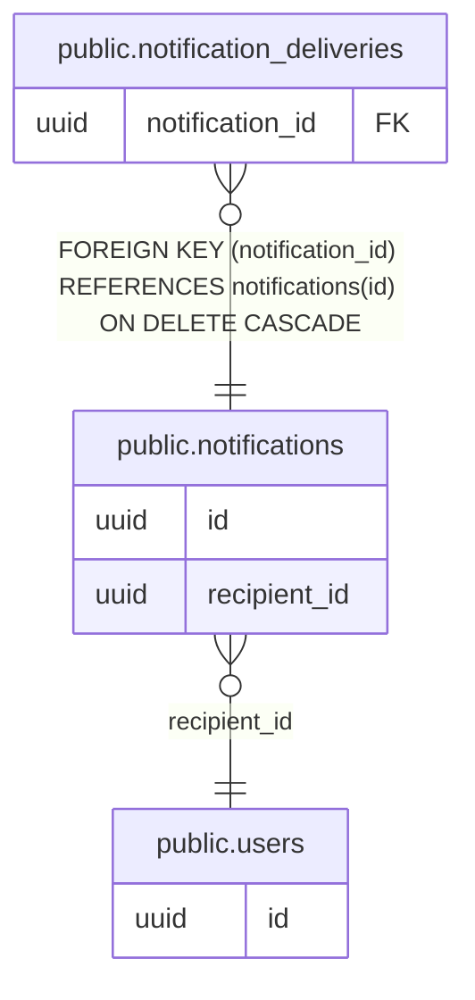

# public.notification_deliveries

## Descrição

Tentativa de entrega de uma notificação em canal externo.

## Colunas

| Nome | Tipo | Padrão | Nulo | Filhos | Pais | Comentário |
| ---- | ---- | ------ | ---- | ------ | ---- | ---------- |
| id | uuid |  | false |  |  |  |
| channel | varchar(20) |  | false |  |  |  |
| status | varchar(20) |  | false |  |  |  |
| attempts | integer | 0 | false |  |  |  |
| last_error | text |  | true |  |  |  |
| sent_at | timestamp(6) with time zone | NULL::timestamp with time zone | true |  |  |  |
| created_at | timestamp(6) with time zone |  | false |  |  |  |
| notification_id | uuid |  | false |  | [public.notifications](public.notifications.md) |  |

## Contextos

| Nome | Definição |
| ---- | ---------- |
| [Notifications](viewpoint-notifications.md) | Inbox canônico e entregas por canal externo. |

## Restrições

| Nome | Tipo | Definição |
| ---- | ---- | ---------- |
| notification_deliveries_attempts_not_null | n | NOT NULL attempts |
| notification_deliveries_channel_not_null | n | NOT NULL channel |
| notification_deliveries_created_at_not_null | n | NOT NULL created_at |
| notification_deliveries_id_not_null | n | NOT NULL id |
| notification_deliveries_notification_id_not_null | n | NOT NULL notification_id |
| notification_deliveries_status_not_null | n | NOT NULL status |
| notification_deliveries_pkey | PRIMARY KEY | PRIMARY KEY (id) |
| fk_9475204aef1a9d84 | FOREIGN KEY | FOREIGN KEY (notification_id) REFERENCES notifications(id) ON DELETE CASCADE |

## Índices

| Nome | Definição |
| ---- | ---------- |
| notification_deliveries_pkey | CREATE UNIQUE INDEX notification_deliveries_pkey ON public.notification_deliveries USING btree (id) |
| uniq_notification_deliveries_channel | CREATE UNIQUE INDEX uniq_notification_deliveries_channel ON public.notification_deliveries USING btree (notification_id, channel) |
| idx_9475204aef1a9d84 | CREATE INDEX idx_9475204aef1a9d84 ON public.notification_deliveries USING btree (notification_id) |

## Relacionamentos

---

> Generated by [tbls](https://github.com/k1LoW/tbls)
