# public.notifications

## Descrição

Notificação canônica persistida no inbox do destinatário.

## Colunas

| Nome | Tipo | Padrão | Nulo | Filhos | Pais | Comentário |
| ---- | ---- | ------ | ---- | ------ | ---- | ---------- |
| id | uuid |  | false | [public.notification_deliveries](public.notification_deliveries.md) |  |  |
| recipient_id | uuid |  | false |  | [public.users](public.users.md) |  |
| type | varchar(60) |  | false |  |  |  |
| category | varchar(20) |  | false |  |  |  |
| title | varchar(120) |  | false |  |  |  |
| body | varchar(500) |  | false |  |  |  |
| payload | json |  | false |  |  |  |
| deduplication_key | varchar(255) |  | false |  |  |  |
| read_at | timestamp(6) with time zone | NULL::timestamp with time zone | true |  |  |  |
| created_at | timestamp(6) with time zone |  | false |  |  |  |

## Contextos

| Nome | Definição |
| ---- | ---------- |
| [Notifications](viewpoint-notifications.md) | Inbox canônico e entregas por canal externo. |

## Restrições

| Nome | Tipo | Definição |
| ---- | ---- | ---------- |
| notifications_body_not_null | n | NOT NULL body |
| notifications_category_not_null | n | NOT NULL category |
| notifications_created_at_not_null | n | NOT NULL created_at |
| notifications_deduplication_key_not_null | n | NOT NULL deduplication_key |
| notifications_id_not_null | n | NOT NULL id |
| notifications_payload_not_null | n | NOT NULL payload |
| notifications_recipient_id_not_null | n | NOT NULL recipient_id |
| notifications_title_not_null | n | NOT NULL title |
| notifications_type_not_null | n | NOT NULL type |
| notifications_pkey | PRIMARY KEY | PRIMARY KEY (id) |

## Índices

| Nome | Definição |
| ---- | ---------- |
| notifications_pkey | CREATE UNIQUE INDEX notifications_pkey ON public.notifications USING btree (id) |
| idx_notifications_recipient_created | CREATE INDEX idx_notifications_recipient_created ON public.notifications USING btree (recipient_id, created_at) |
| idx_notifications_recipient_unread | CREATE INDEX idx_notifications_recipient_unread ON public.notifications USING btree (recipient_id) WHERE (read_at IS NULL) |
| uniq_notifications_recipient_deduplication | CREATE UNIQUE INDEX uniq_notifications_recipient_deduplication ON public.notifications USING btree (recipient_id, deduplication_key) |

## Relacionamentos

```mermaid
erDiagram

"public.notification_deliveries" }o--|| "public.notifications" : "FOREIGN KEY (notification_id) REFERENCES notifications(id) ON DELETE CASCADE"
"public.notifications" }o--|| "public.users" : "recipient_id"
"public.user_modalities" }o--|| "public.users" : "FOREIGN KEY (user_id) REFERENCES users(id) ON DELETE CASCADE"
"public.user_identities" }o--|| "public.users" : "FOREIGN KEY (user_id) REFERENCES users(id) ON DELETE CASCADE"
"public.refresh_tokens" }o--|| "public.users" : "FOREIGN KEY (user_id) REFERENCES users(id) ON DELETE CASCADE"
"public.user_suspensions" }o--|| "public.users" : "FOREIGN KEY (actor_id) REFERENCES users(id) ON DELETE RESTRICT"
"public.user_suspensions" }o--|| "public.users" : "FOREIGN KEY (user_id) REFERENCES users(id) ON DELETE CASCADE"
"public.identity_otp_challenges" }o--|| "public.users" : "FOREIGN KEY (user_id) REFERENCES users(id) ON DELETE CASCADE"
"public.identity_password_reset_tickets" }o--|| "public.users" : "FOREIGN KEY (user_id) REFERENCES users(id) ON DELETE CASCADE"
"public.activities" }o--|| "public.users" : "created_by"
"public.activities" |o--o| "public.users" : "started_by"
"public.activities" |o--o| "public.users" : "finished_by"
"public.activities" |o--o| "public.users" : "cancelled_by"
"public.activities" |o--o| "public.users" : "invalidated_by"
"public.activity_attendances" |o--o| "public.users" : "validated_by"
"public.activity_attendances" |o--o| "public.users" : "cancelled_by"
"public.activity_reschedules" }o--|| "public.users" : "changed_by"
"public.groups" }o--|| "public.users" : "created_by"
"public.groups" }o--|| "public.users" : "owner_id"
"public.groups" |o--o| "public.users" : "archived_by"
"public.groups" |o--o| "public.users" : "deleted_by"
"public.group_memberships" |o--o| "public.users" : "decided_by"
"public.group_memberships" |o--o| "public.users" : "removed_by"
"public.group_ownership_transfers" }o--|| "public.users" : "previous_owner_id"
"public.group_ownership_transfers" }o--|| "public.users" : "new_owner_id"
"public.group_ownership_transfers" }o--|| "public.users" : "actor_id"
"public.admin_audit_entries" }o--|| "public.users" : "actor_id"
"public.group_memberships" }o--|| "public.users" : "Detected Relation"
"public.activity_attendances" }o--|| "public.users" : "Detected Relation"
"public.user_progress" |o--|| "public.users" : "Detected Relation"
"public.xp_events" }o--|| "public.users" : "Detected Relation"
"public.user_achievements" }o--|| "public.users" : "Detected Relation"

"public.notifications" {
  uuid id ""
  uuid recipient_id ""
}
"public.notification_deliveries" {
  uuid notification_id FK ""
}
"public.users" {
  uuid id ""
}
"public.user_modalities" {
  uuid user_id FK ""
}
"public.user_identities" {
  uuid user_id FK ""
}
"public.refresh_tokens" {
  uuid id ""
  uuid user_id FK ""
  uuid replaced_by_id FK ""
}
"public.user_suspensions" {
  uuid user_id FK ""
  uuid actor_id FK ""
}
"public.identity_otp_challenges" {
  uuid id ""
  uuid user_id FK ""
}
"public.identity_password_reset_tickets" {
  uuid user_id FK ""
  uuid challenge_id FK ""
}
"public.activities" {
  uuid id ""
  uuid group_id ""
  uuid created_by ""
  uuid started_by ""
  uuid finished_by ""
  uuid cancelled_by ""
  uuid invalidated_by ""
}
"public.activity_attendances" {
  uuid user_id ""
  uuid validated_by ""
  uuid cancelled_by ""
  uuid activity_id FK ""
}
"public.activity_reschedules" {
  uuid changed_by ""
  uuid activity_id FK ""
}
"public.groups" {
  uuid id ""
  uuid created_by ""
  uuid archived_by ""
  uuid deleted_by ""
  uuid owner_id ""
}
"public.group_memberships" {
  uuid group_id FK ""
  uuid user_id ""
  uuid decided_by ""
  uuid removed_by ""
}
"public.group_ownership_transfers" {
  uuid previous_owner_id ""
  uuid new_owner_id ""
  uuid actor_id ""
  uuid group_id FK ""
}
"public.admin_audit_entries" {
  uuid actor_id ""
}
"public.user_progress" {
  uuid user_id ""
}
"public.xp_events" {
  uuid user_id ""
  varchar_64_ activity_id ""
}
"public.user_achievements" {
  uuid user_id ""
}
```

---

> Generated by [tbls](https://github.com/k1LoW/tbls)
