# public.users

## Descrição

Conta do usuário com perfil, papel global, status e projeções de nível.

## Colunas

| Nome | Tipo | Padrão | Nulo | Filhos | Pais | Comentário |
| ---- | ---- | ------ | ---- | ------ | ---- | ---------- |
| id | uuid |  | false | [public.user_modalities](public.user_modalities.md) [public.user_identities](public.user_identities.md) [public.refresh_tokens](public.refresh_tokens.md) [public.user_suspensions](public.user_suspensions.md) [public.identity_otp_challenges](public.identity_otp_challenges.md) [public.identity_password_reset_tickets](public.identity_password_reset_tickets.md) [public.activities](public.activities.md) [public.activity_attendances](public.activity_attendances.md) [public.activity_reschedules](public.activity_reschedules.md) [public.groups](public.groups.md) [public.group_memberships](public.group_memberships.md) [public.group_ownership_transfers](public.group_ownership_transfers.md) [public.notifications](public.notifications.md) [public.admin_audit_entries](public.admin_audit_entries.md) [public.user_progress](public.user_progress.md) [public.xp_events](public.xp_events.md) [public.user_achievements](public.user_achievements.md) |  |  |
| cpf | varchar(11) |  | true |  |  |  |
| name | varchar(255) |  | false |  |  |  |
| role | varchar(20) |  | false |  |  |  |
| level | integer |  | false |  |  |  |
| onboarding_status | varchar(20) |  | false |  |  |  |
| status | varchar(20) |  | false |  |  |  |
| created_at | timestamp(6) with time zone |  | false |  |  |  |
| updated_at | timestamp(6) with time zone | NULL::timestamp without time zone | false |  |  |  |
| height_cm | integer |  | true |  |  |  |
| weight_kg | double precision |  | true |  |  |  |
| photo_key | varchar(255) | NULL::character varying | true |  |  |  |
| email | varchar(255) |  | false |  |  |  |
| email_verified_at | timestamp(6) with time zone | NULL::timestamp with time zone | true |  |  |  |
| birth_date | date |  | true |  |  |  |

## Contextos

| Nome | Definição |
| ---- | ---------- |
| [Identity](viewpoint-identity.md) | Contas, identidades de login, modalidades e credenciais temporárias. |
| [Groups](viewpoint-groups.md) | Grupos esportivos, participação e transferência de responsabilidade. |
| [Activities](viewpoint-activities.md) | Atividades de grupo, inscrições, presença e remarcações. |
| [Gamification](viewpoint-gamification.md) | Progresso, ledger de XP e conquistas. |
| [Notifications](viewpoint-notifications.md) | Inbox canônico e entregas por canal externo. |
| [Administration](viewpoint-administration.md) | Auditoria administrativa e suspensões de conta. |

## Restrições

| Nome | Tipo | Definição |
| ---- | ---- | ---------- |
| users_created_at_not_null | n | NOT NULL created_at |
| users_email_not_null | n | NOT NULL email |
| users_id_not_null | n | NOT NULL id |
| users_level_not_null | n | NOT NULL level |
| users_name_not_null | n | NOT NULL name |
| users_onboarding_status_not_null | n | NOT NULL onboarding_status |
| users_role_not_null | n | NOT NULL role |
| users_status_not_null | n | NOT NULL status |
| users_updated_at_not_null | n | NOT NULL updated_at |
| users_pkey | PRIMARY KEY | PRIMARY KEY (id) |

## Índices

| Nome | Definição |
| ---- | ---------- |
| users_pkey | CREATE UNIQUE INDEX users_pkey ON public.users USING btree (id) |
| uniq_users_cpf | CREATE UNIQUE INDEX uniq_users_cpf ON public.users USING btree (cpf) WHERE (cpf IS NOT NULL) |
| uniq_users_email | CREATE UNIQUE INDEX uniq_users_email ON public.users USING btree (email) |

## Relacionamentos

```mermaid
erDiagram

"public.user_modalities" }o--|| "public.users" : "FOREIGN KEY (user_id) REFERENCES users(id) ON DELETE CASCADE"
"public.user_identities" }o--|| "public.users" : "FOREIGN KEY (user_id) REFERENCES users(id) ON DELETE CASCADE"
"public.refresh_tokens" }o--|| "public.users" : "FOREIGN KEY (user_id) REFERENCES users(id) ON DELETE CASCADE"
"public.refresh_tokens" }o--o| "public.refresh_tokens" : "FOREIGN KEY (replaced_by_id) REFERENCES refresh_tokens(id) ON DELETE SET NULL"
"public.user_suspensions" }o--|| "public.users" : "FOREIGN KEY (actor_id) REFERENCES users(id) ON DELETE RESTRICT"
"public.user_suspensions" }o--|| "public.users" : "FOREIGN KEY (user_id) REFERENCES users(id) ON DELETE CASCADE"
"public.identity_otp_challenges" }o--|| "public.users" : "FOREIGN KEY (user_id) REFERENCES users(id) ON DELETE CASCADE"
"public.identity_password_reset_tickets" }o--|| "public.identity_otp_challenges" : "FOREIGN KEY (challenge_id) REFERENCES identity_otp_challenges(id) ON DELETE CASCADE"
"public.identity_password_reset_tickets" }o--|| "public.users" : "FOREIGN KEY (user_id) REFERENCES users(id) ON DELETE CASCADE"
"public.activities" }o--|| "public.users" : "created_by"
"public.activity_attendances" }o--|| "public.activities" : "FOREIGN KEY (activity_id) REFERENCES activities(id) ON DELETE CASCADE"
"public.activity_reschedules" }o--|| "public.activities" : "FOREIGN KEY (activity_id) REFERENCES activities(id) ON DELETE CASCADE"
"public.xp_events" }o--o| "public.activities" : "Detected Relation"
"public.activities" }o--|| "public.groups" : "Detected Relation"
"public.activities" |o--o| "public.users" : "started_by"
"public.activities" |o--o| "public.users" : "finished_by"
"public.activities" |o--o| "public.users" : "cancelled_by"
"public.activities" |o--o| "public.users" : "invalidated_by"
"public.activity_attendances" |o--o| "public.users" : "validated_by"
"public.activity_attendances" }o--|| "public.users" : "Detected Relation"
"public.activity_attendances" |o--o| "public.users" : "cancelled_by"
"public.activity_reschedules" }o--|| "public.users" : "changed_by"
"public.groups" }o--|| "public.users" : "created_by"
"public.group_memberships" }o--|| "public.groups" : "FOREIGN KEY (group_id) REFERENCES groups(id) ON DELETE CASCADE"
"public.group_ownership_transfers" }o--|| "public.groups" : "FOREIGN KEY (group_id) REFERENCES groups(id) ON DELETE CASCADE"
"public.groups" |o--o| "public.users" : "archived_by"
"public.groups" |o--o| "public.users" : "deleted_by"
"public.groups" }o--|| "public.users" : "owner_id"
"public.group_memberships" |o--o| "public.users" : "decided_by"
"public.group_memberships" }o--|| "public.users" : "Detected Relation"
"public.group_memberships" |o--o| "public.users" : "removed_by"
"public.group_ownership_transfers" }o--|| "public.users" : "previous_owner_id"
"public.group_ownership_transfers" }o--|| "public.users" : "new_owner_id"
"public.group_ownership_transfers" }o--|| "public.users" : "actor_id"
"public.notifications" }o--|| "public.users" : "recipient_id"
"public.notification_deliveries" }o--|| "public.notifications" : "FOREIGN KEY (notification_id) REFERENCES notifications(id) ON DELETE CASCADE"
"public.admin_audit_entries" }o--|| "public.users" : "actor_id"
"public.user_progress" |o--|| "public.users" : "Detected Relation"
"public.xp_events" }o--|| "public.users" : "Detected Relation"
"public.user_achievements" }o--|| "public.users" : "Detected Relation"

"public.users" {
  uuid id ""
}
"public.user_modalities" {
  uuid user_id FK ""
}
"public.user_identities" {
  uuid user_id FK ""
}
"public.refresh_tokens" {
  uuid id ""
  uuid user_id FK ""
  uuid replaced_by_id FK ""
}
"public.user_suspensions" {
  uuid user_id FK ""
  uuid actor_id FK ""
}
"public.identity_otp_challenges" {
  uuid id ""
  uuid user_id FK ""
}
"public.identity_password_reset_tickets" {
  uuid user_id FK ""
  uuid challenge_id FK ""
}
"public.activities" {
  uuid id ""
  uuid group_id ""
  uuid created_by ""
  uuid started_by ""
  uuid finished_by ""
  uuid cancelled_by ""
  uuid invalidated_by ""
}
"public.activity_attendances" {
  uuid user_id ""
  uuid validated_by ""
  uuid cancelled_by ""
  uuid activity_id FK ""
}
"public.activity_reschedules" {
  uuid changed_by ""
  uuid activity_id FK ""
}
"public.xp_events" {
  uuid user_id ""
  varchar_64_ activity_id ""
}
"public.groups" {
  uuid id ""
  uuid created_by ""
  uuid archived_by ""
  uuid deleted_by ""
  uuid owner_id ""
}
"public.group_memberships" {
  uuid group_id FK ""
  uuid user_id ""
  uuid decided_by ""
  uuid removed_by ""
}
"public.group_ownership_transfers" {
  uuid previous_owner_id ""
  uuid new_owner_id ""
  uuid actor_id ""
  uuid group_id FK ""
}
"public.notifications" {
  uuid id ""
  uuid recipient_id ""
}
"public.notification_deliveries" {
  uuid notification_id FK ""
}
"public.admin_audit_entries" {
  uuid actor_id ""
}
"public.user_progress" {
  uuid user_id ""
}
"public.user_achievements" {
  uuid user_id ""
}
```

---

> Generated by [tbls](https://github.com/k1LoW/tbls)
