# public.xp_events

## Descrição

Ledger append-only de XP; estornos geram lançamentos negativos.

## Colunas

| Nome | Tipo | Padrão | Nulo | Filhos | Pais | Comentário |
| ---- | ---- | ------ | ---- | ------ | ---- | ---------- |
| id | uuid |  | false |  |  |  |
| user_id | uuid |  | false |  | [public.users](public.users.md) |  |
| kind | varchar(40) |  | false |  |  |  |
| amount | integer |  | false |  |  |  |
| source_type | varchar(40) | NULL::character varying | true |  |  |  |
| source_id | varchar(64) | NULL::character varying | true |  |  |  |
| activity_id | varchar(64) | NULL::character varying | true |  | [public.activities](public.activities.md) |  |
| activity_date | varchar(10) | NULL::character varying | true |  |  |  |
| week_key | varchar(10) | NULL::character varying | true |  |  |  |
| rule_version | varchar(32) |  | false |  |  |  |
| metadata | json |  | true |  |  |  |
| idempotency_key | varchar(191) |  | false |  |  |  |
| reversed_at | timestamp(6) with time zone | NULL::timestamp with time zone | true |  |  |  |
| reversal_of_id | uuid |  | true |  |  |  |
| created_at | timestamp(6) with time zone |  | false |  |  |  |

## Contextos

| Nome | Definição |
| ---- | ---------- |
| [Gamification](viewpoint-gamification.md) | Progresso, ledger de XP e conquistas. |

## Restrições

| Nome | Tipo | Definição |
| ---- | ---- | ---------- |
| xp_events_amount_not_null | n | NOT NULL amount |
| xp_events_created_at_not_null | n | NOT NULL created_at |
| xp_events_id_not_null | n | NOT NULL id |
| xp_events_idempotency_key_not_null | n | NOT NULL idempotency_key |
| xp_events_kind_not_null | n | NOT NULL kind |
| xp_events_rule_version_not_null | n | NOT NULL rule_version |
| xp_events_user_id_not_null | n | NOT NULL user_id |
| xp_events_pkey | PRIMARY KEY | PRIMARY KEY (id) |

## Índices

| Nome | Definição |
| ---- | ---------- |
| xp_events_pkey | CREATE UNIQUE INDEX xp_events_pkey ON public.xp_events USING btree (id) |
| idx_xp_events_user_created | CREATE INDEX idx_xp_events_user_created ON public.xp_events USING btree (user_id, created_at) |
| idx_xp_events_user_activity_date | CREATE INDEX idx_xp_events_user_activity_date ON public.xp_events USING btree (user_id, activity_date) |
| idx_xp_events_activity | CREATE INDEX idx_xp_events_activity ON public.xp_events USING btree (activity_id) |
| uniq_xp_events_idempotency | CREATE UNIQUE INDEX uniq_xp_events_idempotency ON public.xp_events USING btree (idempotency_key) |

## Relacionamentos

```mermaid
erDiagram

"public.xp_events" }o--|| "public.users" : "Detected Relation"
"public.user_modalities" }o--|| "public.users" : "FOREIGN KEY (user_id) REFERENCES users(id) ON DELETE CASCADE"
"public.user_identities" }o--|| "public.users" : "FOREIGN KEY (user_id) REFERENCES users(id) ON DELETE CASCADE"
"public.refresh_tokens" }o--|| "public.users" : "FOREIGN KEY (user_id) REFERENCES users(id) ON DELETE CASCADE"
"public.user_suspensions" }o--|| "public.users" : "FOREIGN KEY (actor_id) REFERENCES users(id) ON DELETE RESTRICT"
"public.user_suspensions" }o--|| "public.users" : "FOREIGN KEY (user_id) REFERENCES users(id) ON DELETE CASCADE"
"public.identity_otp_challenges" }o--|| "public.users" : "FOREIGN KEY (user_id) REFERENCES users(id) ON DELETE CASCADE"
"public.identity_password_reset_tickets" }o--|| "public.users" : "FOREIGN KEY (user_id) REFERENCES users(id) ON DELETE CASCADE"
"public.activities" }o--|| "public.users" : "created_by"
"public.activities" |o--o| "public.users" : "started_by"
"public.activities" |o--o| "public.users" : "finished_by"
"public.activities" |o--o| "public.users" : "cancelled_by"
"public.activities" |o--o| "public.users" : "invalidated_by"
"public.activity_attendances" |o--o| "public.users" : "validated_by"
"public.activity_attendances" |o--o| "public.users" : "cancelled_by"
"public.activity_reschedules" }o--|| "public.users" : "changed_by"
"public.groups" }o--|| "public.users" : "created_by"
"public.groups" }o--|| "public.users" : "owner_id"
"public.groups" |o--o| "public.users" : "archived_by"
"public.groups" |o--o| "public.users" : "deleted_by"
"public.group_memberships" |o--o| "public.users" : "decided_by"
"public.group_memberships" |o--o| "public.users" : "removed_by"
"public.group_ownership_transfers" }o--|| "public.users" : "previous_owner_id"
"public.group_ownership_transfers" }o--|| "public.users" : "new_owner_id"
"public.group_ownership_transfers" }o--|| "public.users" : "actor_id"
"public.notifications" }o--|| "public.users" : "recipient_id"
"public.admin_audit_entries" }o--|| "public.users" : "actor_id"
"public.group_memberships" }o--|| "public.users" : "Detected Relation"
"public.activity_attendances" }o--|| "public.users" : "Detected Relation"
"public.user_progress" |o--|| "public.users" : "Detected Relation"
"public.user_achievements" }o--|| "public.users" : "Detected Relation"
"public.xp_events" }o--o| "public.activities" : "Detected Relation"
"public.activity_attendances" }o--|| "public.activities" : "FOREIGN KEY (activity_id) REFERENCES activities(id) ON DELETE CASCADE"
"public.activity_reschedules" }o--|| "public.activities" : "FOREIGN KEY (activity_id) REFERENCES activities(id) ON DELETE CASCADE"
"public.activities" }o--|| "public.groups" : "Detected Relation"

"public.xp_events" {
  uuid user_id ""
  varchar_64_ activity_id ""
}
"public.users" {
  uuid id ""
}
"public.user_modalities" {
  uuid user_id FK ""
}
"public.user_identities" {
  uuid user_id FK ""
}
"public.refresh_tokens" {
  uuid id ""
  uuid user_id FK ""
  uuid replaced_by_id FK ""
}
"public.user_suspensions" {
  uuid user_id FK ""
  uuid actor_id FK ""
}
"public.identity_otp_challenges" {
  uuid id ""
  uuid user_id FK ""
}
"public.identity_password_reset_tickets" {
  uuid user_id FK ""
  uuid challenge_id FK ""
}
"public.activities" {
  uuid id ""
  uuid group_id ""
  uuid created_by ""
  uuid started_by ""
  uuid finished_by ""
  uuid cancelled_by ""
  uuid invalidated_by ""
}
"public.activity_attendances" {
  uuid user_id ""
  uuid validated_by ""
  uuid cancelled_by ""
  uuid activity_id FK ""
}
"public.activity_reschedules" {
  uuid changed_by ""
  uuid activity_id FK ""
}
"public.groups" {
  uuid id ""
  uuid created_by ""
  uuid archived_by ""
  uuid deleted_by ""
  uuid owner_id ""
}
"public.group_memberships" {
  uuid group_id FK ""
  uuid user_id ""
  uuid decided_by ""
  uuid removed_by ""
}
"public.group_ownership_transfers" {
  uuid previous_owner_id ""
  uuid new_owner_id ""
  uuid actor_id ""
  uuid group_id FK ""
}
"public.notifications" {
  uuid id ""
  uuid recipient_id ""
}
"public.admin_audit_entries" {
  uuid actor_id ""
}
"public.user_progress" {
  uuid user_id ""
}
"public.user_achievements" {
  uuid user_id ""
}
```

---

> Generated by [tbls](https://github.com/k1LoW/tbls)
