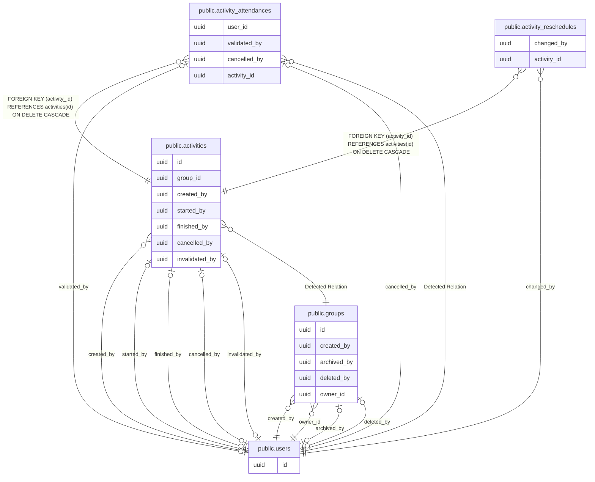

# Activities

## Descrição

Atividades de grupo, inscrições, presença e remarcações.

## Tabelas

| Nome | Colunas | Comentário | Tipo |
| ---- | ------- | ------- | ---- |
| [public.users](public.users.md) | 15 | Conta do usuário com perfil, papel global, status e projeções de nível. | BASE TABLE |
| [public.groups](public.groups.md) | 17 | Raiz do agregado de grupos esportivos. | BASE TABLE |
| [public.activities](public.activities.md) | 27 | Raiz do agregado de atividades de grupo (janela e ciclo de vida). | BASE TABLE |
| [public.activity_attendances](public.activity_attendances.md) | 12 | Episódio de inscrição, check-in e presença em uma atividade. | BASE TABLE |
| [public.activity_reschedules](public.activity_reschedules.md) | 9 | Histórico append-only de remarcações de atividade. | BASE TABLE |

## Relacionamentos

---

> Generated by [tbls](https://github.com/k1LoW/tbls)
