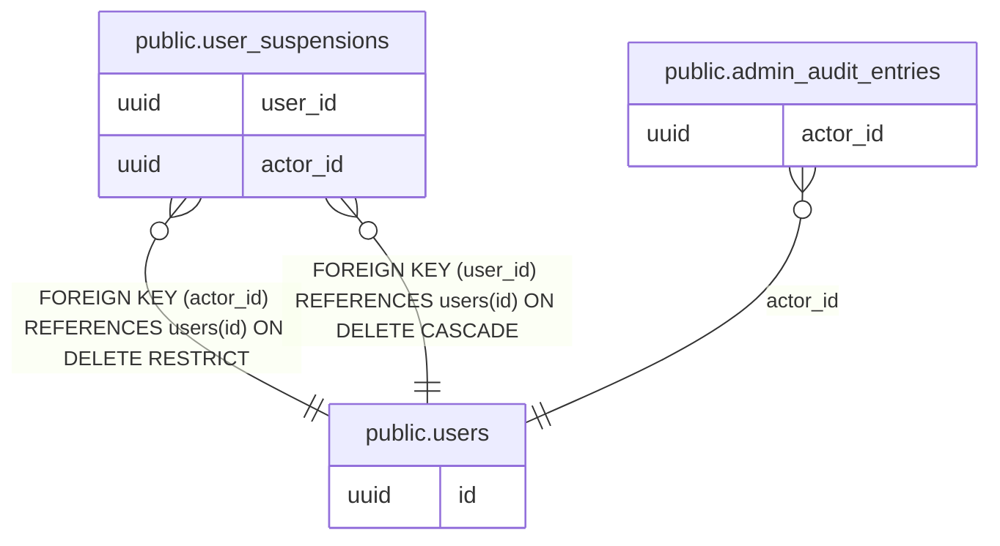

# Administration

## Descrição

Auditoria administrativa e suspensões de conta.

## Tabelas

| Nome | Colunas | Comentário | Tipo |
| ---- | ------- | ------- | ---- |
| [public.users](public.users.md) | 15 | Conta do usuário com perfil, papel global, status e projeções de nível. | BASE TABLE |
| [public.user_suspensions](public.user_suspensions.md) | 6 | Histórico append-only de suspensão e reativação de conta. | BASE TABLE |
| [public.admin_audit_entries](public.admin_audit_entries.md) | 9 | Auditoria append-only das ações da administração global. | BASE TABLE |

## Relacionamentos

---

> Generated by [tbls](https://github.com/k1LoW/tbls)
