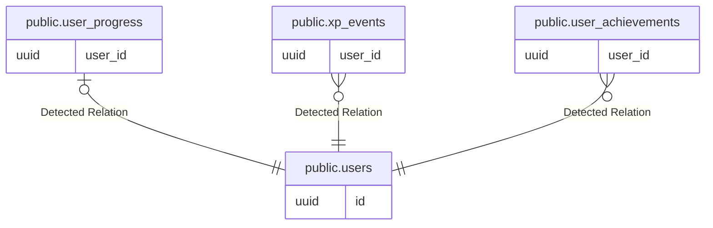

# Gamification

## Descrição

Progresso, ledger de XP e conquistas.

## Tabelas

| Nome | Colunas | Comentário | Tipo |
| ---- | ------- | ------- | ---- |
| [public.users](public.users.md) | 15 | Conta do usuário com perfil, papel global, status e projeções de nível. | BASE TABLE |
| [public.user_progress](public.user_progress.md) | 13 | Progresso agregado do usuário (XP, nível e ofensiva semanal). | BASE TABLE |
| [public.xp_events](public.xp_events.md) | 15 | Ledger append-only de XP; estornos geram lançamentos negativos. | BASE TABLE |
| [public.user_achievements](public.user_achievements.md) | 4 | Conquistas desbloqueadas, registradas uma única vez por código. | BASE TABLE |

## Relacionamentos

---

> Generated by [tbls](https://github.com/k1LoW/tbls)
