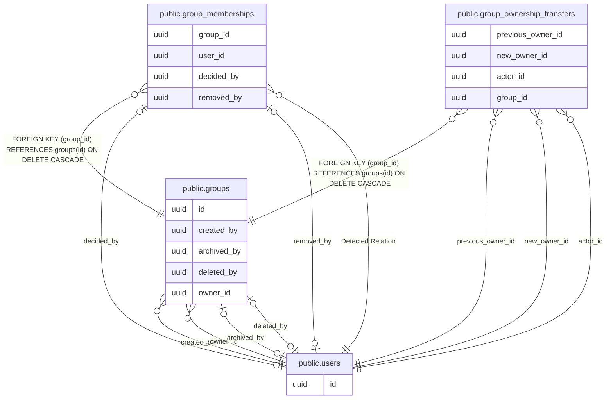

# Groups

## Descrição

Grupos esportivos, participação e transferência de responsabilidade.

## Tabelas

| Nome | Colunas | Comentário | Tipo |
| ---- | ------- | ------- | ---- |
| [public.users](public.users.md) | 15 | Conta do usuário com perfil, papel global, status e projeções de nível. | BASE TABLE |
| [public.groups](public.groups.md) | 17 | Raiz do agregado de grupos esportivos. | BASE TABLE |
| [public.group_memberships](public.group_memberships.md) | 14 | Episódio de participação de um usuário em um grupo. | BASE TABLE |
| [public.group_ownership_transfers](public.group_ownership_transfers.md) | 6 | Histórico append-only de transferência de responsabilidade do grupo. | BASE TABLE |

## Relacionamentos

---

> Generated by [tbls](https://github.com/k1LoW/tbls)
