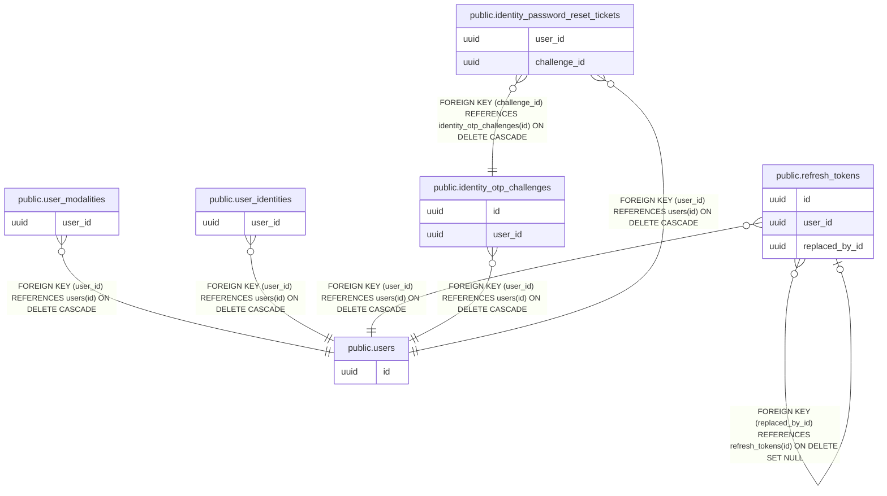

# Identity

## Descrição

Contas, identidades de login, modalidades e credenciais temporárias.

## Tabelas

| Nome | Colunas | Comentário | Tipo |
| ---- | ------- | ------- | ---- |
| [public.users](public.users.md) | 15 | Conta do usuário com perfil, papel global, status e projeções de nível. | BASE TABLE |
| [public.user_modalities](public.user_modalities.md) | 3 | Modalidades praticadas pelo usuário (no máximo uma principal). | BASE TABLE |
| [public.user_identities](public.user_identities.md) | 8 | Identidade de login do usuário (credencial local ou social). | BASE TABLE |
| [public.refresh_tokens](public.refresh_tokens.md) | 8 | Refresh tokens opacos por família de sessão (somente hash). | BASE TABLE |
| [public.identity_otp_challenges](public.identity_otp_challenges.md) | 8 | Desafio OTP de uso único para verificação de e-mail e reset de senha. | BASE TABLE |
| [public.identity_password_reset_tickets](public.identity_password_reset_tickets.md) | 7 | Ticket temporário de troca de senha emitido após a validação do OTP. | BASE TABLE |

## Relacionamentos

---

> Generated by [tbls](https://github.com/k1LoW/tbls)
