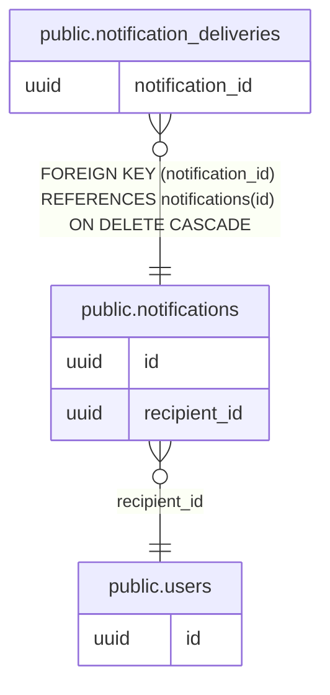

# Notifications

## Descrição

Inbox canônico e entregas por canal externo.

## Tabelas

| Nome | Colunas | Comentário | Tipo |
| ---- | ------- | ------- | ---- |
| [public.users](public.users.md) | 15 | Conta do usuário com perfil, papel global, status e projeções de nível. | BASE TABLE |
| [public.notification_deliveries](public.notification_deliveries.md) | 8 | Tentativa de entrega de uma notificação em canal externo. | BASE TABLE |
| [public.notifications](public.notifications.md) | 10 | Notificação canônica persistida no inbox do destinatário. | BASE TABLE |

## Relacionamentos

---

> Generated by [tbls](https://github.com/k1LoW/tbls)
