<!-- GERADO por `just docs-usecases` a partir de casos-de-uso.yaml. Não edite. -->

# Casos de uso — SIGAME

Catálogo derivado de [`casos-de-uso.yaml`](casos-de-uso.yaml), validado contra o
[levantamento de requisitos](levantamento-de-requisitos.md) e contra as rotas `/api/v1`.

## Cobertura

| Métrica | Valor |
| ------- | ----- |
| Requisitos funcionais | 22 |
| Casos de uso | 75 |
| Casos implementados | 64 |
| Casos em roadmap | 9 |
| Casos adiados | 2 |
| Rotas da API mapeadas | 82 |
| Diagramas | 15 |

## Visão geral

Um caso de uso por requisito funcional, agrupado por módulo e associado ao ator principal.
Os diagramas detalhados abaixo mostram todos os atores e permissões de cada caso.

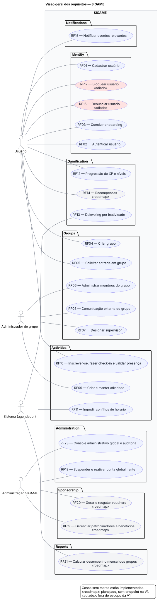

[Fonte PlantUML](casos-de-uso/geral.puml)

## Conta e cadastro

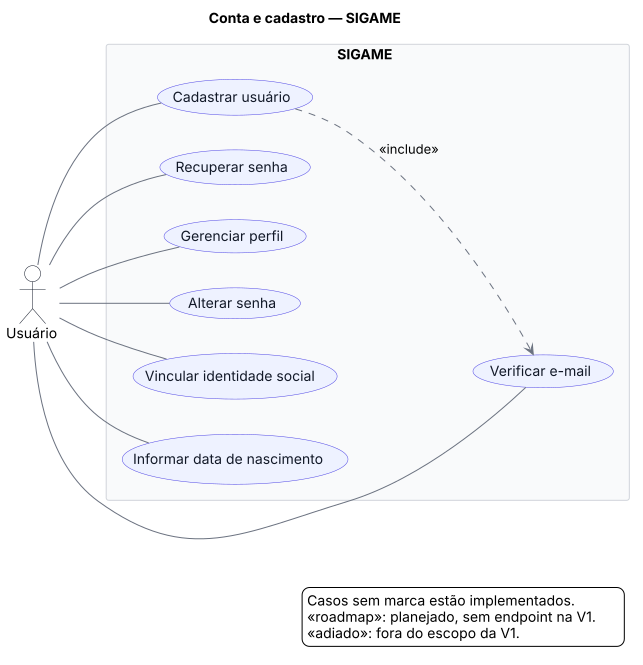

[Fonte PlantUML](casos-de-uso/conta.puml)

| Caso de uso | Nome | RF | Atores | Objetivo | Rotas | Status |
| ----------- | ---- | -- | ------ | -------- | ------ | ------ |
| UC-01.1 | Cadastrar usuário | RF01 | Usuário | Criar a conta com e-mail, senha e dados cadastrais mínimos. | `app_auth_register` | Implementado |
| UC-01.2 | Verificar e-mail | RF01 | Usuário | Confirmar o e-mail por código OTP e permitir o reenvio. | `app_auth_email_verify` `app_auth_email_resend` | Implementado |
| UC-01.3 | Recuperar senha | RF01 | Usuário | Solicitar código, validar o OTP e definir uma nova senha. | `app_auth_password_forgot` `app_auth_password_otp_verify` `app_auth_password_reset` | Implementado |
| UC-01.4 | Gerenciar perfil | RF01 | Usuário | Consultar e editar perfil, foto e CPF do próprio usuário. | `app_me` `app_me_profile_update` `app_me_photo_update` `app_me_photo_remove` `app_me_cpf` | Implementado |
| UC-01.5 | Alterar senha | RF01 | Usuário | Trocar a senha da conta autenticada. | `app_me_password_change` | Implementado |
| UC-01.6 | Vincular identidade social | RF01 | Usuário | Vincular uma identidade Google a uma conta existente. | `app_me_identity_link` `app_auth_social_link` | Implementado |
| UC-01.7 | Informar data de nascimento | RF01 | Usuário | Definir a data de nascimento write-once, pré-requisito do onboarding. | `app_me_birth_date` | Implementado |

## Autenticação e sessão

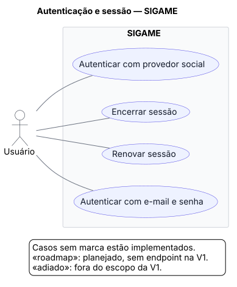

[Fonte PlantUML](casos-de-uso/autenticacao.puml)

| Caso de uso | Nome | RF | Atores | Objetivo | Rotas | Status |
| ----------- | ---- | -- | ------ | -------- | ------ | ------ |
| UC-02.1 | Autenticar com e-mail e senha | RF02 | Usuário | Iniciar a sessão e receber access token e refresh token em cookie. | `app_auth_login` | Implementado |
| UC-02.2 | Renovar sessão | RF02 | Usuário | Rotacionar o refresh token e renovar o access token. | `app_auth_refresh` | Implementado |
| UC-02.3 | Encerrar sessão | RF02 | Usuário | Revogar a sessão atual ou todas as famílias de refresh tokens. | `app_auth_logout` `app_auth_logout_all` | Implementado |
| UC-02.4 | Autenticar com provedor social | RF02 | Usuário | Iniciar e concluir o fluxo OAuth do Google. | `app_auth_social_start` `app_auth_social_callback` | Implementado |

## Onboarding e modalidades

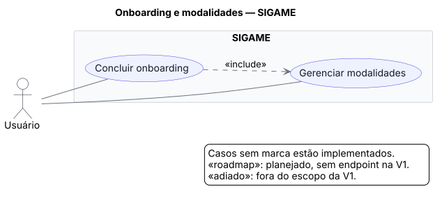

[Fonte PlantUML](casos-de-uso/onboarding.puml)

| Caso de uso | Nome | RF | Atores | Objetivo | Rotas | Status |
| ----------- | ---- | -- | ------ | -------- | ------ | ------ |
| UC-03.1 | Concluir onboarding | RF03 | Usuário | Validar os dados mínimos, conceder nível 2 e 100 XP uma única vez. | `app_me_onboarding` | Implementado |
| UC-03.2 | Gerenciar modalidades | RF03 | Usuário | Selecionar modalidades ativas e a principal, preservando o histórico. | `app_me_modalities_update` | Implementado |

## Grupos e comunicação

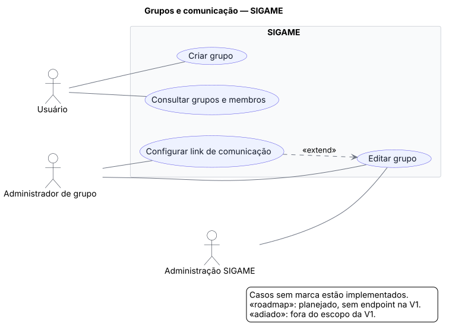

[Fonte PlantUML](casos-de-uso/grupos.puml)

| Caso de uso | Nome | RF | Atores | Objetivo | Rotas | Status |
| ----------- | ---- | -- | ------ | -------- | ------ | ------ |
| UC-04.1 | Criar grupo | RF04 | Usuário | Criar um grupo esportivo e assumir como administrador. | `app_group_create` | Implementado |
| UC-04.2 | Consultar grupos e membros | RF04 | Usuário | Listar grupos, detalhar um grupo e consultar seus membros. | `app_group_list` `app_group_show` `app_group_members` `app_me_groups` | Implementado |
| UC-04.3 | Editar grupo | RF04 | Administrador de grupo, Administração SIGAME | Atualizar nome, descrição, modalidade, limite e link de comunicação. | `app_group_update` | Implementado |
| UC-08.1 | Configurar link de comunicação | RF08 | Administrador de grupo | Cadastrar, alterar ou remover o link externo visível a membros aprovados. | `app_group_update` | Implementado |

## Participação e papéis

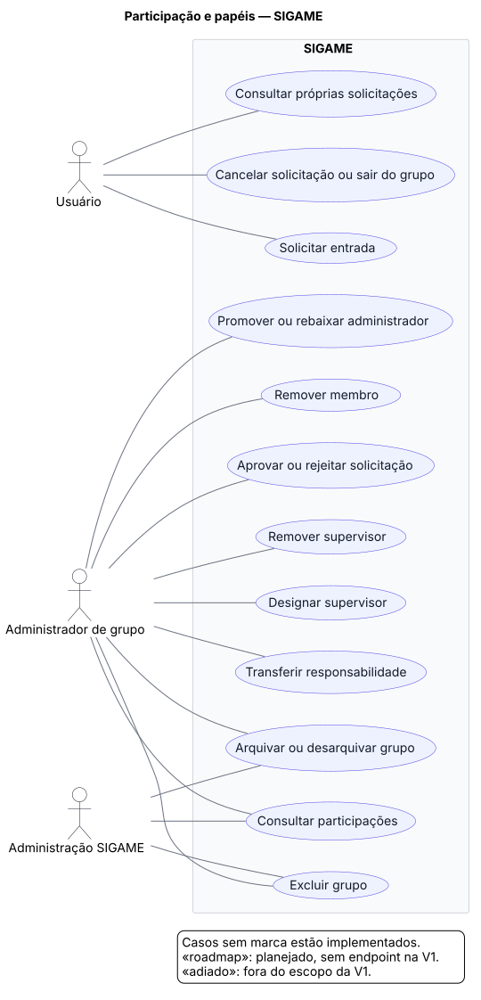

[Fonte PlantUML](casos-de-uso/participacao.puml)

| Caso de uso | Nome | RF | Atores | Objetivo | Rotas | Status |
| ----------- | ---- | -- | ------ | -------- | ------ | ------ |
| UC-05.1 | Solicitar entrada | RF05 | Usuário | Solicitar entrada em um grupo e aguardar a aprovação. | `app_group_membership_request` | Implementado |
| UC-05.2 | Cancelar solicitação ou sair do grupo | RF05 | Usuário | Cancelar a pendência ou encerrar a própria participação. | `app_group_membership_leave` | Implementado |
| UC-05.3 | Consultar próprias solicitações | RF05 | Usuário | Listar solicitações e participações do próprio usuário. | `app_me_membership_requests` | Implementado |
| UC-06.1 | Aprovar ou rejeitar solicitação | RF06 | Administrador de grupo | Decidir solicitações respeitando limites e o estado do grupo. | `app_group_membership_approve` `app_group_membership_reject` | Implementado |
| UC-06.2 | Remover membro | RF06 | Administrador de grupo | Remover um membro registrando autor, data e motivo. | `app_group_membership_remove` | Implementado |
| UC-06.3 | Promover ou rebaixar administrador | RF06 | Administrador de grupo | Alterar papéis mantendo ao menos um administrador aprovado. | `app_group_membership_role` | Implementado |
| UC-06.4 | Consultar participações | RF06 | Administrador de grupo, Administração SIGAME | Listar as participações do grupo por situação. | `app_group_membership_list` | Implementado |
| UC-06.5 | Arquivar ou desarquivar grupo | RF06 | Administrador de grupo, Administração SIGAME | Colocar o grupo em somente leitura e reverter a operação. | `app_group_archive` `app_group_unarchive` | Implementado |
| UC-06.6 | Excluir grupo | RF06 | Administrador de grupo, Administração SIGAME | Excluir logicamente o grupo de forma terminal e auditada. | `app_group_delete` | Implementado |
| UC-06.7 | Transferir responsabilidade | RF06 | Administrador de grupo | Transferir ownerId para um membro aprovado e ativo. | `app_group_ownership_transfer` | Implementado |
| UC-07.1 | Designar supervisor | RF07 | Administrador de grupo | Designar um membro aprovado como supervisor do grupo. | `app_group_supervisor_designate` | Implementado |
| UC-07.2 | Remover supervisor | RF07 | Administrador de grupo | Limpar a designação de supervisor do grupo. | `app_group_supervisor_clear` | Implementado |

## Atividades

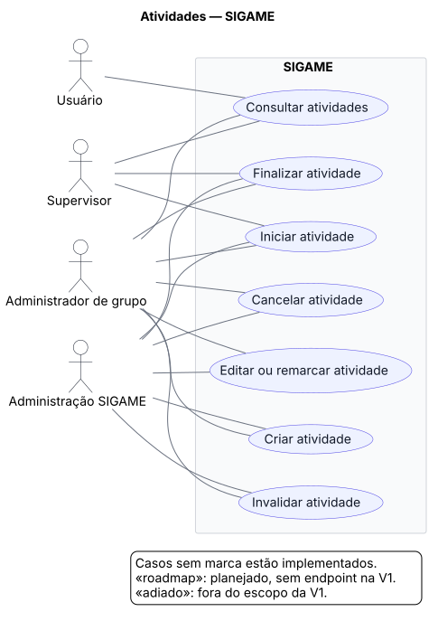

[Fonte PlantUML](casos-de-uso/atividades.puml)

| Caso de uso | Nome | RF | Atores | Objetivo | Rotas | Status |
| ----------- | ---- | -- | ------ | -------- | ------ | ------ |
| UC-09.1 | Criar atividade | RF09 | Administrador de grupo, Administração SIGAME | Criar uma atividade em grupo ativo com janela, local e trajeto. | `app_activity_create` | Implementado |
| UC-09.2 | Consultar atividades | RF09 | Usuário, Administrador de grupo, Supervisor | Listar e detalhar atividades e o histórico de remarcações. | `app_activity_list` `app_activity_show` `app_my_activity_list` `app_activity_reschedule_list` | Implementado |
| UC-09.3 | Editar ou remarcar atividade | RF09 | Administrador de grupo, Administração SIGAME | Alterar dados e janela preservando a remarcação anterior. | `app_activity_update` | Implementado |
| UC-09.4 | Cancelar atividade | RF09 | Administrador de grupo, Administração SIGAME | Cancelar a atividade com motivo e impedir novas operações. | `app_activity_cancel` | Implementado |
| UC-09.5 | Iniciar atividade | RF09 | Administrador de grupo, Supervisor, Administração SIGAME | Iniciar a atividade dentro da janela operacional. | `app_activity_start` | Implementado |
| UC-09.6 | Finalizar atividade | RF09 | Administrador de grupo, Supervisor, Administração SIGAME | Finalizar a atividade dentro do prazo e disparar a apuração de XP. | `app_activity_finish` | Implementado |
| UC-09.7 | Invalidar atividade | RF09 | Administrador de grupo, Administração SIGAME | Invalidar a atividade com motivo e estornar o XP concedido. | `app_activity_invalidate` | Implementado |

## Inscrição e presença

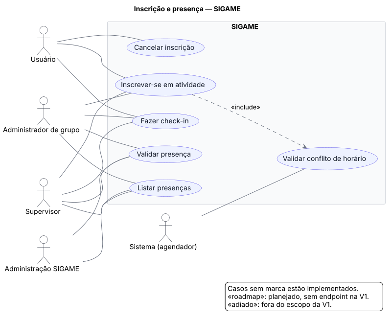

[Fonte PlantUML](casos-de-uso/presenca.puml)

| Caso de uso | Nome | RF | Atores | Objetivo | Rotas | Status |
| ----------- | ---- | -- | ------ | -------- | ------ | ------ |
| UC-10.1 | Inscrever-se em atividade | RF10 | Usuário, Supervisor, Administrador de grupo | Inscrever-se respeitando vínculo aprovado e conflito de horário. | `app_activity_enroll` | Implementado |
| UC-10.2 | Cancelar inscrição | RF10 | Usuário | Cancelar a própria inscrição na atividade. | `app_activity_enrollment_cancel` | Implementado |
| UC-10.3 | Fazer check-in | RF10 | Usuário, Supervisor, Administrador de grupo | Registrar a presença no período de check-in. | `app_activity_check_in` | Implementado |
| UC-10.4 | Listar presenças | RF10 | Administrador de grupo, Supervisor, Administração SIGAME | Listar inscrições, check-ins e validações da atividade. | `app_activity_attendance_list` | Implementado |
| UC-10.5 | Validar presença | RF10 | Administrador de grupo, Supervisor, Administração SIGAME | Validar presenças e liberar o XP elegível. | `app_activity_attendance_validate` | Implementado |
| UC-11.1 | Validar conflito de horário | RF11 | Sistema (agendador) | Recusar inscrição sobreposta a outra atividade do mesmo usuário. |  | Implementado |

## Gamificação e progressão

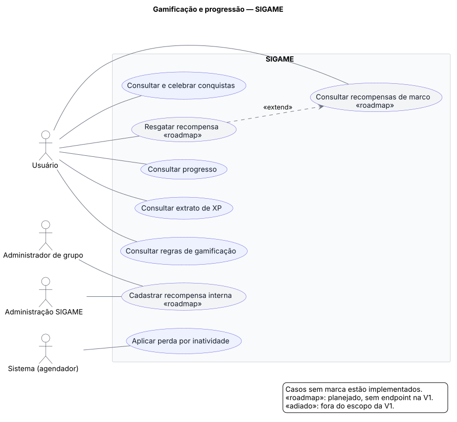

[Fonte PlantUML](casos-de-uso/gamificacao.puml)

| Caso de uso | Nome | RF | Atores | Objetivo | Rotas | Status |
| ----------- | ---- | -- | ------ | -------- | ------ | ------ |
| UC-12.1 | Consultar progresso | RF12 | Usuário | Consultar XP, nível, barra de progresso e ofensiva semanal. | `app_my_progress` | Implementado |
| UC-12.2 | Consultar extrato de XP | RF12 | Usuário | Listar lançamentos de XP, estornos e períodos de apuração. | `app_my_xp_history` | Implementado |
| UC-12.3 | Consultar regras de gamificação | RF12 | Usuário | Consultar curva de níveis, fontes de XP e versão da regra vigente. | `app_gamification_rules` | Implementado |
| UC-12.4 | Consultar e celebrar conquistas | RF12 | Usuário | Listar conquistas desbloqueadas e marcar a celebração (ADR-047). | `app_my_achievements` `app_my_achievement_celebrated` | Implementado |
| UC-13.1 | Aplicar perda por inatividade | RF13 | Sistema (agendador) | Aplicar o decay de XP e nível após o período de tolerância. |  | Implementado |
| UC-14.1 | Consultar recompensas de marco | RF14 | Usuário | Consultar recompensas elegíveis nos marcos de nível 5, 8 e 10. |  | Roadmap |
| UC-14.2 | Cadastrar recompensa interna | RF14 | Administrador de grupo, Administração SIGAME | Cadastrar uma recompensa interna para uma atividade do grupo. |  | Roadmap |
| UC-14.3 | Resgatar recompensa | RF14 | Usuário | Resgatar uma recompensa elegível sem perdê-la em deleveling. |  | Roadmap |

## Notificações

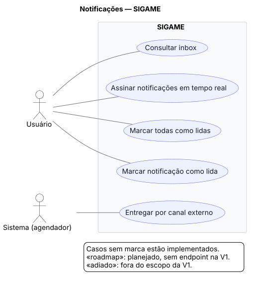

[Fonte PlantUML](casos-de-uso/notificacoes.puml)

| Caso de uso | Nome | RF | Atores | Objetivo | Rotas | Status |
| ----------- | ---- | -- | ------ | -------- | ------ | ------ |
| UC-15.1 | Consultar inbox | RF15 | Usuário | Listar notificações com filtros e consultar a contagem de não lidas. | `app_notifications_list` `app_notifications_unread_count` | Implementado |
| UC-15.2 | Marcar notificação como lida | RF15 | Usuário | Marcar uma notificação como lida de forma idempotente. | `app_notifications_read` | Implementado |
| UC-15.3 | Marcar todas como lidas | RF15 | Usuário | Marcar todas as notificações do próprio usuário como lidas. | `app_notifications_read_all` | Implementado |
| UC-15.4 | Assinar notificações em tempo real | RF15 | Usuário | Obter URL e token Mercure restritos ao tópico do próprio usuário. | `app_notifications_realtime` | Implementado |
| UC-15.5 | Entregar por canal externo | RF15 | Sistema (agendador) | Entregar e-mail ou push por adaptador sem substituir o inbox canônico. |  | Implementado |

## Contas (administração)

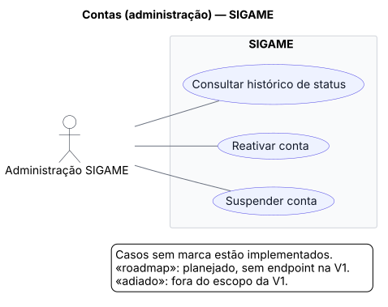

[Fonte PlantUML](casos-de-uso/contas.puml)

| Caso de uso | Nome | RF | Atores | Objetivo | Rotas | Status |
| ----------- | ---- | -- | ------ | -------- | ------ | ------ |
| UC-18.1 | Suspender conta | RF18 | Administração SIGAME | Suspender globalmente a conta com motivo, revogando as sessões. | `app_admin_user_suspend` | Implementado |
| UC-18.2 | Reativar conta | RF18 | Administração SIGAME | Reativar a conta e registrar o histórico append-only. | `app_admin_user_reactivate` | Implementado |
| UC-18.3 | Consultar histórico de status | RF18 | Administração SIGAME | Listar suspensões e reativações da conta. | `app_admin_user_status_history` | Implementado |

## Console administrativo

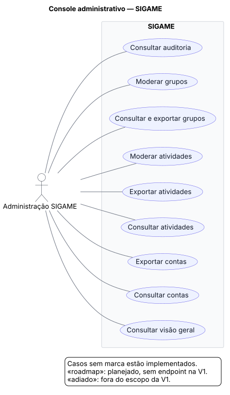

[Fonte PlantUML](casos-de-uso/console.puml)

| Caso de uso | Nome | RF | Atores | Objetivo | Rotas | Status |
| ----------- | ---- | -- | ------ | -------- | ------ | ------ |
| UC-23.1 | Consultar visão geral | RF23 | Administração SIGAME | Consolidar contas, grupos, atividades e check-ins recentes. | `app_admin_overview` | Implementado |
| UC-23.2 | Consultar contas | RF23 | Administração SIGAME | Listar e detalhar contas com filtros e paginação. | `app_admin_user_list` `app_admin_user_show` | Implementado |
| UC-23.3 | Exportar contas | RF23 | Administração SIGAME | Exportar CSV de contas sem dados sensíveis de perfil. | `app_admin_user_export` | Implementado |
| UC-23.4 | Consultar atividades | RF23 | Administração SIGAME | Listar atividades de qualquer grupo com filtros. | `app_admin_activity_list` | Implementado |
| UC-23.5 | Exportar atividades | RF23 | Administração SIGAME | Exportar CSV de atividades usando os mesmos filtros da listagem. | `app_admin_activity_export` | Implementado |
| UC-23.6 | Moderar atividades | RF23 | Administração SIGAME | Cancelar ou invalidar atividades de qualquer grupo com auditoria. | `app_activity_cancel` `app_activity_invalidate` | Implementado |
| UC-23.7 | Consultar e exportar grupos | RF23 | Administração SIGAME | Listar, detalhar, consultar membros e exportar qualquer grupo. | `app_admin_group_list` `app_admin_group_show` `app_admin_group_members` `app_admin_group_export` | Implementado |
| UC-23.8 | Moderar grupos | RF23 | Administração SIGAME | Arquivar, desarquivar e excluir qualquer grupo com auditoria. | `app_group_archive` `app_group_unarchive` `app_group_delete` | Implementado |
| UC-23.9 | Consultar auditoria | RF23 | Administração SIGAME | Consultar a trilha append-only com filtros por ação, alvo e período. | `app_admin_audit_list` | Implementado |

## Moderação (adiada)

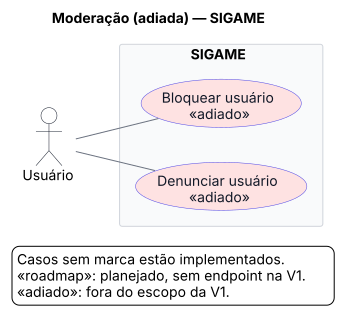

[Fonte PlantUML](casos-de-uso/moderacao.puml)

| Caso de uso | Nome | RF | Atores | Objetivo | Rotas | Status |
| ----------- | ---- | -- | ------ | -------- | ------ | ------ |
| UC-16.1 | Denunciar usuário | RF16 | Usuário | Registrar uma denúncia para moderação futura. |  | Adiado |
| UC-17.1 | Bloquear usuário | RF17 | Usuário | Bloquear interações com outro usuário. |  | Adiado |

## Patrocínio e vouchers (roadmap)

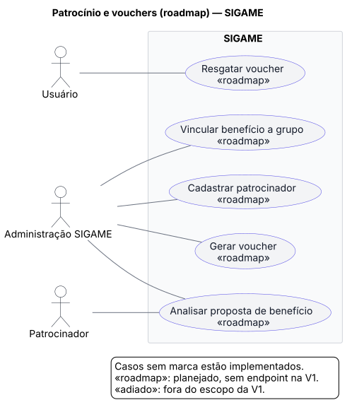

[Fonte PlantUML](casos-de-uso/patrocinio.puml)

| Caso de uso | Nome | RF | Atores | Objetivo | Rotas | Status |
| ----------- | ---- | -- | ------ | -------- | ------ | ------ |
| UC-19.1 | Cadastrar patrocinador | RF19 | Administração SIGAME | Cadastrar patrocinador e seus dados de contato. |  | Roadmap |
| UC-19.2 | Analisar proposta de benefício | RF19 | Administração SIGAME, Patrocinador | Aprovar ou recusar uma proposta de benefício. |  | Roadmap |
| UC-19.3 | Vincular benefício a grupo | RF19 | Administração SIGAME | Vincular um benefício aprovado a um grupo. |  | Roadmap |
| UC-20.1 | Gerar voucher | RF20 | Administração SIGAME | Gerar um voucher individual com código único. |  | Roadmap |
| UC-20.2 | Resgatar voucher | RF20 | Usuário | Resgatar um voucher uma única vez, com proteção de concorrência. |  | Roadmap |

## Relatórios (roadmap)

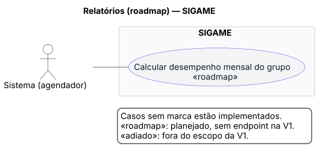

[Fonte PlantUML](casos-de-uso/relatorios.puml)

| Caso de uso | Nome | RF | Atores | Objetivo | Rotas | Status |
| ----------- | ---- | -- | ------ | -------- | ------ | ------ |
| UC-21.1 | Calcular desempenho mensal do grupo | RF21 | Sistema (agendador) | Calcular e persistir o indicador interno mensal por grupo. |  | Roadmap |

## Como atualizar

1. Edite `casos-de-uso.yaml`.
2. Rode `just docs-usecases` para regenerar o Markdown e os diagramas.
3. Commite a alteração. `just docs-usecases-check` valida a cobertura sem escrever.
