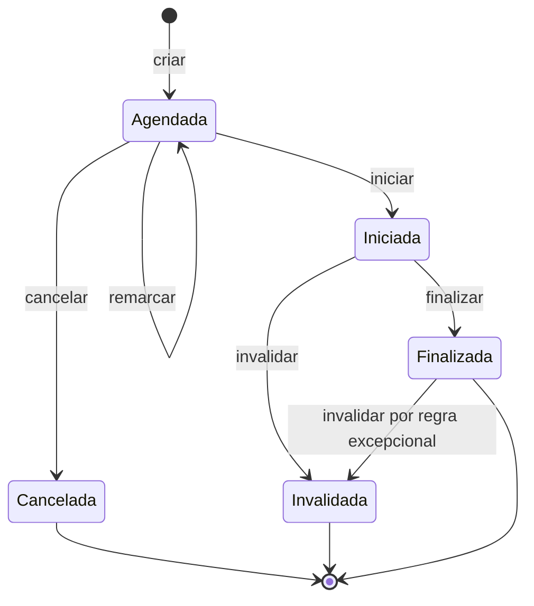
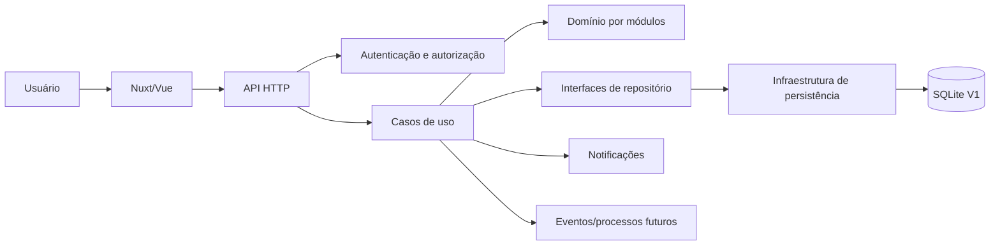
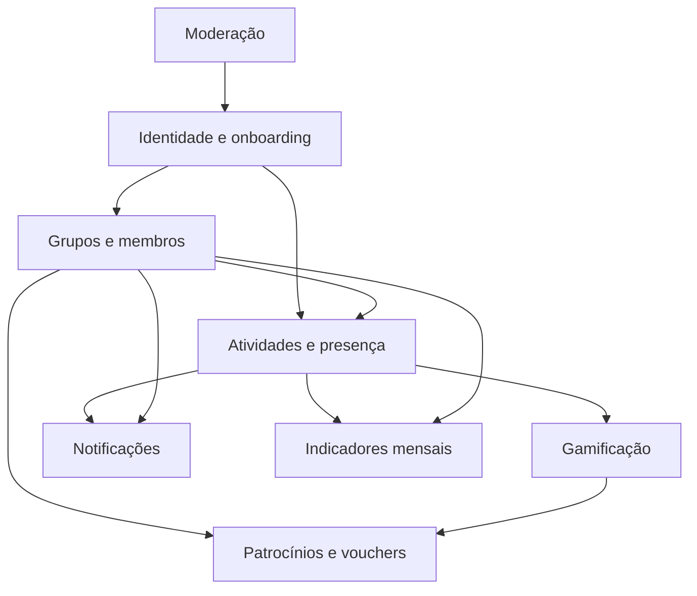

# SIGAME — Requisitos da V1

> **Status:** Em revisão  
> **Versão:** 0.2  
> **Última atualização:** 2026-09-19  
> **Fonte:** levantamento inicial, especificação de requisitos e proposta arquitetural do SIGAME.

---

## 1. Como usar este documento

Este documento é a fonte organizada dos requisitos funcionais, regras de negócio e critérios de aceitação da V1.

A especificação foi organizada por **capacidade do produto**, e não apenas por tipo de requisito. Cada capacidade
possui:

- objetivo;
- regras e restrições;
- critérios de aceitação;
- exemplos de decisão, quando houver regra quantitativa;
- dependências ou pontos ainda pendentes.

### 1.1 Identificadores

Os identificadores devem ser estáveis. Não renomeie um requisito apenas porque a ordem mudou.

| Prefixo | Tipo                    |
|---------|-------------------------|
| `OBJ`   | Objetivo do produto     |
| `RF`    | Capacidade funcional    |
| `RN`    | Regra de negócio        |
| `RNF`   | Requisito não funcional |
| `CA`    | Critério de aceitação   |
| `DEC`   | Decisão pendente        |

Ao alterar um requisito já implementado, registre a mudança no histórico ao final deste documento.

### 1.2 Status dos requisitos

| Status         | Significado                 |
|----------------|-----------------------------|
| `Proposto`     | Ainda em discussão          |
| `Aprovado`     | Aceito para a V1            |
| `Implementado` | Implementado e validado     |
| `Adiado`       | Não será implementado na V1 |
| `Rejeitado`    | Não faz parte do produto    |

---

## 2. Visão do produto

### OBJ01 — Incentivar atividades físicas em grupo

O SIGAME é uma plataforma web voltada a incentivar a prática de atividades físicas em grupo. O sistema deve ajudar
pessoas a encontrar outras com interesses e disponibilidades compatíveis, formar pequenos grupos, organizar atividades e
acompanhar sua evolução.

A V1 prioriza:

- socialização;
- inclusão de iniciantes e pessoas sedentárias;
- segurança e moderação;
- organização de atividades;
- acompanhamento de progresso;
- motivação por gamificação.

### OBJ02 — Modalidades iniciais

A V1 oferecerá as modalidades:

- caminhada;
- corrida;
- ciclismo.

O usuário poderá praticar mais de uma modalidade e definir uma delas como principal.

### OBJ03 — Limites de escopo da V1

A V1 não inclui:

- aplicativo mobile nativo;
- chat interno;
- rastreamento GPS obrigatório;
- recebimento de dinheiro, Pix, comissão ou repasse financeiro;

---

## 3. Atores e permissões

### 3.1 Atores

| Ator                   | Descrição                                                                          |
|------------------------|------------------------------------------------------------------------------------|
| Usuário                | Pessoa cadastrada que participa do SIGAME                                          |
| Administrador de grupo | Criador ou responsável pela gestão de um grupo específico                          |
| Supervisor             | Usuário designado para executar operações delegadas no grupo                       |
| Administração SIGAME   | Administração global da plataforma                                                 |
| Patrocinador           | Entidade responsável por proposta de benefício, caso incluída no fluxo final da V1 |

Um usuário pode exercer papéis diferentes em contextos diferentes. Ser administrador de um grupo não concede poderes
administrativos globais.

### 3.2 Matriz inicial de permissões

| Operação                              |       Usuário | Admin. do grupo |                  Supervisor | Administração SIGAME |
|---------------------------------------|--------------:|----------------:|----------------------------:|---------------------:|
| Editar próprio perfil                 |           Sim |             Sim |                         Sim |                  Sim |
| Criar grupo                           | Se habilitado |             Sim |               Se habilitado |                  Sim |
| Solicitar entrada em grupo            |           Sim |             Sim |                         Sim |                  Sim |
| Aprovar entrada                       |           Não |             Sim | Não, salvo delegação futura |                  Sim |
| Remover membro do grupo               |           Não |             Sim |                         Não |                  Sim |
| Criar atividade                       |           Não |             Sim |          Conforme delegação |                  Sim |
| Remarcar/cancelar atividade           |           Não |             Sim |          Conforme delegação |                  Sim |
| Check-in próprio                      |           Sim |             Sim |                         Sim |                  Sim |
| Validar presença                      |           Não |             Sim |                         Sim |                  Sim |
| Suspender conta globalmente           |           Não |             Não |                         Não |                  Sim |
| Consultar denúncias globais           |           Não |             Não |                         Não |                  Sim |
| Criar recompensa interna              |           Não |             Sim |                    Pendente |                  Sim |
| Gerenciar patrocinadores e benefícios |           Não |             Não |                         Não |                  Sim |

> A coluna “Conforme delegação” deverá ser detalhada antes da implementação final de atividades.

---

## 4. Identidade, cadastro e onboarding

### RF01 — Cadastrar usuário

O sistema deve permitir o cadastro de usuário com CPF, e-mail, senha e dados cadastrais mínimos.

#### Regras

- `RN01.1` O CPF deve ser único na V1.
- `RN01.2` O e-mail deve ser único.
- `RN01.3` A V1 não realiza validação governamental de identidade por CPF.
- `RN01.4` A senha nunca deve ser armazenada em texto puro.
- `RN01.5` Foto de perfil não é obrigatória.
- `RN01.6` Peso e altura são opcionais.
- `RN01.7` Peso e altura não podem impedir o acesso às funcionalidades sociais.
- `RN01.8` Todo usuário novo inicia no nível 1.

#### Critérios de aceitação

- `CA01.1` Não é possível cadastrar dois usuários com o mesmo CPF.
- `CA01.2` Não é possível cadastrar dois usuários com o mesmo e-mail.
- `CA01.3` Um cadastro sem foto, peso ou altura pode ser concluído se os demais dados obrigatórios forem válidos.
- `CA01.4` A senha persistida não é igual à senha informada.
- `CA01.5` Um usuário recém-cadastrado possui nível 1.

### RF02 — Autenticar usuário

O sistema deve autenticar o usuário e manter sua sessão conforme o perfil e o estado da conta.

#### Regras

- `RN02.1` Conta suspensa não pode iniciar uma nova sessão.
- `RN02.2` A autenticação deve identificar o usuário responsável pela operação.
- `RN02.3` Operações protegidas devem verificar a autorização no backend, mesmo que a interface oculte controles.

#### Critérios de aceitação

- `CA02.1` Credenciais válidas permitem autenticação.
- `CA02.2` Credenciais inválidas não permitem autenticação.
- `CA02.3` Conta suspensa não pode autenticar.
- `CA02.4` Uma requisição protegida sem sessão válida é recusada.

### RF03 — Concluir onboarding

O sistema deve executar o onboarding inicial e controlar sua conclusão.

#### Regras

- `RN03.1` O onboarding define os dados mínimos necessários para progressão inicial.
- `RN03.2` Ao concluir os requisitos definidos, o usuário alcança o nível 2.
- `RN03.3` O usuário pode selecionar uma ou mais modalidades.
- `RN03.4` Uma modalidade ativa pode ser definida como principal.
- `RN03.5` Alterar a modalidade principal não remove histórico nem XP.

#### Critérios de aceitação

- `CA03.1` Um onboarding incompleto não concede o nível 2.
- `CA03.2` Um onboarding válido pode ser concluído uma única vez ou de forma idempotente.
- `CA03.3` A conclusão válida eleva o usuário ao nível 2.
- `CA03.4` O usuário pode ter mais de uma modalidade ativa.
- `CA03.5` Alterar a modalidade principal preserva o histórico de atividades e XP.

#### Matriz de exemplos — onboarding e modalidades

| Situação                                                | Resultado esperado                                            |
|---------------------------------------------------------|---------------------------------------------------------------|
| Nenhuma modalidade selecionada                          | Rejeitar conclusão                                            |
| Uma modalidade selecionada                              | Permitir, se os demais dados obrigatórios estiverem completos |
| Duas ou três modalidades selecionadas                   | Permitir                                                      |
| Modalidade principal não pertence às modalidades ativas | Rejeitar                                                      |
| Peso ausente                                            | Permitir, pois é opcional                                     |
| Altura ausente                                          | Permitir, pois é opcional                                     |
| Onboarding concluído novamente                          | Não duplicar progressão nem conceder XP indevido              |

---

## 5. Grupos e membros

### RF04 — Criar grupo

Usuários habilitados devem poder criar grupos esportivos.

#### Regras

- `RN04.1` Apenas usuário a partir do nível 2 pode criar grupo.
- `RN04.2` O criador do grupo assume o papel de administrador.
- `RN04.3` Cada usuário pode participar de no máximo 3 grupos na V1, conforme a interpretação adotada para o limite de
  grupos.
- `RN04.4` O grupo possui limite inicial de 5 membros aprovados.
- `RN04.5` Um grupo torna-se ativo ao atingir no mínimo 3 membros aprovados.
- `RN04.6` O grupo pode existir em formação com menos de 3 membros.

#### Critérios de aceitação

- `CA04.1` Usuário nível 1 não consegue criar grupo.
- `CA04.2` Usuário nível 2 consegue criar grupo quando não excede seu limite de grupos.
- `CA04.3` O criador é registrado como administrador do grupo.
- `CA04.4` Grupo com menos de 3 membros aprovados permanece em formação.
- `CA04.5` Grupo com 3 ou mais membros aprovados fica ativo.
- `CA04.6` Grupo não aceita mais de 5 membros aprovados.

### RF05 — Solicitar entrada em grupo

O sistema deve permitir que usuários habilitados solicitem entrada em grupos.

#### Regras

- `RN05.1` A solicitação depende de aprovação do administrador.
- `RN05.2` Usuário não pode criar solicitações duplicadas pendentes para o mesmo grupo.
- `RN05.3` Usuário suspenso não pode solicitar entrada.
- `RN05.4` O limite de participação em grupos deve ser verificado no momento da aprovação.

#### Critérios de aceitação

- `CA05.1` Usuário habilitado consegue criar uma solicitação pendente.
- `CA05.2` Solicitação duplicada pendente é recusada ou tratada de forma idempotente.
- `CA05.3` Solicitação não concede participação antes da aprovação.
- `CA05.4` Solicitação de usuário suspenso é recusada.

### RF06 — Administrar membros do grupo

O administrador deve poder aprovar, rejeitar e remover membros, registrando os motivos quando aplicável.

#### Regras

- `RN06.1` Somente o administrador do grupo pode aprovar ou rejeitar solicitações, salvo mudança futura de delegação.
- `RN06.2` O administrador pode remover membro do grupo.
- `RN06.3` A remoção deve registrar o motivo.
- `RN06.4` Administrador de grupo não pode suspender globalmente uma conta.
- `RN06.5` A aprovação deve respeitar o limite máximo de 5 membros.
- `RN06.6` A aprovação deve respeitar o limite máximo de grupos do usuário.

#### Critérios de aceitação

- `CA06.1` Administrador consegue aprovar solicitação pendente válida.
- `CA06.2` Aprovação transforma a solicitação em participação aprovada.
- `CA06.3` Aprovação de grupo cheio é recusada.
- `CA06.4` Usuário não administrador não consegue aprovar solicitação.
- `CA06.5` Remoção registra autor, membro removido, grupo, data e motivo.
- `CA06.6` Remoção não provoca suspensão global.

#### Matriz de exemplos — estado do grupo

| Membros aprovados | Estado esperado | Pode receber atividade?   |
|------------------:|-----------------|---------------------------|
|                 0 | Em formação     | Não, salvo decisão futura |
|                 1 | Em formação     | Não, salvo decisão futura |
|                 2 | Em formação     | Não, salvo decisão futura |
|                 3 | Ativo           | Sim                       |
|                 4 | Ativo           | Sim                       |
|                 5 | Ativo e cheio   | Sim, sem novas aprovações |

### RF07 — Designar supervisor

O administrador deve poder designar um supervisor para o grupo.

#### Regras

- `RN07.1` A existência de supervisor é opcional.
- `RN07.2` O supervisor deve ser membro aprovado do grupo, salvo decisão futura.
- `RN07.3` O supervisor não recebe poderes globais.
- `RN07.4` Os poderes operacionais exatos do supervisor ainda precisam ser definidos.

#### Critérios de aceitação

- `CA07.1` Administrador consegue designar membro aprovado como supervisor.
- `CA07.2` Usuário externo ao grupo não pode ser designado sem regra explícita que permita isso.
- `CA07.3` Supervisor consegue executar somente as operações delegadas.

### RF08 — Comunicação externa do grupo

O administrador pode cadastrar um link externo de comunicação do grupo.

#### Regras

- `RN08.1` Não haverá chat próprio na V1.
- `RN08.2` O link só pode ser visualizado por membros aprovados.
- `RN08.3` O telefone pessoal não deve ser exposto como requisito de comunicação.

#### Critérios de aceitação

- `CA08.1` Visitante ou usuário não aprovado não visualiza o link.
- `CA08.2` Membro aprovado visualiza o link quando cadastrado.
- `CA08.3` Administrador consegue alterar ou remover o link.
- `CA08.4` O sistema não exige a publicação de telefone pessoal.

---

## 6. Atividades e presença

### RF09 — Criar e manter atividade

O sistema deve permitir criar e manter atividades vinculadas a grupos ativos.

Cada atividade deve conter, no mínimo:

- data;
- horário de início previsto;
- ponto de encontro;
- ponto final ou trajeto;
- distância estimada;
- grupo responsável.

#### Regras

- `RN09.1` Apenas administrador ou supervisor autorizado pode criar atividade.
- `RN09.2` A atividade deve pertencer a um grupo ativo.
- `RN09.3` Administrador ou supervisor autorizado pode remarcar, cancelar, iniciar e finalizar atividade.
- `RN09.4` Alterações relevantes devem gerar alerta interno.
- `RN09.5` GPS não é obrigatório na V1.

#### Critérios de aceitação

- `CA09.1` Atividade sem dados obrigatórios é recusada.
- `CA09.2` Usuário sem permissão não consegue criar atividade.
- `CA09.3` Atividade de grupo em formação é recusada, salvo decisão futura.
- `CA09.4` Remarcação preserva o histórico da alteração.
- `CA09.5` Cancelamento impede novas operações incompatíveis.
- `CA09.6` Criação, alteração e cancelamento geram alerta aos participantes relevantes.

### Ciclo de vida da atividade

#### Regras de transição

- `RN09.6` Atividade cancelada não pode ser iniciada.
- `RN09.7` Atividade finalizada não pode ser iniciada novamente.
- `RN09.8` Atividade cancelada ou invalidada não gera XP.
- `RN09.9` A definição final de janela operacional de início e finalização ainda está pendente.

### RF10 — Check-in e validação de presença

O participante deve poder registrar seu check-in, e administrador ou supervisor deve poder validar a presença.

#### Regras

- `RN10.1` O check-in é individual.
- `RN10.2` Apenas participante inscrito pode realizar check-in.
- `RN10.3` Somente administrador ou supervisor autorizado pode validar presença.
- `RN10.4` GPS não é obrigatório.
- `RN10.5` Somente presença validada gera XP.
- `RN10.6` Uma presença validada não pode gerar XP novamente.

#### Critérios de aceitação

- `CA10.1` Participante inscrito consegue realizar check-in dentro da janela permitida.
- `CA10.2` Usuário não inscrito não consegue realizar check-in.
- `CA10.3` Check-in não validado não gera XP.
- `CA10.4` Validação autorizada altera o estado da presença.
- `CA10.5` Tentativa de validar duas vezes não gera XP duplicado.
- `CA10.6` Validação de atividade cancelada ou invalidada é recusada.

### RF11 — Impedir conflitos de horário

O sistema deve impedir que o mesmo usuário seja atribuído a atividades conflitantes.

#### Definição provisória

Duas atividades conflitam quando seus intervalos de horário se sobrepõem, mesmo que parcialmente.

#### Critérios de aceitação

- `CA11.1` Atividades sem sobreposição podem ser atribuídas ao mesmo usuário.
- `CA11.2` Atividades com sobreposição parcial não podem ser atribuídas ao mesmo usuário.
- `CA11.3` Atividades com mesmo horário não podem ser atribuídas ao mesmo usuário.
- `CA11.4` A regra deve ser aplicada no backend e protegida por transação.

> `DEC01` — Definir se haverá margem de deslocamento, como 15 ou 30 minutos, e se administradores poderão forçar uma
> inscrição conflitante.

---

## 7. Gamificação e progressão

### RF12 — Progressão de XP e níveis

O sistema deve calcular e apresentar o nível e o progresso de XP do usuário.

#### Regras

- `RN12.1` Todo usuário inicia no nível 1.
- `RN12.2` A gamificação possui 10 níveis.
- `RN12.3` A conclusão do onboarding concede o acesso ao nível 2, conforme RF03.
- `RN12.4` Participação em atividade só gera XP após validação da presença.
- `RN12.5` O sistema pode registrar XP por ofensiva/engajamento e outros eventos previstos.
- `RN12.6` O histórico de XP não deve ser perdido ao trocar a modalidade principal.

#### Critérios de aceitação

- `CA12.1` Usuário novo começa no nível 1.
- `CA12.2` Usuário que conclui onboarding válido alcança o nível 2.
- `CA12.3` Presença apenas com check-in não gera XP.
- `CA12.4` Presença validada gera XP uma única vez.
- `CA12.5` O progresso retornado pela API pode ser apresentado visualmente pelo frontend.

#### Matriz de exemplos — progressão

| Evento                        | XP esperado | Altera nível?          | Observação                |
|-------------------------------|------------:|------------------------|---------------------------|
| Cadastro                      |     Definir | Não, inicia no nível 1 | `DEC02`                   |
| Onboarding concluído          |     Definir | Sim, alcança nível 2   | Valor ainda pendente      |
| Check-in não validado         |           0 | Não                    | Não é participação válida |
| Presença validada             |     Definir | Possivelmente          | Impedir duplicidade       |
| Troca de modalidade principal |           0 | Não                    | Preserva histórico        |

> `DEC02` — Definir tabela de XP por nível e valores concedidos por evento.

### RF13 — Deleveling por inatividade

O sistema deve aplicar perda de progresso por inatividade conforme as regras definidas.

#### Regras

- `RN13.1` Até 7 dias sem atividade válida não há perda por inatividade.
- `RN13.2` Após a tolerância, o usuário perde 2% da barra do nível a cada 2 dias sem atividade válida.
- `RN13.3` Ao sofrer deleveling, o usuário retorna ao nível anterior com 98% da barra.
- `RN13.4` O nível 2 é o piso do deleveling.
- `RN13.5` Deleveling não remove acesso a grupos já conquistados.
- `RN13.6` Recompensas já resgatadas não são retiradas.

#### Critérios de aceitação

- `CA13.1` Usuário com até 7 dias desde a última atividade válida não sofre penalização.
- `CA13.2` Usuário além da tolerância sofre a perda correspondente ao número de períodos completos de 2 dias.
- `CA13.3` Usuário no nível 2 não desce para o nível 1 por inatividade.
- `CA13.4` Deleveling não remove associações com grupos.
- `CA13.5` Deleveling não revoga recompensas já resgatadas.
- `CA13.6` A aplicação da penalização é idempotente para o mesmo período de inatividade.

> `DEC03` — Definir se a penalização de 2% incide sobre a barra atual, sobre o XP necessário do nível ou sobre o saldo
> absoluto de XP.

### RF14 — Recompensas

O sistema deve associar recompensas a marcos de nível e permitir recompensas internas de atividades de grupo.

#### Regras

- `RN14.1` Os principais marcos são os níveis 5, 8 e 10.
- `RN14.2` Recompensas podem incluir benefícios de patrocinadores, vouchers e elementos internos.
- `RN14.3` Administrador de grupo pode cadastrar recompensa interna para atividade, conforme permissões.
- `RN14.4` Recompensa resgatada não é removida por deleveling.

#### Critérios de aceitação

- `CA14.1` Alcançar nível com marco configurado torna a recompensa elegível.
- `CA14.2` Recompensa resgatada fica registrada no histórico do usuário.
- `CA14.3` Deleveling não remove recompensa resgatada.
- `CA14.4` Usuário sem permissão não cadastra recompensa interna.

---

## 8. Notificações internas

### RF15 — Alertas e notificações

O sistema deve exibir alertas internos sobre eventos relevantes, especialmente atividades de grupo.

#### Eventos mínimos

- criação de atividade;
- alteração de atividade;
- cancelamento;
- início;
- encerramento;
- mudanças relevantes na participação do usuário.

#### Critérios de aceitação

- `CA15.1` Participantes relevantes recebem uma notificação quando uma atividade é criada.
- `CA15.2` Alterações relevantes geram nova notificação ou atualizam a anterior conforme política definida.
- `CA15.3` Usuário consegue consultar suas notificações.
- `CA15.4` Usuário consegue distinguir notificações lidas e não lidas.

> `DEC04` — Definir se notificações podem ser apagadas, arquivadas e marcadas manualmente como lidas.

---

## 9. Segurança, moderação e privacidade

### RF16 — Denunciar usuário

Usuários devem poder denunciar outros usuários informando motivo e observação.

#### Regras

- `RN16.1` Uma denúncia deve registrar denunciante, denunciado, motivo, observação, data e estado.
- `RN16.2` O denunciado não deve obter acesso indevido aos dados internos da apuração.
- `RN16.3` A administração SIGAME consulta e trata denúncias globais.

#### Critérios de aceitação

- `CA16.1` Usuário autenticado consegue registrar denúncia válida.
- `CA16.2` Denúncia sem motivo obrigatório é recusada.
- `CA16.3` Denúncia fica disponível para administração SIGAME.
- `CA16.4` Usuário comum não consulta a fila global de denúncias.

### RF17 — Bloquear usuário

Usuários devem poder bloquear outros usuários.

#### Critérios de aceitação

- `CA17.1` Usuário consegue bloquear outro usuário.
- `CA17.2` O bloqueio impede as interações definidas pela política do produto.
- `CA17.3` O sistema impede bloqueio de si próprio, salvo decisão futura.

> `DEC05` — Definir quais comportamentos o bloqueio impede: solicitações, visualização de perfil, mensagens futuras,
> participação conjunta ou todos eles.

### RF18 — Suspender conta globalmente

A administração SIGAME deve poder suspender globalmente uma conta.

#### Regras

- `RN18.1` Suspensão global é exclusiva da administração SIGAME.
- `RN18.2` Administrador de grupo pode remover membro, mas não suspender conta.
- `RN18.3` Conta suspensa não pode autenticar nem executar operações protegidas.
- `RN18.4` A suspensão deve registrar motivo, autor, data de início e, quando aplicável, data de término.

#### Critérios de aceitação

- `CA18.1` Administração SIGAME consegue suspender conta.
- `CA18.2` Administrador de grupo não consegue suspender conta globalmente.
- `CA18.3` Conta suspensa não consegue autenticar.
- `CA18.4` Suspensão fica registrada para auditoria.

### RNF01 — Privacidade e exposição de dados

Dados sensíveis não devem ser expostos a usuários sem autorização.

#### Dados sensíveis mínimos

- CPF;
- e-mail;
- telefone;
- peso;
- altura;
- dados de autenticação;
- informações internas de moderação.

#### Critérios de aceitação

- `CA19.1` Usuário comum não visualiza CPF de outro usuário.
- `CA19.2` Administrador de grupo não visualiza telefone pessoal como requisito de comunicação.
- `CA19.3` Dados de peso e altura não são expostos fora da autorização definida.
- `CA19.4` Senhas e credenciais nunca aparecem em respostas da API.

> `DEC06` — Definir a visão de perfil para o próprio usuário, membros do mesmo grupo, administradores e administração
> SIGAME.

---

## 10. Patrocínios, benefícios e vouchers

### RF19 — Gerenciar patrocinadores e benefícios

A administração deve poder cadastrar patrocinadores, analisar propostas e vincular benefícios a grupos.

#### Regras

- `RN19.1` O patrocínio da V1 é vinculado ao grupo.
- `RN19.2` Proposta de benefício depende de aprovação da administração SIGAME.
- `RN19.3` O patrocinador acessa somente as funções autorizadas, caso seu fluxo seja incluído na V1.
- `RN19.4` Recebimento financeiro está fora do escopo.

#### Critérios de aceitação

- `CA20.1` Administração consegue cadastrar patrocinador.
- `CA20.2` Benefício pendente não pode ser utilizado antes da aprovação.
- `CA20.3` Administração consegue vincular benefício aprovado a um grupo.
- `CA20.4` Nenhuma operação financeira é necessária para concluir o fluxo da V1.

### RF20 — Gerar e resgatar vouchers

O sistema deve gerar vouchers individuais e controlar seu resgate.

#### Regras

- `RN20.1` Cada voucher possui código único.
- `RN20.2` Voucher é individual e intransferível.
- `RN20.3` Voucher não pode ser reutilizado.
- `RN20.4` O sistema deve registrar estado do voucher.
- `RN20.5` A operação de resgate deve ser protegida contra concorrência e duplicidade.

#### Critérios de aceitação

- `CA21.1` Dois vouchers nunca recebem o mesmo código.
- `CA21.2` Voucher disponível pode ser resgatado por usuário autorizado.
- `CA21.3` Voucher já utilizado não pode ser resgatado novamente.
- `CA21.4` Duas tentativas simultâneas não resultam em dois resgates válidos.
- `CA21.5` O histórico registra usuário, voucher, data e benefício utilizado.

> `DEC07` — Definir quem pode resgatar o voucher, como os vouchers são distribuídos e se existe limite por usuário ou
> período.

---

## 11. Indicador mensal de grupos

### RF21 — Calcular desempenho mensal dos grupos

O sistema deve calcular um indicador interno mensal de desempenho dos grupos.

#### Regras

- `RN21.1` O ranking não é público.
- `RN21.2` O patrocínio pode considerar o desempenho do grupo.
- `RN21.3` O cálculo deve preservar o período de referência.

#### Critérios de aceitação

- `CA22.1` O sistema consegue calcular um resultado para um mês de referência.
- `CA22.2` O resultado fica associado ao grupo e ao período.
- `CA22.3` Usuário público não consulta o ranking global.
- `CA22.4` Reprocessamento do mesmo período não cria resultados duplicados.

> `DEC08` — Definir fórmula do indicador, métricas, pesos, acesso e momento do cálculo.

---

## 12. Requisitos não funcionais

### RNF02 — Plataforma e dispositivos

- A aplicação será web.
- O uso prioritário será em mobile (já que é o que a maioria usa para acessar a internet, principalmente para serviços deste tipo).
- Deve existir responsividade para se adequar aos dispositivos móveis e telas grandes (úteis para os organizadores).

### RNF03 — Integridade e consistência

- Dados devem ser persistidos com integridade referencial.
- Operações que alteram múltiplas entidades devem utilizar transação.
- Regras críticas não podem depender apenas do frontend.
- Restrições como CPF, e-mail e código de voucher únicos devem ser protegidas também pelo banco.

### RNF04 — Desempenho e disponibilidade

- O desempenho deve ser adequado ao uso acadêmico e à carga esperada da V1.
- Não haverá SLA formal na etapa acadêmica.
- Manutenções pontuais poderão tornar o sistema temporariamente indisponível.

### RNF05 — Separação arquitetural

A arquitetura deve separar:

- interface e apresentação;
- transporte HTTP;
- casos de uso;
- regras de domínio;
- persistência;
- integrações externas.

A estrutura deve permitir testes sem depender da interface web ou de banco real para regras puras.

### RNF06 — Persistência

- O banco será PostgreSQL.
- A persistência deve ser encapsulada por interfaces de repositório.

### RNF07 — Segurança de credenciais

- Senhas devem utilizar mecanismo seguro de hash.
- Senhas nunca devem ser armazenadas ou retornadas em texto puro.
- Sessões, tokens e cookies devem ser protegidos conforme o mecanismo de autenticação escolhido.

---

## 13. Arquitetura funcional de alto nível

### Módulos funcionais previstos

---

## 14. Dependências e decisões pendentes

| ID      | Questão                                                   | Impacto       | Prioridade | Status   |
|---------|-----------------------------------------------------------|---------------|------------|----------|
| `DEC01` | Margem de conflito de horários e possibilidade de exceção | Atividades    | Alta       | Pendente |
| `DEC02` | Tabela de XP por nível e evento                           | Gamificação   | Alta       | Pendente |
| `DEC03` | Fórmula exata do deleveling                               | Gamificação   | Alta       | Pendente |
| `DEC04` | Comportamento das notificações lidas/arquivadas           | Notificações  | Média      | Pendente |
| `DEC05` | Efeitos do bloqueio entre usuários                        | Moderação     | Alta       | Pendente |
| `DEC06` | Matriz final de visibilidade de dados                     | Privacidade   | Alta       | Pendente |
| `DEC07` | Público, distribuição e limites de vouchers               | Vouchers      | Alta       | Pendente |
| `DEC08` | Fórmula e periodicidade do indicador mensal               | Indicadores   | Média      | Pendente |
| `DEC09` | Nitro como backend ou API Symfony/Laravel separada        | Arquitetura   | Alta       | Decidido |
| `DEC10` | Janela operacional de check-in, início e finalização      | Atividades    | Alta       | Pendente |
| `DEC11` | Permissões exatas do supervisor                           | Autorização   | Alta       | Pendente |
| `DEC12` | Regra de atividade válida e mínimo de participantes       | Atividades/XP | Alta       | Pendente |

---

## 15. Estratégia de rastreabilidade e testes

Cada requisito funcional deve possuir pelo menos um critério de aceitação. Cada regra de negócio crítica deve possuir:

1. uma definição textual;
2. critérios de aceitação positivos;
3. critérios de rejeição ou exceção;
4. uma matriz de exemplos quando houver valores, limites ou combinações;
5. um ou mais testes automatizados associados.

### Exemplo de rastreabilidade

| Requisito                  | Critérios         | Testes esperados                                 |
|----------------------------|-------------------|--------------------------------------------------|
| `RF04` Criar grupo         | `CA04.1`–`CA04.6` | Teste de caso de uso + teste do agregado `Group` |
| `RF06` Administrar membros | `CA06.1`–`CA06.6` | Testes de autorização, limite e auditoria        |
| `RF10` Presença            | `CA10.1`–`CA10.6` | Testes de fluxo e idempotência de XP             |
| `RF13` Deleveling          | `CA13.1`–`CA13.6` | Testes de datas, piso e idempotência             |
| `RF20` Vouchers            | `CA21.1`–`CA21.5` | Testes de unicidade e concorrência               |

### Tipos de teste

| Tipo       | Objetivo                                                          |
|------------|-------------------------------------------------------------------|
| Unidade    | Entidades, value objects e políticas puras                        |
| Aplicação  | Casos de uso, autorização e transações com dependências simuladas |
| Integração | Repositórios, banco, constraints e migrações                      |
| API        | Contrato HTTP, autenticação, autorização e serialização           |
| E2E        | Fluxos principais completos, em quantidade reduzida               |

---

## 16. Histórico de alterações

| Versão | Data       | Alteração                                                                          | Responsável                    |
|--------|------------|------------------------------------------------------------------------------------|--------------------------------|
| 0.1    | 2026-09-19 | Consolidação inicial dos PDFs                                                      | Felipe do Nascimento Magalhães |
| 0.2    | 2026-09-19 | Organização por capacidades, critérios de aceitação, matrizes e decisões pendentes | Gustavo Teixeira de Sousa      |

---

## 17. Checklist de revisão pendente

- [ ] Definir o que é uma atividade válida.
- [ ] Definir estados e janela operacional da atividade.
- [ ] Definir XP por evento e por nível.
- [ ] Definir fórmula exata de deleveling.
- [ ] Definir permissões completas do supervisor.
- [ ] Definir efeito do bloqueio entre usuários.
- [ ] Definir visibilidade de cada campo de perfil.
- [ ] Definir regras de geração e resgate de vouchers.
- [ ] Definir fórmula do indicador mensal.
- [ ] Validar se todos os critérios de aceitação serão convertidos em testes.
