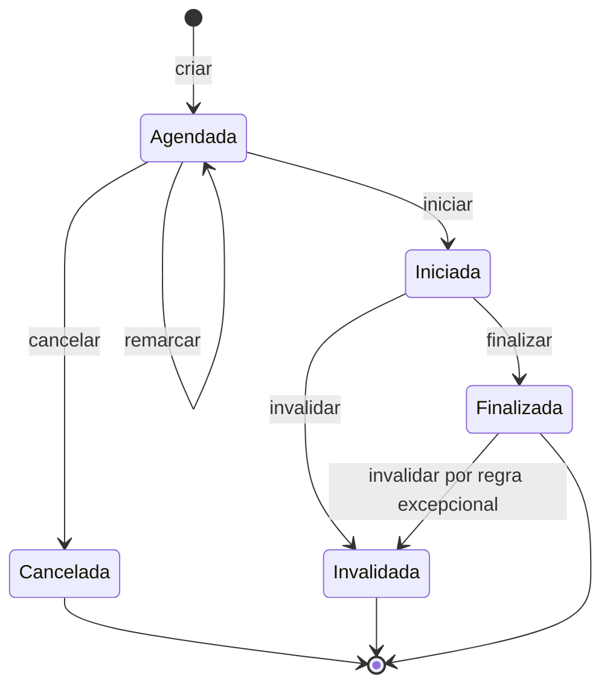
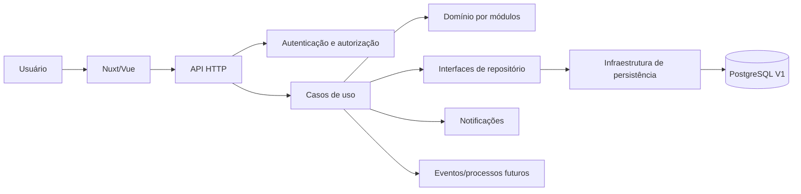
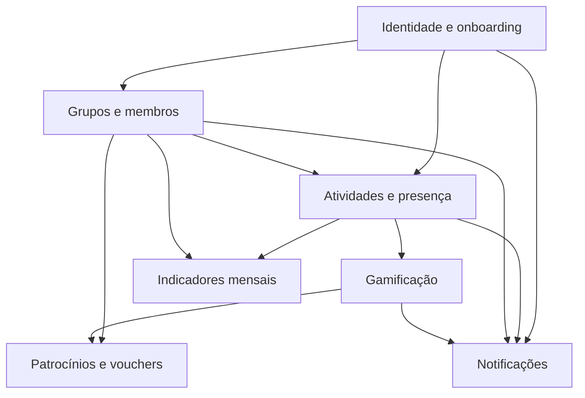

# SIGAME — Requisitos da V1

> **Status:** Em revisão
>
> **Versão:** 0.7
>
> **Última atualização:** 2026-11-10
>
> **Fonte:** levantamento inicial, especificação de requisitos e proposta arquitetural do SIGAME.

> **Escopo deste documento:** requisitos de produto (RF, RN, CA). O estado da implementação, o roadmap e as decisões
> ainda abertas ficam em [../implementacao.md](../implementacao.md). As decisões já tomadas e o porquê ficam
> em [../decisoes.md](../decisoes.md).

---

## 1. Como usar este documento

Este documento é a fonte organizada dos requisitos funcionais, regras de negócio e critérios de aceitação da V1.

A especificação foi organizada por **capacidade do produto**, e não apenas por tipo de requisito. Cada capacidade
possui:

- objetivo;
- regras e restrições;
- critérios de aceitação;
- exemplos de decisão, quando houver regra quantitativa;
- dependências ou pontos ainda pendentes.

### 1.1 Identificadores

Os identificadores devem ser estáveis. Não renomeie um requisito apenas porque a ordem mudou.

| Prefixo | Tipo                    |
|---------|-------------------------|
| `OBJ`   | Objetivo do produto     |
| `RF`    | Capacidade funcional    |
| `RN`    | Regra de negócio        |
| `RNF`   | Requisito não funcional |
| `CA`    | Critério de aceitação   |
| `DEC`   | Decisão pendente        |

Ao alterar um requisito já implementado, registre a mudança no histórico ao final deste documento.

### 1.2 Status dos requisitos

| Status         | Significado                 |
|----------------|-----------------------------|
| `Proposto`     | Ainda em discussão          |
| `Aprovado`     | Aceito para a V1            |
| `Implementado` | Implementado e validado     |
| `Adiado`       | Não será implementado na V1 |
| `Rejeitado`    | Não faz parte do produto    |

---

## 2. Visão do produto

### OBJ01 — Incentivar atividades físicas em grupo

O SIGAME é uma plataforma web voltada a incentivar a prática de atividades físicas em grupo. O sistema deve ajudar
pessoas a encontrar outras com interesses e disponibilidades compatíveis, formar pequenos grupos, organizar atividades e
acompanhar sua evolução.

A V1 prioriza:

- socialização;
- inclusão de iniciantes e pessoas sedentárias;
- segurança e moderação;
- organização de atividades;
- acompanhamento de progresso;
- motivação por gamificação.

### OBJ02 — Modalidades iniciais

A V1 oferecerá as modalidades:

- caminhada;
- corrida;
- ciclismo.

O usuário poderá praticar mais de uma modalidade e definir uma delas como principal.

### OBJ03 — Limites de escopo da V1

A V1 não inclui:

- aplicativo mobile nativo;
- chat interno;
- rastreamento GPS obrigatório;
- recebimento de dinheiro, Pix, comissão ou repasse financeiro;

---

## 3. Atores e permissões

### 3.1 Atores

| Ator                   | Descrição                                                                          |
|------------------------|------------------------------------------------------------------------------------|
| Usuário                | Pessoa cadastrada que participa do SIGAME                                          |
| Administrador de grupo | Criador ou responsável pela gestão de um grupo específico                          |
| Supervisor             | Usuário designado para executar operações delegadas no grupo                       |
| Administração SIGAME   | Administração global da plataforma                                                 |
| Patrocinador           | Entidade responsável por proposta de benefício, caso incluída no fluxo final da V1 |

Um usuário pode exercer papéis diferentes em contextos diferentes. Ser administrador de um grupo não concede poderes
administrativos globais.

### 3.2 Matriz inicial de permissões

| Operação                                |       Usuário | Admin. do grupo |                  Supervisor | Administração SIGAME |
|-----------------------------------------|--------------:|----------------:|----------------------------:|---------------------:|
| Editar próprio perfil                   |           Sim |             Sim |                         Sim |                  Sim |
| Criar grupo                             | Se habilitado |             Sim |               Se habilitado |                  Sim |
| Solicitar entrada em grupo              |           Sim |             Sim |                         Sim |                  Sim |
| Aprovar entrada                         |           Não |             Sim | Não, salvo delegação futura |                  Sim |
| Remover membro do grupo                 |           Não |             Sim |                         Não |                  Sim |
| Promover/rebaixar administrador         |           Não |             Sim |                         Não |                  Sim |
| Criar atividade                         |           Não |             Sim |                         Não |                  Sim |
| Editar/remarcar atividade               |           Não |             Sim |                         Não |                  Sim |
| Cancelar atividade                      |           Não |             Sim |                         Não |                  Sim |
| Iniciar/finalizar atividade             |           Não |             Sim |                         Sim |                  Sim |
| Invalidar atividade                     |           Não |             Sim |                         Não |                  Sim |
| Inscrever-se em atividade               |           Sim |             Sim |                         Sim |                  Sim |
| Check-in próprio                        |           Sim |             Sim |                         Sim |                  Sim |
| Validar presença                        |           Não |             Sim |                         Sim |                  Sim |
| Listar presenças                        |           Não |             Sim |                         Sim |                  Sim |
| Ver histórico de remarcações            |           Não |             Sim |                         Não |                  Sim |
| Listar e consultar contas               |           Não |             Não |                         Não |                  Sim |
| Suspender conta globalmente             |           Não |             Não |                         Não |                  Sim |
| Reativar conta globalmente              |           Não |             Não |                         Não |                  Sim |
| Consultar notificações próprias         |           Sim |             Sim |                         Sim |                  Sim |
| Marcar notificações próprias como lidas |           Sim |             Sim |                         Sim |                  Sim |
| Criar recompensa interna                |           Não |             Sim |                    Pendente |                  Sim |
| Gerenciar patrocinadores e benefícios   |           Não |             Não |                         Não |                  Sim |

> Os poderes de atividade do supervisor foram fechados no `ADR-027`: ele opera a atividade no dia
> (check-in, validação/lista de presenças, início e finalização), mas não cria, edita, remarca, cancela,
> invalida nem altera informações sensíveis. O criador do grupo só possui poderes enquanto estiver no papel
> de administrador, conforme o `ADR-023`.

---

## 4. Identidade, cadastro e onboarding

### RF01 — Cadastrar usuário

O sistema deve permitir o cadastro de usuário com e-mail, senha e dados cadastrais mínimos. O CPF é opcional no
cadastro.

#### Regras

- `RN01.1` O CPF é opcional no cadastro. Quando informado, deve ser único na V1.
- `RN01.2` O e-mail deve ser único.
- `RN01.3` A V1 não realiza validação governamental de identidade por CPF.
- `RN01.4` A senha nunca deve ser armazenada em texto puro.
- `RN01.5` Foto de perfil não é obrigatória.
- `RN01.6` Peso e altura são opcionais.
- `RN01.7` Peso e altura não podem impedir o acesso às funcionalidades sociais.
- `RN01.8` Todo usuário novo inicia no nível 1.
- `RN01.9` O CPF pode ser definido depois do cadastro, por endpoint autenticado. Uma vez definido, é **write-once**: o
  próprio usuário não pode alterá-lo.
- `RN01.10` O cadastro por provedor social cria a conta sem senha local e sem CPF, com onboarding pendente e nível 1.
- `RN01.11` Quando o provedor confirma `email_verified=true` e o e-mail já pertence a uma conta **sem senha local**, a
  identidade social é vinculada a essa conta em vez de criar uma duplicata. Se a conta existente tiver senha local, o
  vínculo só ocorre após o usuário autenticar na conta e confirmar a vinculação.
- `RN01.12` O CPF é exigido apenas para resgatar recompensas/vouchers externos à plataforma, como comprovação de
  identidade real e prevenção de ganhos indevidos.

#### Critérios de aceitação

- `CA01.1` Não é possível cadastrar dois usuários com o mesmo CPF quando ele é informado.
- `CA01.2` Não é possível cadastrar dois usuários com o mesmo e-mail.
- `CA01.3` Um cadastro sem foto, peso ou altura pode ser concluído se os demais dados obrigatórios forem válidos.
- `CA01.4` A senha persistida não é igual à senha informada.
- `CA01.5` Um usuário recém-cadastrado possui nível 1.
- `CA01.6` Um cadastro sem CPF é permitido.
- `CA01.7` Um CPF já definido não pode ser alterado pelo próprio usuário.
- `CA01.8` Um CPF informado por outro usuário não pode ser reutilizado.

### RF02 — Autenticar usuário

O sistema deve autenticar o usuário por e-mail/senha ou por provedor social (Google nesta entrega) e manter sua sessão
conforme o perfil e o estado da conta.

#### Regras

- `RN02.1` Conta suspensa não pode iniciar uma nova sessão.
- `RN02.2` A autenticação deve identificar o usuário responsável pela operação.
- `RN02.3` Operações protegidas devem verificar a autorização no backend, mesmo que a interface oculte controles.
- `RN02.4` A sessão usa um **access token JWT** de curta duração (15 minutos) e um **refresh token opaco** de alta
  entropia (7 dias), este último em cookie `HttpOnly`.
- `RN02.5` A cada renovação, o refresh token é rotacionado dentro da mesma família; o token anterior é revogado.
- `RN02.6` O reuso de um refresh token revogado fora da janela de graça revoga toda a família.
- `RN02.7` O logout revoga a família do cookie; o logout de todos os dispositivos revoga todas as famílias.
- `RN02.8` No login social, o e-mail deve estar verificado pelo provedor; o vínculo automático só ocorre quando a conta
  existente não tem senha local. Contas com senha local exigem autenticação e vínculo explícito.
- `RN02.9` O refresh token nunca é retornado no corpo da resposta; o access token nunca é armazenado em cookie.

#### Critérios de aceitação

- `CA02.1` Credenciais válidas permitem autenticação.
- `CA02.2` Credenciais inválidas não permitem autenticação.
- `CA02.3` Conta suspensa não pode autenticar.
- `CA02.4` Uma requisição protegida sem sessão válida é recusada.
- `CA02.5` Uma renovação válida devolve novo access token e novo refresh token, invalidando o anterior.
- `CA02.6` O reuso de um refresh token revogado é recusado e revoga a família.
- `CA02.7` O logout invalida o refresh token utilizado.
- `CA02.8` O login social cria ou vincula a conta e emite o mesmo par de tokens.
- `CA02.9` O endpoint de CPF define o CPF uma única vez e rejeita alteração.

### RF03 — Concluir onboarding

O sistema deve executar o onboarding inicial e controlar sua conclusão.

#### Regras

- `RN03.1` O onboarding define os dados mínimos necessários para progressão inicial.
- `RN03.2` Ao concluir os requisitos definidos, o usuário alcança o nível 2.
- `RN03.3` O usuário pode selecionar uma ou mais modalidades.
- `RN03.4` Uma modalidade ativa pode ser definida como principal.
- `RN03.5` Alterar a modalidade principal não remove histórico nem XP.

#### Critérios de aceitação

- `CA03.1` Um onboarding incompleto não concede o nível 2.
- `CA03.2` Um onboarding válido pode ser concluído uma única vez ou de forma idempotente.
- `CA03.3` A conclusão válida eleva o usuário ao nível 2.
- `CA03.4` O usuário pode ter mais de uma modalidade ativa.
- `CA03.5` Alterar a modalidade principal preserva o histórico de atividades e XP.

#### Matriz de exemplos — onboarding e modalidades

| Situação                                                | Resultado esperado                                            |
|---------------------------------------------------------|---------------------------------------------------------------|
| Nenhuma modalidade selecionada                          | Rejeitar conclusão                                            |
| Uma modalidade selecionada                              | Permitir, se os demais dados obrigatórios estiverem completos |
| Duas ou três modalidades selecionadas                   | Permitir                                                      |
| Modalidade principal não pertence às modalidades ativas | Rejeitar                                                      |
| Peso ausente                                            | Permitir, pois é opcional                                     |
| Altura ausente                                          | Permitir, pois é opcional                                     |
| Onboarding concluído novamente                          | Não duplicar progressão nem conceder XP indevido              |

---

## 5. Grupos e membros

### RF04 — Criar grupo

Usuários habilitados devem poder criar grupos esportivos.

#### Campos do grupo

| Campo               | Obrigatório | Regra                                                                             |
|---------------------|-------------|-----------------------------------------------------------------------------------|
| `name`              | Sim         | 3 a 80 caracteres, com espaços removidos das pontas                               |
| `description`       | Não         | até 500 caracteres                                                                |
| `modality`          | Sim         | `caminhada`, `corrida` ou `ciclismo`                                              |
| `communicationLink` | Não         | URL `http` ou `https`, até 2048 caracteres, visível apenas para membros aprovados |
| `maxMembers`        | Não         | inteiro maior ou igual a 3; ausente ou `null` representa grupo ilimitado             |

#### Regras

- `RN04.1` Apenas usuário a partir do nível 2 pode criar grupo.
- `RN04.2` O criador do grupo assume o papel de administrador no momento da criação.
- `RN04.3` Cada usuário pode participar de no máximo 3 grupos na V1, conforme a interpretação adotada para o limite de
  grupos.
- `RN04.4` O grupo pode definir um limite de membros aprovados; ausente ou `null` representa grupo ilimitado e, quando
  informado, o mínimo é 3.
- `RN04.5` Um grupo torna-se ativo ao atingir no mínimo 3 membros aprovados.
- `RN04.6` O grupo pode existir em formação com menos de 3 membros.
- `RN04.7` O grupo registra o criador em campo próprio (`createdBy`), independente do papel de administrador.
- `RN04.8` O criador inicia como administrador, mas o grupo pode ter mais de um administrador aprovado.
- `RN04.9` O papel de administrador é atributo da participação (`Membership.role`), não do criador.

#### Critérios de aceitação

- `CA04.1` Usuário nível 1 não consegue criar grupo.
- `CA04.2` Usuário nível 2 consegue criar grupo quando não excede seu limite de grupos.
- `CA04.3` O criador é registrado como administrador do grupo.
- `CA04.4` Grupo com menos de 3 membros aprovados permanece em formação.
- `CA04.5` Grupo com 3 ou mais membros aprovados fica ativo.
- `CA04.6` Grupo com limite definido não aceita mais membros aprovados que o limite; grupo ilimitado não possui teto.
- `CA04.7` O `createdBy` permanece registrado mesmo se o criador for rebaixado ou removido.
- `CA04.8` Um grupo pode ter dois ou mais administradores aprovados.

### RF05 — Solicitar entrada em grupo

O sistema deve permitir que usuários habilitados solicitem entrada em grupos.

#### Regras

- `RN05.1` A solicitação depende de aprovação do administrador.
- `RN05.2` Usuário não pode criar solicitações duplicadas pendentes para o mesmo grupo.
- `RN05.3` Usuário suspenso não pode solicitar entrada.
- `RN05.4` O limite de participação em grupos deve ser verificado no momento da aprovação.

#### Critérios de aceitação

- `CA05.1` Usuário habilitado consegue criar uma solicitação pendente.
- `CA05.2` Solicitação duplicada pendente é recusada ou tratada de forma idempotente.
- `CA05.3` Solicitação não concede participação antes da aprovação.
- `CA05.4` Solicitação de usuário suspenso é recusada.

### RF06 — Administrar membros do grupo

O administrador deve poder aprovar, rejeitar e remover membros, registrar os motivos quando aplicável e gerenciar os
papéis de administrador.

#### Regras

- `RN06.1` Qualquer administrador do grupo pode aprovar ou rejeitar solicitações.
- `RN06.2` Qualquer administrador pode remover membro do grupo.
- `RN06.3` A remoção deve registrar autor, data e motivo.
- `RN06.4` Administrador de grupo não pode suspender globalmente uma conta.
- `RN06.5` A aprovação deve respeitar o limite máximo configurado no grupo, quando houver.
- `RN06.6` A aprovação deve respeitar o limite máximo de grupos do usuário.
- `RN06.7` O grupo deve manter ao menos um administrador aprovado.
- `RN06.8` Qualquer administrador pode promover ou rebaixar um membro aprovado.
- `RN06.9` O último administrador não pode ser rebaixado nem removido.

#### Critérios de aceitação

- `CA06.1` Administrador consegue aprovar solicitação pendente válida.
- `CA06.2` Aprovação transforma a solicitação em participação aprovada.
- `CA06.3` Aprovação de grupo cheio é recusada; grupo ilimitado não fica cheio.
- `CA06.4` Usuário não administrador não consegue aprovar solicitação.
- `CA06.5` Remoção registra autor, membro removido, grupo, data e motivo.
- `CA06.6` Remoção não provoca suspensão global.
- `CA06.7` Dois administradores conseguem aprovar e remover membros.
- `CA06.8` Rebaixar o último administrador é recusado.
- `CA06.9` Remover o último administrador é recusado.
- `CA06.10` Administrador rebaixado perde imediatamente as operações de gestão.

#### Matriz de exemplos — estado do grupo

| Membros aprovados | Estado sem limite | Estado com limite 5 | Pode receber atividade?   |
|------------------:|-------------------|---------------------|---------------------------|
|                 0 | Em formação       | Em formação         | Não, salvo decisão futura |
|                 1 | Em formação       | Em formação         | Não, salvo decisão futura |
|                 2 | Em formação       | Em formação         | Não, salvo decisão futura |
|                 3 | Ativo             | Ativo               | Sim                       |
|                 4 | Ativo             | Ativo               | Sim                       |
|                 5 | Ativo             | Ativo e cheio       | Sim, sem novas aprovações |
|            6 ou + | Ativo             | Ativo e cheio       | Sim, sem novas aprovações |

Grupos ilimitados nunca alcançam o estado `FULL`. Em grupos com limite configurado, o estado `FULL` ocorre quando a
quantidade de membros aprovados atinge o limite.

### RF07 — Designar supervisor

O administrador deve poder designar um supervisor para o grupo.

#### Regras

- `RN07.1` A existência de supervisor é opcional.
- `RN07.2` O supervisor deve ser membro aprovado do grupo.
- `RN07.3` O supervisor não recebe poderes globais.
- `RN07.4` Na V1, o supervisor não aprova, rejeita, remove, promove nem rebaixa membros. Na atividade, ele pode
  fazer o próprio check-in, validar e listar presenças, iniciar e finalizar a atividade. Não pode criar, editar,
  remarcar, cancelar, invalidar nem alterar informações sensíveis da atividade.

#### Critérios de aceitação

- `CA07.1` Administrador consegue designar membro aprovado como supervisor.
- `CA07.2` Usuário externo ao grupo não pode ser designado.
- `CA07.3` Supervisor consegue executar somente as operações delegadas.
- `CA07.4` Supervisor não consegue aprovar, rejeitar ou remover membros.
- `CA07.5` A remoção do membro limpa automaticamente a designação de supervisor.

### RF08 — Comunicação externa do grupo

O administrador pode cadastrar um link externo de comunicação do grupo.

#### Regras

- `RN08.1` Não haverá chat próprio na V1.
- `RN08.2` O link só pode ser visualizado por membros aprovados.
- `RN08.3` O telefone pessoal não deve ser exposto como requisito de comunicação.

#### Critérios de aceitação

- `CA08.1` Visitante ou usuário não aprovado não visualiza o link.
- `CA08.2` Membro aprovado visualiza o link quando cadastrado.
- `CA08.3` Administrador consegue alterar ou remover o link.
- `CA08.4` O sistema não exige a publicação de telefone pessoal.
- `CA08.5` O link só aceita URL `http` ou `https` válida.

---

## 6. Atividades e presença

### RF09 — Criar e manter atividade

O sistema deve permitir criar e manter atividades vinculadas a grupos ativos.

#### Campos da atividade

| Campo                      | Obrigatório | Regra                                                 |
|----------------------------|-------------|-------------------------------------------------------|
| `title`                    | Sim         | 3 a 100 caracteres, com espaços removidos das pontas  |
| `description`              | Não         | até 500 caracteres                                    |
| `startsAt`                 | Sim         | data/hora de início em ISO 8601 com offset, no futuro |
| `estimatedDurationMinutes` | Não         | duração média estimada, de 15 a 1440 minutos          |
| `meetingPoint`             | Sim         | 3 a 255 caracteres                                    |
| `route`                    | Sim         | ponto final ou trajeto, 3 a 500 caracteres            |
| `estimatedDistanceMeters`  | Sim         | inteiro entre 1 e 1.000.000                           |
| `group`                    | Sim         | grupo `ACTIVE` ou `FULL` no momento da criação        |

#### Regras

- `RN09.1` Apenas administrador do grupo ou administrador SIGAME pode criar, editar, remarcar, cancelar e invalidar
  atividade.
- `RN09.2` A atividade deve pertencer a um grupo com pelo menos 3 membros aprovados no momento da criação.
- `RN09.3` Supervisor pode iniciar, finalizar, validar e listar presenças, mas não pode criar, editar, remarcar,
  cancelar nem invalidar.
- `RN09.4` Alterações relevantes devem gerar alerta interno.
- `RN09.5` GPS não é obrigatório na V1.
- `RN09.6` Atividade cancelada não pode ser iniciada.
- `RN09.7` Atividade finalizada não pode ser iniciada novamente.
- `RN09.8` Atividade cancelada ou invalidada não gera XP.
- `RN09.9` A janela operacional de início, check-in, finalização e validação segue o `ADR-025`.
- `RN09.10` O criador não é inscrito automaticamente na atividade.
- `RN09.11` Atividades e dados de encontro são visíveis apenas para membros aprovados do grupo; administradores SIGAME
  podem consultar para moderação.
- `RN09.12` A remarcação só é permitida em atividade agendada e preserva a janela anterior em histórico append-only.
- `RN09.13` O cancelamento só é permitido em atividade agendada, com motivo opcional.
- `RN09.14` A invalidação só é permitida em atividade iniciada ou finalizada, por administrador, com motivo obrigatório.
- `RN09.15` Quando `estimatedDurationMinutes` é omitido, a janela de planejamento usa 120 minutos.
- `RN09.16` Atividade iniciada com duração informada fecha automaticamente após a duração somada a uma tolerância de
  50%, com mínimo de 15 e máximo de 240 minutos.
- `RN09.17` Atividade iniciada sem duração informada fecha automaticamente após 12 horas.
- `RN09.18` Atividade não iniciada é cancelada automaticamente após 3 horas do início previsto.
- `RN09.19` O fechamento automático é idempotente e não substitui a finalização explícita.
- `RN09.20` Se o grupo cair para `FORMING`, atividades já criadas continuam válidas; apenas novas criações são
  bloqueadas.

#### Critérios de aceitação

- `CA09.1` Atividade sem `title`, `startsAt`, `meetingPoint`, `route` ou `estimatedDistanceMeters` é recusada.
- `CA09.2` Usuário sem permissão não consegue criar, editar, remarcar, cancelar ou invalidar atividade.
- `CA09.3` Atividade de grupo em formação é recusada na criação.
- `CA09.4` Remarcação preserva a janela anterior no histórico.
- `CA09.5` Cancelamento impede início, check-in e validação.
- `CA09.6` Criação, alteração, remarcação, cancelamento, início e finalização geram evento interno.
- `CA09.7` Usuário não membro não visualiza a atividade.
- `CA09.8` Invalidação exige administrador e motivo.
- `CA09.9` Atividade existente continua operável se o grupo cair para formação.
- `CA09.10` Início e finalização fora da janela operacional são recusados.
- `CA09.11` Cancelada e invalidada são estados terminais.
- `CA09.12` Duração omitida não impede a criação.
- `CA09.13` Atividade iniciada com duração é fechada automaticamente no prazo calculado.
- `CA09.14` Atividade não iniciada é cancelada automaticamente após 3 horas.
- `CA09.15` Fechamento automático sem 2 check-ins não gera XP.

### Ciclo de vida da atividade



#### Regras de transição

- `RN09.6` Atividade cancelada não pode ser iniciada.
- `RN09.7` Atividade finalizada não pode ser iniciada novamente.
- `RN09.8` Atividade cancelada ou invalidada não gera XP.
- `RN09.21` Início permitido de 15 minutos antes até 2 horas após o horário previsto.
- `RN09.22` Finalização permitida até 24 horas após o início real.
- `RN09.23` Invalidação permitida em até 48 horas após o encerramento previsto ou real.
- `RN09.24` O fechamento automático usa o início real, não o horário previsto.

### RF10 — Inscrever-se, fazer check-in e validar presença

O participante deve poder se inscrever, registrar seu check-in e ter a presença validada por administrador ou
supervisor.

#### Regras

- `RN10.1` A inscrição é individual e permitida apenas a membro aprovado do grupo.
- `RN10.2` Há no máximo uma inscrição ativa por par usuário/atividade.
- `RN10.3` A inscrição só é permitida em atividade agendada e antes do início.
- `RN10.4` A inscrição respeita o conflito de horário do RF11.
- `RN10.5` O cancelamento da inscrição só é permitido antes do início e é idempotente.
- `RN10.6` O check-in é individual e só é permitido para participante inscrito.
- `RN10.7` O check-in abre 30 minutos antes do início e fecha 30 minutos após o fim previsto.
- `RN10.8` Somente administrador, supervisor ou administrador SIGAME pode validar presença.
- `RN10.9` GPS não é obrigatório.
- `RN10.10` Somente presença validada gera XP.
- `RN10.11` Uma presença validada não pode gerar XP novamente.
- `RN10.12` A validação exige check-in prévio.
- `RN10.13` A validação só é permitida após a finalização e o fechamento do check-in, em até 48 horas após a
  finalização.
- `RN10.14` A atividade só é elegível a XP com pelo menos 2 participantes com check-in.
- `RN10.15` A validação pode ocorrer com menos de 2 check-ins, mas o evento indica `xpEligible=false`.

#### Critérios de aceitação

- `CA10.1` Participante inscrito consegue realizar check-in dentro da janela permitida.
- `CA10.2` Usuário não inscrito não consegue realizar check-in.
- `CA10.3` Check-in não validado não gera XP.
- `CA10.4` Validação autorizada altera o estado da presença.
- `CA10.5` Tentativa de validar duas vezes não gera XP duplicado.
- `CA10.6` Validação de atividade cancelada ou invalidada é recusada.
- `CA10.7` Membro aprovado consegue se inscrever em atividade agendada.
- `CA10.8` Não membro não consegue se inscrever.
- `CA10.9` Inscrição repetida não cria segundo episódio ativo.
- `CA10.10` Inscrição conflitante é recusada.
- `CA10.11` Cancelamento de inscrição após o início é recusado.
- `CA10.12` Validação sem check-in é recusada.
- `CA10.13` Validação fora da janela é recusada.
- `CA10.14` Atividade com menos de 2 check-ins valida presença com `xpEligible=false`.

### RF11 — Impedir conflitos de horário

O sistema deve impedir que o mesmo usuário seja atribuído a atividades conflitantes.

#### Definição

Duas atividades conflitam quando seus intervalos de horário se sobrepõem, mesmo que parcialmente. Não há margem de
deslocamento e não há exceção administrativa na V1.

#### Regras

- `RN11.1` A margem de conflito é de 0 minutos; atividades encostadas não conflitam.
- `RN11.2` Não há override administrativo para inscrição conflitante.
- `RN11.3` O conflito é verificado na inscrição e na remarcação para todos os inscritos ativos.
- `RN11.4` A regra é aplicada no backend, em transação, com lock por usuário e por atividade.
- `RN11.5` A atividade iniciada usa o horário de fechamento automático como fim efetivo para conflito.

#### Critérios de aceitação

- `CA11.1` Atividades sem sobreposição podem ser atribuídas ao mesmo usuário.
- `CA11.2` Atividades com sobreposição parcial não podem ser atribuídas ao mesmo usuário.
- `CA11.3` Atividades com mesmo horário não podem ser atribuídas ao mesmo usuário.
- `CA11.4` A regra deve ser aplicada no backend e protegida por transação.
- `CA11.5` Atividades encostadas são aceitas.
- `CA11.6` Remarcação que crie conflito para um inscrito é recusada.

---

## 7. Gamificação e progressão

### RF12 — Progressão de XP e níveis

O sistema deve calcular, registrar e apresentar o XP e o nível do usuário. A progressão recompensa participação
válida, atividades em grupo, atividades de fim de semana e consistência semanal. A gamificação **não** possui
ofensiva diária e **não** concede bônus por dias consecutivos: a constância é medida por semana, para não estimular
treino diário sem planejamento.

#### Regras gerais

- `RN12.1` Todo usuário inicia no nível 1.
- `RN12.2` A gamificação possui 10 níveis.
- `RN12.3` A conclusão do onboarding concede o acesso ao nível 2, conforme RF03.
- `RN12.4` Participação em atividade só gera XP após validação da presença.
- `RN12.5` O sistema registra XP por atividade, bônus de grupo, fim de semana e ofensiva semanal.
- `RN12.6` O histórico de XP não deve ser perdido ao trocar a modalidade principal.
- `RN12.7` A atividade precisa estar finalizada, não cancelada/invalidada e ter pelo menos 2 check-ins para ser elegível
  a XP.
- `RN12.8` O evento `AttendanceValidated` informa `xpEligible`; a Gamification não deve conceder XP quando for falso.
- `RN12.9` Invalidação posterior de atividade com XP exige evento de reversão com os usuários validados.

#### Definições e grandezas

O sistema mantém duas grandezas distintas:

| Grandeza                        | Definição                                | Pode diminuir?                                                           | Uso                                      |
|---------------------------------|------------------------------------------|--------------------------------------------------------------------------|------------------------------------------|
| **XP vitalício** (`xpLifetime`) | Soma de todo XP conquistado pelo usuário | Apenas quando uma atividade que gerou XP é invalidada e o XP é estornado | Histórico, fidelidade e recálculo futuro |
| **Saldo de XP** (`xpBalance`)   | XP atual do usuário                      | Sim, por deleveling e por estorno                                        | Nível, barra e progresso                 |

- `RN12.10` O nível é derivado do saldo de XP. O XP vitalício não define o nível.
- `RN12.11` Deleveling reduz o saldo e o nível, mas **não reduz o XP vitalício**.
- `RN12.12` O estorno por invalidação de atividade reduz os dois, porque a atividade deixou de existir como conquista
  válida.
- `RN12.13` O XP não é armazenado apenas como um número agregado: cada concessão, estorno e penalidade gera um
  lançamento no histórico de XP.

#### Curva de níveis

A curva é triangular e cumulativa:

`T(n) = 50 × n × (n − 1)`

| Nível | XP acumulado necessário | XP para o próximo nível |
|------:|------------------------:|------------------------:|
|     1 |                       0 |                     100 |
|     2 |                     100 |                     200 |
|     3 |                     300 |                     300 |
|     4 |                     600 |                     400 |
|     5 |                   1.000 |                     500 |
|     6 |                   1.500 |                     600 |
|     7 |                   2.100 |                     700 |
|     8 |                   2.800 |                     800 |
|     9 |                   3.600 |                     900 |
|    10 |                   4.500 |                       — |

- `RN12.14` Todo usuário novo começa no nível 1 com 0 XP.
- `RN12.15` A conclusão do onboarding concede **100 XP uma única vez**, colocando o usuário no nível 2.
- `RN12.16` O nível é o maior `n` entre 1 e 10 tal que `T(n) ≤ saldo`.
- `RN12.17` A barra do nível é `(saldo − T(n)) / (T(n+1) − T(n))` para níveis 1 a 9.
- `RN12.18` No nível 10 a barra é exibida como “máximo”; o saldo pode continuar crescendo para o histórico.
- `RN12.19` O onboarding repetido não concede XP novamente.

#### Fontes de XP

| Fonte                  | Quando é concedida                         | Valor                            | Limite                    |
|------------------------|--------------------------------------------|----------------------------------|---------------------------|
| Atividade validada     | Presença validada com `xpEligible=true`    | Fórmula da atividade             | 100 XP por atividade      |
| Bônus de grupo         | Atividade com 3–4 check-ins ou 5 check-ins | +10 ou +15                       | Por atividade             |
| Bônus de fim de semana | Atividade iniciada em sábado ou domingo    | ×1,2 no XP de atividade          | Por atividade             |
| Início de semana       | Primeira atividade válida da semana        | +10                              | 1 vez por semana          |
| Meta semanal           | Segunda atividade válida da semana         | 20 a 50 XP, conforme a sequência | 1 vez por semana          |
| Onboarding             | Conclusão válida do onboarding             | +100                             | 1 vez por usuário         |
| Estorno                | Invalidação de atividade                   | Negativo                         | Por lançamento estornado  |
| Decay                  | Inatividade após a tolerância              | Negativo                         | Por período de 2 dias     |
| Bônus de fidelidade    | Recálculo de regra                         | Positivo                         | 1 vez por versão de regra |

Não geram XP:

- check-in sem validação;
- atividade com `xpEligible=false`;
- atividade cancelada;
- atividade invalidada;
- atividade com menos de 2 check-ins;
- cadastro;
- troca de modalidade principal;
- conclusão repetida do onboarding.

#### Fórmula do XP de atividade

O XP de atividade é calculado em etapas, nesta ordem:

```text
1. xpBase      = base da modalidade
2. xpDistancia = bônus pela faixa de distância
3. xpDuracao   = bônus pela faixa de duração
4. xpGrupo     = bônus pelo número de check-ins
5. xpBruto     = xpBase + xpDistancia + xpDuracao + xpGrupo
6. xpFimSemana = floor(xpBruto × 1,2) se sábado ou domingo
7. xpFatorDia  = floor(xpFimSemana × fator da atividade do dia)
8. xpFinal     = min(xpFatorDia, 100)
```

A ordem importa: o bônus de fim de semana incide sobre base + distância + duração + grupo; o fator diário incide
depois; o teto de 100 é o último passo.

##### Base por modalidade

| Modalidade | XP base |
|------------|--------:|
| Caminhada  |      20 |
| Corrida    |      25 |
| Ciclismo   |      30 |

##### Faixas de distância

| Modalidade | Faixa                    | Bônus |
|------------|--------------------------|------:|
| Caminhada  | até 2 km                 |     0 |
| Caminhada  | acima de 2 km até 5 km   |   +10 |
| Caminhada  | acima de 5 km até 10 km  |   +15 |
| Caminhada  | acima de 10 km           |   +20 |
| Corrida    | até 3 km                 |     0 |
| Corrida    | acima de 3 km até 6 km   |   +10 |
| Corrida    | acima de 6 km até 10 km  |   +15 |
| Corrida    | acima de 10 km           |   +20 |
| Ciclismo   | até 10 km                |     0 |
| Ciclismo   | acima de 10 km até 20 km |   +10 |
| Ciclismo   | acima de 20 km até 40 km |   +15 |
| Ciclismo   | acima de 40 km           |   +20 |

##### Faixas de duração

| Duração estimada     | Bônus |
|----------------------|------:|
| Não informada        |     0 |
| Menor que 30 minutos |     0 |
| De 30 a 59 minutos   |    +5 |
| 60 minutos ou mais   |   +10 |

##### Bônus de grupo

O bônus usa o número de **check-ins** da atividade, não o número de validações. Isso garante que todos os
participantes recebam o mesmo bônus, independentemente da ordem em que as presenças forem validadas.

| Check-ins | Bônus |
|----------:|------:|
|         2 |     0 |
|       3–4 |   +10 |
|         5 |   +15 |

##### Fator diário

Para evitar farm de atividades, o XP de atividade é reduzido a partir da quarta atividade XP-elegível do mesmo dia:

| Atividade XP-elegível do dia | Fator |
|-----------------------------:|------:|
|                           1ª |   1,0 |
|                           2ª |   1,0 |
|                           3ª |   1,0 |
|                           4ª |  0,25 |
|                 5ª em diante |   0,0 |

O fator diário afeta somente o XP de atividade. Ele não afeta o bônus de início de semana nem o de meta semanal.
Atividades além da terceira continuam contando para a meta semanal.

##### Teto por atividade

- `RN12.20` Nenhuma atividade concede mais de **100 XP**, mesmo somando distância, duração, grupo e fim de semana.

#### Exemplos completos de XP de atividade

| Situação                                            | Cálculo                                        | XP |
|-----------------------------------------------------|------------------------------------------------|---:|
| Caminhada 3 km, 45 min, dia de semana, 2 check-ins  | 20 + 10 + 5 + 0                                | 35 |
| Caminhada 3 km, 45 min, fim de semana, 2 check-ins  | (20 + 10 + 5) × 1,2                            | 42 |
| Corrida 5 km, 30 min, dia de semana, 2 check-ins    | 25 + 10 + 5 + 0                                | 40 |
| Corrida 5 km, 30 min, fim de semana, 2 check-ins    | (25 + 10 + 5) × 1,2                            | 48 |
| Corrida 12 km, 75 min, fim de semana, 5 check-ins   | (25 + 20 + 10 + 15) × 1,2                      | 84 |
| Ciclismo 25 km, 90 min, dia de semana, 3 check-ins  | 30 + 15 + 10 + 10                              | 65 |
| Ciclismo 25 km, 90 min, fim de semana, 5 check-ins  | (30 + 15 + 10 + 15) × 1,2                      | 84 |
| Ciclismo 50 km, 120 min, fim de semana, 5 check-ins | (30 + 20 + 10 + 15) × 1,2 = 90, abaixo do teto | 90 |
| Corrida 5 km, 30 min, como 4ª atividade do dia      | 40 × 0,25                                      | 10 |
| Corrida 5 km, 30 min, como 5ª atividade do dia      | 40 × 0,0                                       |  0 |

#### Ofensiva semanal — o “foguinho”

A única mecânica de constância da V1 é a ofensiva semanal.

##### Definição de semana

- A semana vai de **segunda-feira 00:00:00** a **domingo 23:59:59**, no fuso `America/Sao_Paulo`.
- A data usada é a data de **início da atividade** (`startsAt`), não a data da validação.
- A semana é identificada pela data da segunda-feira, por exemplo `2026-11-09`.

##### Regras

- `RN12.21` A primeira atividade válida da semana concede **+10 XP** (`WEEKLY_START`), mantém a ofensiva acesa e conta a
  semana como válida para a sequência.
- `RN12.22` A segunda atividade válida da semana concede **+20 XP + bônus de sequência** (`WEEKLY_GOAL`) e completa a
  meta semanal.
- `RN12.23` O bônus de sequência é `5 × min(semanasConsecutivas − 1, 6)`, com máximo de +30. O total da meta semanal
  fica entre 20 e 50 XP.
- `RN12.24` Uma semana com **1 atividade** mantém o foguinho, mas não concede o bônus de meta semanal.
- `RN12.25` Uma semana com **0 atividades** apaga o foguinho ao fim da semana. O recorde (`best`) é preservado.
- `RN12.26` Duas atividades no mesmo dia contam como duas atividades para a meta semanal. Não há exigência de dias
  distintos na V1.
- `RN12.27` A ofensiva semanal é recalculada após validações tardias e estornos.
- `RN12.28` Se uma atividade for invalidada e a semana passar a ter 1 atividade, o bônus de meta é estornado e o
  foguinho permanece; se passar a ter 0, o foguinho daquela semana é desfeito.

##### Evolução do bônus semanal

| Semana consecutiva | Início (+10) | Meta (20 a 50) | Total da semana |
|-------------------:|-------------:|---------------:|----------------:|
|                  1 |          +10 |            +20 |             +30 |
|                  2 |          +10 |            +25 |             +35 |
|                  3 |          +10 |            +30 |             +40 |
|                  4 |          +10 |            +35 |             +45 |
|                  5 |          +10 |            +40 |             +50 |
|                  6 |          +10 |            +45 |             +55 |
|          7 ou mais |          +10 |            +50 |             +60 |

##### Estados do foguinho

| Estado     | Quando ocorre                                                                       |
|------------|-------------------------------------------------------------------------------------|
| `APAGADO`  | O usuário nunca teve uma semana válida ou a última semana terminou com 0 atividades |
| `ACESO`    | A semana corrente já tem pelo menos 1 atividade                                     |
| `EM_RISCO` | A semana corrente ainda não tem atividade e a semana anterior estava acesa          |
| `COMPLETO` | A semana corrente já tem 2 ou mais atividades                                       |

O número exibido ao lado do foguinho é o número de semanas consecutivas com pelo menos 1 atividade.

#### Ausência de ofensiva diária

- `RN12.29` Não existe bônus por dias consecutivos.
- `RN12.30` Não existe bônus de primeira atividade do dia.
- `RN12.31` O XP do dia é a soma do XP das atividades válidas daquele dia, mais os bônus semanais concedidos naquele
  dia.
- `RN12.32` Fazer atividades em dias consecutivos não gera XP adicional além do XP de cada atividade e dos bônus
  semanais.

Essa decisão evita estimular treino diário sem planejamento e mantém a gamificação alinhada à maturidade do usuário.

#### Atribuição de data e fuso horário

- `RN12.33` O XP, o fim de semana e a ofensiva semanal usam a data de início da atividade no fuso `America/Sao_Paulo`.
- `RN12.34` O deleveling usa o instante da validação da presença, não a data da atividade.
- `RN12.35` Feriados não são tratados como fim de semana na V1.
- `RN12.36` Uma atividade que começa às 23:50 de sábado e termina no domingo conta como sábado.

#### Idempotência e histórico

- `RN12.37` Cada presença validada gera XP no máximo uma vez.
- `RN12.38` Cada bônus semanal é concedido no máximo uma vez por semana, salvo estorno e nova concessão válida.
- `RN12.39` Todo lançamento de XP possui uma chave de idempotência, a origem, a data da atividade, a versão da regra e o
  valor concedido.
- `RN12.40` O histórico de XP é append-only: estornos e penalidades são novos lançamentos, não alterações no lançamento
  original.

#### Estorno por invalidação

- `RN12.41` A invalidação de uma atividade estorna o XP de atividade e os bônus semanais que ela disparou.
- `RN12.42` O estorno recalcula o saldo, o nível e a ofensiva semanal.
- `RN12.43` O estorno pode fazer o usuário descer de nível, respeitando o piso do nível 2.
- `RN12.44` O estorno não remove grupos, recompensas já resgatadas ou vouchers já utilizados.
- `RN12.45` O estorno é idempotente: a mesma atividade não pode ser estornada duas vezes.

#### Versionamento das regras

- `RN12.46` Cada lançamento de XP registra a versão da regra usada (`ruleVersion`).
- `RN12.47` A versão inicial da V1 é `2026-11-v1`.
- `RN12.48` Uma mudança futura de regra não pode reduzir o XP já conquistado sem um bônus de fidelidade.
- `RN12.49` O recálculo de uma nova versão compara o XP de atividade antigo com o novo e concede `LEGACY_BONUS` quando o
  novo cálculo for maior. Se o novo cálculo for menor, o valor antigo é preservado.
- `RN12.50` Bônus de engajamento (início e meta semanal) passam a valer da nova versão em diante; o recálculo retroativo
  completo fica para uma versão futura.

#### Critérios de aceitação

- `CA12.1` Usuário novo começa no nível 1.
- `CA12.2` Usuário que conclui onboarding válido alcança o nível 2.
- `CA12.3` Presença apenas com check-in não gera XP.
- `CA12.4` Presença validada gera XP uma única vez.
- `CA12.5` O progresso retornado pela API pode ser apresentado visualmente pelo frontend.
- `CA12.6` Um usuário novo possui 0 XP e nível 1.
- `CA12.7` Um onboarding válido concede exatamente 100 XP e nível 2, uma única vez.
- `CA12.8` Uma atividade validada concede o XP exato da fórmula de atividade.
- `CA12.9` O bônus de fim de semana só se aplica a atividades iniciadas em sábado ou domingo no fuso local.
- `CA12.10` Uma atividade com 3–4 check-ins concede +10 de grupo; com 5 check-ins, +15.
- `CA12.11` A primeira atividade válida da semana concede +10 e mantém o foguinho.
- `CA12.12` A segunda atividade válida da semana concede +20 + bônus de sequência e completa a meta.
- `CA12.13` Uma semana com 1 atividade mantém o foguinho e não concede o bônus de meta.
- `CA12.14` Uma semana com 0 atividades apaga o foguinho e preserva o recorde.
- `CA12.15` Não existe bônus por dias consecutivos nem bônus de primeira atividade do dia.
- `CA12.16` A quarta atividade XP-elegível do dia concede 25% do XP de atividade; a quinta concede 0.
- `CA12.17` Nenhuma atividade concede mais de 100 XP.
- `CA12.18` Check-in não validado, atividade cancelada, atividade invalidada e `xpEligible=false` não geram XP.
- `CA12.19` A validação repetida da mesma presença não duplica XP.
- `CA12.20` A invalidação de atividade estorna o XP de atividade e os bônus semanais vinculados.
- `CA12.21` XP, fim de semana e ofensiva usam a data de início da atividade no fuso `America/Sao_Paulo`.
- `CA12.22` O recálculo de uma nova versão de regra não reduz o XP já conquistado.
- `CA12.23` O deleveling não reduz o XP vitalício.
- `CA12.24` O endpoint de progresso retorna saldo, nível, barra, foguinho, meta semanal e bônus aplicáveis.

#### Matriz de exemplos — semana e ofensiva

Ana está no nível 4, com saldo atual de 700 XP.

| Dia | Atividade                           |                XP de atividade |                       Bônus | Total | Saldo |
|-----|-------------------------------------|-------------------------------:|----------------------------:|------:|------:|
| Seg | Caminhada 3 km, 45 min, 2 check-ins |                             35 |        +10 início de semana |    45 |   745 |
| Qua | Corrida 5 km, 30 min, 2 check-ins   |                             40 | +20 meta semanal (semana 1) |    60 |   805 |
| Sáb | Ciclismo 25 km, 90 min, 3 check-ins | (30 + 15 + 10 + 10) × 1,2 = 78 |                           0 |    78 |   883 |
| Dom | Caminhada 2 km, 30 min, 2 check-ins |        (20 + 0 + 5) × 1,2 = 30 |                           0 |    30 |   913 |

Resultado da semana: 213 XP, foguinho = 1 semana, meta semanal completa, nível permanece 4 (o próximo nível exige
1.000 XP).

#### Casos de borda

| Situação                                     | Resultado                                                               |
|----------------------------------------------|-------------------------------------------------------------------------|
| Atividade com 2 check-ins                    | Sem bônus de grupo                                                      |
| Atividade com 3 check-ins                    | +10 de grupo                                                            |
| Atividade com 5 check-ins                    | +15 de grupo                                                            |
| Atividade cancelada                          | Sem XP                                                                  |
| Atividade invalidada                         | Sem XP; se já concedido, estorno                                        |
| Check-in sem validação                       | Sem XP                                                                  |
| `xpEligible=false`                           | Sem XP                                                                  |
| Mesma presença validada duas vezes           | XP concedido uma única vez                                              |
| Duas atividades no mesmo dia                 | Contam para a meta semanal; não há bônus diário                         |
| Quarta atividade do dia                      | 25% do XP de atividade                                                  |
| Quinta atividade do dia                      | 0 XP de atividade, mas conta para a meta semanal                        |
| Atividade no sábado ou domingo               | ×1,2 no XP de atividade                                                 |
| Atividade começa sábado e termina domingo    | Conta como sábado                                                       |
| Atividade validada dias depois               | XP e ofensiva usam a data de início; deleveling usa a data de validação |
| Semana com 1 atividade                       | Foguinho mantido, sem bônus de meta                                     |
| Semana com 0 atividades                      | Foguinho apagado                                                        |
| Troca de modalidade principal                | Sem XP e sem perda de histórico                                         |
| Onboarding repetido                          | Sem XP duplicado                                                        |
| Atividade invalidada que tinha bônus semanal | Bônus estornado e ofensiva recalculada                                  |

> `DEC16` — Definir se a validação da própria presença pelo administrador/supervisor pode gerar XP ou se exige um
> validador diferente do participante.

### RF13 — Deleveling por inatividade

O sistema deve aplicar perda de progresso por inatividade conforme as regras definidas.

#### Regras

- `RN13.1` Até 7 dias sem atividade válida não há perda por inatividade.
- `RN13.2` Após a tolerância, o usuário perde 2% da barra do nível a cada 2 dias sem atividade válida.
- `RN13.3` Ao sofrer deleveling, o usuário retorna ao nível anterior com 98% da barra.
- `RN13.4` O nível 2 é o piso do deleveling.
- `RN13.5` Deleveling não remove acesso a grupos já conquistados.
- `RN13.6` Recompensas já resgatadas não são retiradas.
- `RN13.7` A tolerância é de **7 dias completos** desde a última atividade validada.
- `RN13.8` Depois da tolerância, cada **2 dias completos** sem atividade válida reduzem **2% da barra do nível atual**.
- `RN13.9` A barra é medida em pontos percentuais do XP necessário para o próximo nível.
- `RN13.10` Quando a barra cruza 0%, o usuário cai um nível e a barra do novo nível começa em **98%**.
- `RN13.11` O piso é o **nível 2**. O saldo nunca desce abaixo de `T(2) = 100 XP`.
- `RN13.12` O deleveling não afeta o XP vitalício.
- `RN13.13` O deleveling não remove grupos, recompensas já resgatadas nem vouchers utilizados.
- `RN13.14` O deleveling é idempotente por usuário e por período.
- `RN13.15` Usuário que não concluiu o onboarding (nível 1) não sofre deleveling.
- `RN13.16` Uma nova atividade validada interrompe o deleveling, mas não devolve o XP já perdido.
- `RN13.17` A referência para a tolerância é o instante da validação da presença, não a data da atividade.
- `RN13.18` Se o usuário tiver vários períodos pendentes, eles são aplicados em sequência, um por um.

#### Critérios de aceitação

- `CA13.1` Usuário com até 7 dias desde a última atividade válida não sofre penalização.
- `CA13.2` Usuário além da tolerância sofre a perda correspondente ao número de períodos completos de 2 dias.
- `CA13.3` Usuário no nível 2 não desce para o nível 1 por inatividade.
- `CA13.4` Deleveling não remove associações com grupos.
- `CA13.5` Deleveling não revoga recompensas já resgatadas.
- `CA13.6` A aplicação da penalização é idempotente para o mesmo período de inatividade.
- `CA13.7` Usuário com até 7 dias desde a última validação não sofre penalidade.
- `CA13.8` Cada período completo de 2 dias após a tolerância reduz 2% da barra do nível atual.
- `CA13.9` Ao cruzar 0%, o usuário cai um nível e a barra do novo nível começa em 98%.
- `CA13.10` O usuário no nível 2 não desce para o nível 1.
- `CA13.11` Usuário no nível 1 ou sem onboarding não sofre deleveling.
- `CA13.12` A aplicação é idempotente para o mesmo período.
- `CA13.13` O deleveling preserva XP vitalício, grupos, recompensas e vouchers.
- `CA13.14` Uma nova atividade válida interrompe o deleveling, mas não restaura o XP perdido.
- `CA13.15` Vários períodos pendentes são aplicados em sequência sem duplicidade.

#### Matriz de exemplos — deleveling

| Situação                                                      | Cálculo                            | Resultado                                           |
|---------------------------------------------------------------|------------------------------------|-----------------------------------------------------|
| Nível 5, saldo 1.250 (50% da barra), 7 dias + 10 dias inativo | 5 períodos × 2% × 500 = 50 XP      | Saldo 1.200, ainda nível 5                          |
| Nível 5, saldo 1.000 (0% da barra), 7 dias + 2 dias inativo   | Cruzou 0%                          | Nível 4 com 98% da barra: 600 + 392 = 992 XP        |
| Nível 5, saldo 1.250, 7 dias + 30 dias inativo                | 11 períodos × 10 XP = 110 XP       | Saldo 1.140, ainda nível 5                          |
| Nível 5, saldo 1.250, 7 dias + 60 dias inativo                | 26 períodos aplicados em sequência | Pode cair para o nível 4 e continuar perdendo barra |
| Nível 2, saldo 100                                            | Piso                               | Permanece nível 2 com 100 XP                        |

### RF14 — Recompensas

O sistema deve associar recompensas a marcos de nível e permitir recompensas internas de atividades de grupo.

#### Regras

- `RN14.1` Os principais marcos são os níveis 5, 8 e 10.
- `RN14.2` Recompensas podem incluir benefícios de patrocinadores, vouchers e elementos internos.
- `RN14.3` Administrador de grupo pode cadastrar recompensa interna para atividade, conforme permissões.
- `RN14.4` Recompensa resgatada não é removida por deleveling.

#### Critérios de aceitação

- `CA14.1` Alcançar nível com marco configurado torna a recompensa elegível.
- `CA14.2` Recompensa resgatada fica registrada no histórico do usuário.
- `CA14.3` Deleveling não remove recompensa resgatada.
- `CA14.4` Usuário sem permissão não cadastra recompensa interna.

---

## 8. Notificações

### RF15 — Notificar eventos relevantes

O sistema deve registrar notificações para o destinatário e entregá-las pelo canal interno (sino) e, quando definido,
por canais externos, sem acoplar a notificação a um único frontend.

#### Definições

- **Notificação:** registro canônico do evento para um destinatário, com tipo, categoria, título, corpo, dados
  estruturados, estado de leitura e chave de idempotência.
- **Tipo:** código estável consumido por web, app nativo e canais externos.
- **Canal interno:** inbox persistido e exposto pela API; o sino do frontend é apenas um consumidor.
- **Canal externo:** entrega adicional (e-mail, WhatsApp ou push) por adaptador; não substitui o registro interno.
- **Tempo real:** transporte SSE (Mercure) que projeta o inbox; não é um canal de notificação.

#### Regras

- `RN15.1` Toda notificação pertence a exatamente um destinatário; listagens e leituras são isoladas por usuário.
- `RN15.2` O tipo é estável e determina a categoria (`GROUP`, `ACTIVITY`, `GAMIFICATION` ou `ACCOUNT`).
- `RN15.3` O título e o corpo são renderizados em PT-BR no backend; `data` carrega apenas IDs e dados públicos para deep
  link.
- `RN15.4` O conteúdo não depende de URL de frontend; clientes web e nativo montam suas próprias rotas.
- `RN15.5` A API lista notificações com filtro `all`, `unread` ou `read`, filtro de categoria e paginação.
- `RN15.6` Marcar como lida é idempotente e registra `readAt`; “marcar todas” afeta somente o próprio usuário.
- `RN15.7` Não há exclusão nem arquivamento pelo usuário na V1; o frontend pode ocultar as lidas usando o filtro.
- `RN15.8` O canal interno é sempre persistido; canais externos são opcionais por tipo.
- `RN15.9` Na V1, somente suspensão e reativação de conta usam e-mail; WhatsApp e push ficam para versões futuras.
- `RN15.10` Notificações são geradas a partir de Domain Events, de forma assíncrona; falha de notificação não reverte a
  operação de negócio.
- `RN15.11` A criação é idempotente por `(destinatário, deduplicationKey)`; o reenvio da mesma mensagem não duplica o
  item.
- `RN15.12` Entregas externas têm status (`PENDING`, `SENT`, `FAILED`, `SKIPPED`), tentativas e último erro; falhas são
  reprocessadas pelo Messenger.
- `RN15.13` O público é resolvido por administradores do grupo, membros aprovados, inscritos ou usuário afetado,
  conforme o tipo.
- `RN15.14` O ator da ação não recebe a notificação quando ela é consequência direta da própria ação.
- `RN15.15` Usuário suspenso não recebe notificações comuns; eventos de conta usam e-mail e são registrados para leitura
  após a reativação.
- `RN15.16` Nenhum título, corpo ou `data` expõe CPF, telefone, senha, tokens ou notas internas.
- `RN15.17` Não há preferências de notificação na V1; a política de canais é fixa por tipo.
- `RN15.18` Eventos automáticos de fechamento e cancelamento trafegam com `automatic=true`.
- `RN15.19` O token de assinatura do Mercure é somente leitura, de curta duração e restrito ao tópico do próprio
  usuário.
- `RN15.20` O sino pode usar SSE e, em caso de falha do Mercure, refazer a consulta da API; a notificação permanece
  disponível.
- `RN15.21` Se o worker estiver parado, notificações e e-mails atrasam até a próxima execução; a mensagem permanece na
  fila.

#### Catálogo da V1

| Evento                         | Tipo                                           | Destinatários                     | Canal externo |
|--------------------------------|------------------------------------------------|-----------------------------------|---------------|
| Solicitação de entrada         | `MEMBERSHIP_REQUESTED`                         | administradores do grupo          | —             |
| Entrada aprovada/rejeitada     | `MEMBERSHIP_APPROVED` / `MEMBERSHIP_REJECTED`  | solicitante                       | —             |
| Membro removido                | `MEMBER_REMOVED`                               | membro removido                   | —             |
| Papel alterado                 | `MEMBERSHIP_PROMOTED` / `MEMBERSHIP_DEMOTED`   | membro afetado                    | —             |
| Supervisor designado/removido  | `SUPERVISOR_DESIGNATED` / `SUPERVISOR_REMOVED` | membro afetado                    | —             |
| Grupo ativado                  | `GROUP_ACTIVATED`                              | membros aprovados                 | —             |
| Atividade criada               | `ACTIVITY_CREATED`                             | membros aprovados, exceto criador | —             |
| Atividade atualizada/remarcada | `ACTIVITY_UPDATED` / `ACTIVITY_RESCHEDULED`    | inscritos, exceto ator            | —             |
| Atividade cancelada/invalidada | `ACTIVITY_CANCELLED` / `ACTIVITY_INVALIDATED`  | inscritos, exceto ator            | —             |
| Atividade finalizada           | `ACTIVITY_FINISHED`                            | administradores e supervisor      | —             |
| Presença validada              | `ATTENDANCE_VALIDATED`                         | participante                      | —             |
| Nível alcançado/perdido        | `LEVEL_REACHED` / `LEVEL_LOST`                 | usuário                           | —             |
| Meta semanal concluída         | `WEEKLY_GOAL_COMPLETED`                        | usuário                           | —             |
| Conta suspensa                 | `ACCOUNT_SUSPENDED`                            | titular                           | e-mail        |
| Conta reativada                | `ACCOUNT_REACTIVATED`                          | titular                           | e-mail        |

Não geram notificação na V1: início de atividade, inscrição e cancelamento de inscrição, check-in, cada XP individual,
atualização de dados do grupo e ofensiva em risco.

#### Critérios de aceitação

- `CA15.1` Solicitação de entrada gera notificação para todos os administradores do grupo.
- `CA15.2` Aprovação e rejeição geram notificação para o solicitante.
- `CA15.3` Remoção, promoção, rebaixamento e mudança de supervisor geram notificação para o afetado.
- `CA15.4` Ativação do grupo gera notificação para os membros aprovados.
- `CA15.5` Criação de atividade gera notificação para os membros aprovados, exceto o criador.
- `CA15.6` Remarcação, cancelamento e invalidação geram notificação para os inscritos, exceto o ator.
- `CA15.7` Finalização gera notificação para administradores e supervisor.
- `CA15.8` Validação de presença gera notificação para o participante, salvo quando ele mesmo validou.
- `CA15.9` Nível e meta semanal geram notificação para o usuário.
- `CA15.10` O sino obtém a contagem de não lidas correta para o usuário.
- `CA15.11` A listagem filtra por lida/não lida e categoria e isola o destinatário.
- `CA15.12` Marcar uma ou todas é idempotente e não afeta notificações de outro usuário.
- `CA15.13` Ler notificação de outro usuário retorna `404 NOTIFICATION_NOT_FOUND`.
- `CA15.14` O mesmo evento reenviado não duplica a notificação.
- `CA15.15` Falha de canal externo não desfaz a notificação e fica registrada na entrega.
- `CA15.16` Suspensão e reativação geram e-mail para o titular.
- `CA15.17` O payload contém IDs suficientes para o deep link, sem URL de frontend.
- `CA15.18` O endpoint de tempo real devolve URL de assinatura e token restrito ao tópico do usuário.
- `CA15.19` Criar ou marcar notificação como lida publica a atualização no tópico privado do usuário.
- `CA15.20` Se o Mercure falhar, a notificação continua disponível na API.

> `DEC04` encerrada: leitura e “marcar todas” na V1; sem arquivamento ou exclusão pelo usuário.

---

## 9. Segurança, moderação e privacidade

### RF16 — Denunciar usuário

> **Status:** Adiado na V1.

Denúncias de usuários não fazem parte da V1. A moderação é centralizada na administração SIGAME via RF18. O tema deve
ser reavaliado futuramente, quando houver necessidade e estrutura de moderação dedicada.

### RF17 — Bloquear usuário

> **Status:** Adiado na V1.

Bloqueio entre usuários não faz parte da V1. A política de interações e os efeitos do bloqueio ficam para uma
reavaliação futura.

> `DEC05` encerrada: bloqueio entre usuários fora da V1.

### RF18 — Suspender e reativar conta globalmente

A administração SIGAME deve poder suspender e reativar globalmente uma conta, com histórico auditável.

#### Regras

- `RN18.1` Suspensão e reativação são exclusivas da administração SIGAME.
- `RN18.2` Administrador de grupo pode remover membro, mas não suspender globalmente.
- `RN18.3` Conta suspensa não pode autenticar nem executar operações protegidas; access tokens são recusados e todas as
  famílias de refresh tokens são revogadas na suspensão.
- `RN18.4` A suspensão exige motivo público; a reativação aceita motivo opcional. O histórico registra autor, motivo e
  data de forma append-only.
- `RN18.5` A suspensão é indefinida até reativação manual na V1; não há auto-reativação.
- `RN18.6` A suspensão preserva grupos, participações, inscrições, XP, recompensas e vouchers; apenas o acesso é
  bloqueado.
- `RN18.7` Somente contas `USER` podem ser suspensas; contas `ADMIN_SIGAME` não podem ser suspensas pela API.
- `RN18.8` Suspender conta já suspensa ou reativar conta ativa é no-op idempotente, sem novo histórico ou evento.
- `RN18.9` Reativação devolve o acesso, mas não restaura sessões antigas; o usuário autentica novamente.
- `RN18.10` A administração lista e busca contas por nome, e-mail, estado e papel, com paginação e detalhe.
- `RN18.11` O e-mail de suspensão/reativação vai para o e-mail canônico; o motivo é público ao titular.
- `RN18.12` Solicitação pendente de usuário suspenso não pode ser aprovada.
- `RN18.13` O histórico de status é somente auditoria; não é editável nem excluível.
- `RN18.14` A provisão de `ADMIN_SIGAME` é feita por CLI/seed, não por endpoint público.
- `RN18.15` A suspensão do único administrador de um grupo não transfere o grupo automaticamente; a limitação fica
  registrada no `DEC15`.

#### Matriz de estados

| Estado atual   | Ação               | Resultado                                             |
|----------------|--------------------|-------------------------------------------------------|
| `ACTIVE`       | suspender          | `SUSPENDED`, histórico, revogação de sessões e e-mail |
| `SUSPENDED`    | suspender          | sucesso sem mudança, sem histórico e sem e-mail       |
| `SUSPENDED`    | reativar           | `ACTIVE`, histórico e e-mail                          |
| `ACTIVE`       | reativar           | sucesso sem mudança                                   |
| `ADMIN_SIGAME` | suspender          | `403 CANNOT_SUSPEND_ADMIN`                            |
| inexistente    | suspender/reativar | `404 USER_NOT_FOUND`                                  |

#### Critérios de aceitação

- `CA18.1` Administração SIGAME suspende conta comum com motivo e histórico.
- `CA18.2` Administrador de grupo não suspende globalmente.
- `CA18.3` Usuário comum não acessa os endpoints administrativos.
- `CA18.4` Conta suspensa não autentica; access token existente é recusado e refresh é revogado.
- `CA18.5` Administração reativa a conta e o usuário volta a autenticar.
- `CA18.6` Suspender e reativar são idempotentes.
- `CA18.7` Motivo ausente ou fora de 3–500 caracteres retorna `422`.
- `CA18.8` Suspender conta administrativa retorna `403`.
- `CA18.9` Grupos, inscrições, XP, recompensas e vouchers são preservados.
- `CA18.10` O histórico lista autor, motivo e data em ordem decrescente.
- `CA18.11` A listagem administrativa não expõe CPF, telefone, peso ou altura.
- `CA18.12` Aprovação de solicitação de usuário suspenso retorna `409 GROUP_MEMBERSHIP_SUSPENDED`.
- `CA18.13` Suspensão e reativação geram e-mail para o titular.
- `CA18.14` Usuário inexistente retorna `404`.
- `CA18.15` A suspensão fica registrada para auditoria.

### RNF01 — Privacidade e exposição de dados

Dados sensíveis não devem ser expostos a usuários sem autorização.

#### Dados sensíveis mínimos

- CPF;
- e-mail;
- telefone;
- peso;
- altura;
- dados de autenticação;
- informações internas de moderação;
- conteúdo de notificações e tokens de tempo real.

#### Critérios de aceitação

- `CA19.1` Usuário comum não visualiza CPF de outro usuário.
- `CA19.2` Administrador de grupo não visualiza telefone pessoal como requisito de comunicação.
- `CA19.3` Dados de peso e altura não são expostos fora da autorização definida.
- `CA19.4` Senhas e credenciais nunca aparecem em respostas da API.
- `CA19.5` A listagem administrativa expõe apenas identificação, e-mail, estado, papel, nível e timestamps.
- `CA19.6` Notificações não expõem CPF, telefone, senha, tokens ou notas internas.
- `CA19.7` Ler notificação de outro usuário retorna `404`.
- `CA19.8` O token Mercure não permite publicar e só assina o tópico do próprio usuário.

> `DEC06` — Definir a visão de perfil para o próprio usuário, membros do mesmo grupo, administradores e administração
> SIGAME. A matriz de notificações já limita o conteúdo ao público indicado no catálogo.


---

## 10. Patrocínios, benefícios e vouchers

### RF19 — Gerenciar patrocinadores e benefícios

A administração deve poder cadastrar patrocinadores, analisar propostas e vincular benefícios a grupos.

#### Regras

- `RN19.1` O patrocínio da V1 é vinculado ao grupo.
- `RN19.2` Proposta de benefício depende de aprovação da administração SIGAME.
- `RN19.3` O patrocinador acessa somente as funções autorizadas, caso seu fluxo seja incluído na V1.
- `RN19.4` Recebimento financeiro está fora do escopo.

#### Critérios de aceitação

- `CA20.1` Administração consegue cadastrar patrocinador.
- `CA20.2` Benefício pendente não pode ser utilizado antes da aprovação.
- `CA20.3` Administração consegue vincular benefício aprovado a um grupo.
- `CA20.4` Nenhuma operação financeira é necessária para concluir o fluxo da V1.

### RF20 — Gerar e resgatar vouchers

O sistema deve gerar vouchers individuais e controlar seu resgate.

#### Regras

- `RN20.1` Cada voucher possui código único.
- `RN20.2` Voucher é individual e intransferível.
- `RN20.3` Voucher não pode ser reutilizado.
- `RN20.4` O sistema deve registrar estado do voucher.
- `RN20.5` A operação de resgate deve ser protegida contra concorrência e duplicidade.
- `RN20.6` O resgate de voucher/recompensa externo exige que o usuário tenha um CPF válido e previamente definido.

#### Critérios de aceitação

- `CA21.1` Dois vouchers nunca recebem o mesmo código.
- `CA21.2` Voucher disponível pode ser resgatado por usuário autorizado.
- `CA21.3` Voucher já utilizado não pode ser resgatado novamente.
- `CA21.4` Duas tentativas simultâneas não resultam em dois resgates válidos.
- `CA21.5` O histórico registra usuário, voucher, data e benefício utilizado.
- `CA21.6` O resgate externo é recusado quando o usuário não possui CPF definido.

> `DEC07` — Definir quem pode resgatar o voucher, como os vouchers são distribuídos e se existe limite por usuário ou
> período.

---

## 11. Indicador mensal de grupos

### RF21 — Calcular desempenho mensal dos grupos

O sistema deve calcular um indicador interno mensal de desempenho dos grupos.

#### Regras

- `RN21.1` O ranking não é público.
- `RN21.2` O patrocínio pode considerar o desempenho do grupo.
- `RN21.3` O cálculo deve preservar o período de referência.

#### Critérios de aceitação

- `CA22.1` O sistema consegue calcular um resultado para um mês de referência.
- `CA22.2` O resultado fica associado ao grupo e ao período.
- `CA22.3` Usuário público não consulta o ranking global.
- `CA22.4` Reprocessamento do mesmo período não cria resultados duplicados.

> `DEC08` — Definir fórmula do indicador, métricas, pesos, acesso e momento do cálculo.

---

## 12. Requisitos não funcionais

### RNF02 — Plataforma e dispositivos

- A aplicação será web.
- O uso prioritário será em mobile (já que é o que a maioria usa para acessar a internet, principalmente para serviços
  deste tipo).
- Deve existir responsividade para se adequar aos dispositivos móveis e telas grandes (úteis para os organizadores).

### RNF03 — Integridade e consistência

- Dados devem ser persistidos com integridade referencial.
- Operações que alteram múltiplas entidades devem utilizar transação.
- Regras críticas não podem depender apenas do frontend.
- Restrições como CPF, e-mail e código de voucher únicos devem ser protegidas também pelo banco.

### RNF04 — Desempenho e disponibilidade

- O desempenho deve ser adequado ao uso acadêmico e à carga esperada da V1.
- Não haverá SLA formal na etapa acadêmica.
- Manutenções pontuais poderão tornar o sistema temporariamente indisponível.

### RNF05 — Separação arquitetural

A arquitetura deve separar:

- interface e apresentação;
- transporte HTTP;
- casos de uso;
- regras de domínio;
- persistência;
- integrações externas.

A estrutura deve permitir testes sem depender da interface web ou de banco real para regras puras.

### RNF06 — Persistência

- O banco será PostgreSQL.
- A persistência deve ser encapsulada por interfaces de repositório.

### RNF07 — Segurança de credenciais

- Senhas devem utilizar mecanismo seguro de hash.
- Senhas nunca devem ser armazenadas ou retornadas em texto puro.
- O access token deve ser um JWT assinado com HS256 e segredo de pelo menos 32 caracteres.
- O refresh token deve ser uma string opaca de 256 bits, nunca persistida em texto puro (apenas SHA-256).
- O refresh token deve trafegar em cookie `HttpOnly`, `Secure` e `SameSite` configurável (preferencialmente `strict` em
  produção same-site), com path `/api/v1/auth`.
- Sessões, tokens e cookies devem ser protegidos conforme o mecanismo de autenticação escolhido.

---

## 13. Arquitetura funcional de alto nível



### Módulos funcionais previstos



---

## 14. Decisões e acompanhamento

As decisões ainda pendentes (`DEC06`–`DEC08`, `DEC15` e `DEC16`) e o estado de implementação de cada requisito estão
em [../implementacao.md](../implementacao.md#3-decisões-em-aberto). As decisões da Fase 7 (`DEC04` e `DEC05`), da Fase 5
(`DEC01`, `DEC10`, `DEC11` e `DEC12`), da Fase 6 (`DEC02` e `DEC03`), as decisões anteriores (`DEC09`, `DEC13`, `DEC14`)
e as decisões arquiteturais estão em [../decisoes.md](../decisoes.md).

Ao fechar uma decisão:

1. registre contexto, decisão, alternativas e consequências em `../decisoes.md`;
2. remova a pendência de `../implementacao.md`;
3. atualize o requisito e os critérios de aceitação neste documento;
4. adicione ou ajuste os testes correspondentes.

---

## 15. Estratégia de rastreabilidade e testes

Cada requisito funcional deve possuir pelo menos um critério de aceitação. Cada regra de negócio crítica deve possuir:

1. uma definição textual;
2. critérios de aceitação positivos;
3. critérios de rejeição ou exceção;
4. uma matriz de exemplos quando houver valores, limites ou combinações;
5. um ou mais testes automatizados associados.

### Exemplo de rastreabilidade

| Requisito                  | Critérios          | Testes esperados                                                  |
|----------------------------|--------------------|-------------------------------------------------------------------|
| `RF04` Criar grupo         | `CA04.1`–`CA04.6`  | Teste de caso de uso + teste do agregado `Group`                  |
| `RF06` Administrar membros | `CA06.1`–`CA06.6`  | Testes de autorização, limite e auditoria                         |
| `RF10` Inscrição/presença  | `CA10.1`–`CA10.14` | Testes de fluxo, conflito e idempotência de XP                    |
| `RF13` Deleveling          | `CA13.1`–`CA13.15` | Testes de datas, piso, 98% ao cair e idempotência                 |
| `RF15` Notificações        | `CA15.1`–`CA15.20` | Testes de catálogo, isolamento, leitura, idempotência e Mercure   |
| `RF18` Contas              | `CA18.1`–`CA18.15` | Testes de autorização, suspensão, sessão, histórico e privacidade |
| `RF20` Vouchers            | `CA21.1`–`CA21.5`  | Testes de unicidade e concorrência                                |

### Tipos de teste

| Tipo       | Objetivo                                                          |
|------------|-------------------------------------------------------------------|
| Unidade    | Entidades, value objects e políticas puras                        |
| Aplicação  | Casos de uso, autorização e transações com dependências simuladas |
| Integração | Repositórios, banco, constraints e migrações                      |
| API        | Contrato HTTP, autenticação, autorização e serialização           |
| E2E        | Fluxos principais completos, em quantidade reduzida               |

---

## 16. Histórico de alterações

| Versão | Data       | Alteração                                                                                                                                  | Responsável                    |
|--------|------------|--------------------------------------------------------------------------------------------------------------------------------------------|--------------------------------|
| 0.1    | 2026-09-19 | Consolidação inicial dos PDFs                                                                                                              | Felipe do Nascimento Magalhães |
| 0.2    | 2026-09-19 | Organização por capacidades, critérios de aceitação, matrizes e decisões pendentes                                                         | Gustavo Teixeira de Sousa      |
| 0.3    | 2026-11-05 | Extração de decisões e acompanhamento para `implementacao.md` e `decisoes.md`                                                              | Gustavo Teixeira de Sousa      |
| 0.4    | 2026-11-09 | Fase 4: campos do grupo, criador independente, múltiplos admins e poderes do supervisor                                                    | Gustavo Teixeira de Sousa      |
| 0.5    | 2026-11-09 | Fase 5: atividades, inscrição, conflito, presença, duração opcional e fechamento automático                                                | Gustavo Teixeira de Sousa      |
| 0.6    | 2026-11-09 | Fase 6: curva de níveis, XP por atividade, bônus de grupo e fim de semana, ofensiva semanal e deleveling                                   | Gustavo Teixeira de Sousa      |
| 0.7    | 2026-11-10 | Fase 7: notificações multicanal com sino e Mercure, leitura, administração de contas e suspensão/reativação; denúncias e bloqueios adiados | Gustavo Teixeira de Sousa      |

---

## 17. Checklist de revisão

O checklist de revisão pendente foi movido
para [../implementacao.md](../implementacao.md#6-checklist-de-revisão-de-requisitos), junto com o roadmap e as decisões
em aberto.

Cada item fechado deve virar uma entrada em [../decisoes.md](../decisoes.md) e atualizar o requisito correspondente
neste documento.
