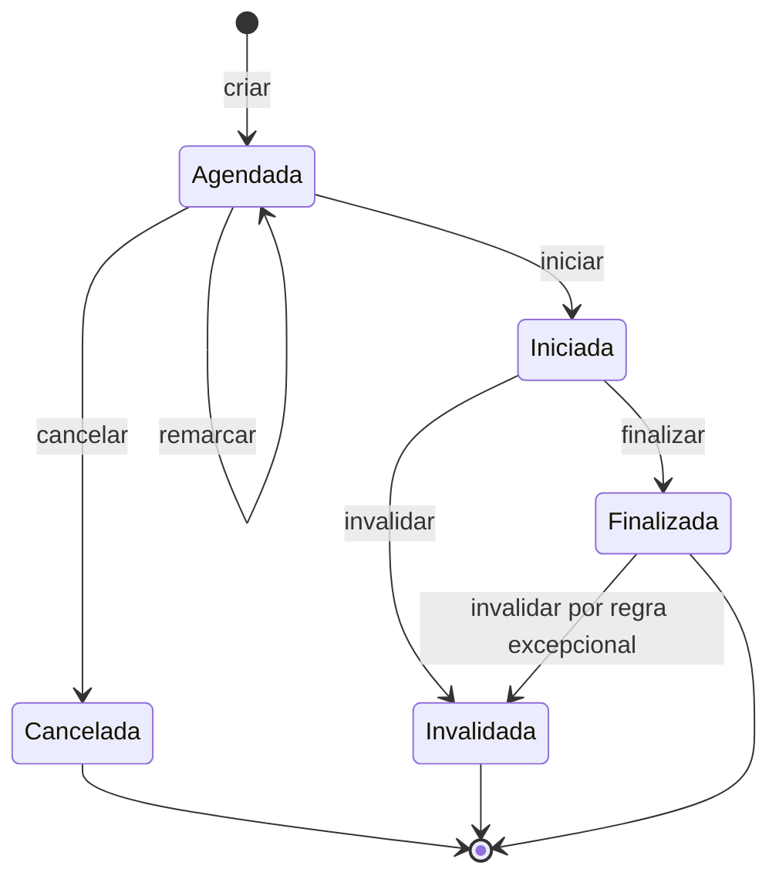
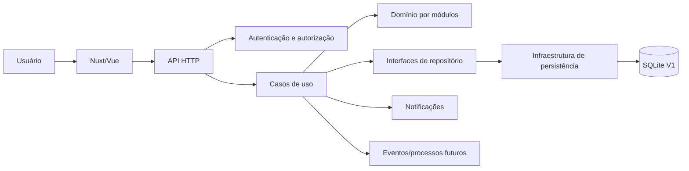
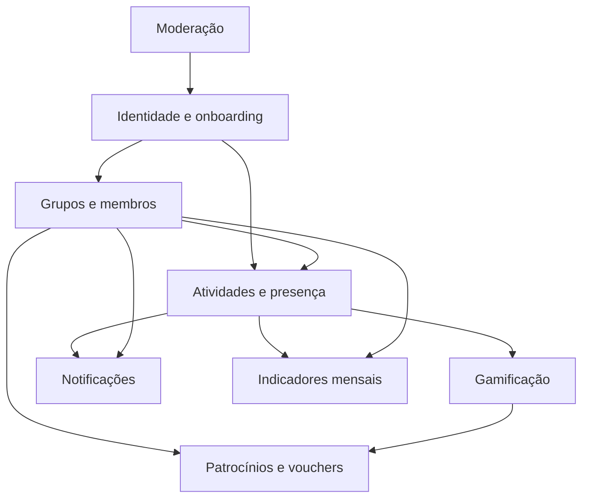

# SIGAME — Requisitos da V1

> **Status:** Em revisão
>
> **Versão:** 0.5
>
> **Última atualização:** 2026-11-09
>
> **Fonte:** levantamento inicial, especificação de requisitos e proposta arquitetural do SIGAME.

> **Escopo deste documento:** requisitos de produto (RF, RN, CA). O estado da implementação, o roadmap e as decisões ainda abertas ficam em [../implementacao.md](../implementacao.md). As decisões já tomadas e o porquê ficam em [../decisoes.md](../decisoes.md).

---

## 1. Como usar este documento

Este documento é a fonte organizada dos requisitos funcionais, regras de negócio e critérios de aceitação da V1.

A especificação foi organizada por **capacidade do produto**, e não apenas por tipo de requisito. Cada capacidade
possui:

- objetivo;
- regras e restrições;
- critérios de aceitação;
- exemplos de decisão, quando houver regra quantitativa;
- dependências ou pontos ainda pendentes.

### 1.1 Identificadores

Os identificadores devem ser estáveis. Não renomeie um requisito apenas porque a ordem mudou.

| Prefixo | Tipo                    |
|---------|-------------------------|
| `OBJ`   | Objetivo do produto     |
| `RF`    | Capacidade funcional    |
| `RN`    | Regra de negócio        |
| `RNF`   | Requisito não funcional |
| `CA`    | Critério de aceitação   |
| `DEC`   | Decisão pendente        |

Ao alterar um requisito já implementado, registre a mudança no histórico ao final deste documento.

### 1.2 Status dos requisitos

| Status         | Significado                 |
|----------------|-----------------------------|
| `Proposto`     | Ainda em discussão          |
| `Aprovado`     | Aceito para a V1            |
| `Implementado` | Implementado e validado     |
| `Adiado`       | Não será implementado na V1 |
| `Rejeitado`    | Não faz parte do produto    |

---

## 2. Visão do produto

### OBJ01 — Incentivar atividades físicas em grupo

O SIGAME é uma plataforma web voltada a incentivar a prática de atividades físicas em grupo. O sistema deve ajudar
pessoas a encontrar outras com interesses e disponibilidades compatíveis, formar pequenos grupos, organizar atividades e
acompanhar sua evolução.

A V1 prioriza:

- socialização;
- inclusão de iniciantes e pessoas sedentárias;
- segurança e moderação;
- organização de atividades;
- acompanhamento de progresso;
- motivação por gamificação.

### OBJ02 — Modalidades iniciais

A V1 oferecerá as modalidades:

- caminhada;
- corrida;
- ciclismo.

O usuário poderá praticar mais de uma modalidade e definir uma delas como principal.

### OBJ03 — Limites de escopo da V1

A V1 não inclui:

- aplicativo mobile nativo;
- chat interno;
- rastreamento GPS obrigatório;
- recebimento de dinheiro, Pix, comissão ou repasse financeiro;

---

## 3. Atores e permissões

### 3.1 Atores

| Ator                   | Descrição                                                                          |
|------------------------|------------------------------------------------------------------------------------|
| Usuário                | Pessoa cadastrada que participa do SIGAME                                          |
| Administrador de grupo | Criador ou responsável pela gestão de um grupo específico                          |
| Supervisor             | Usuário designado para executar operações delegadas no grupo                       |
| Administração SIGAME   | Administração global da plataforma                                                 |
| Patrocinador           | Entidade responsável por proposta de benefício, caso incluída no fluxo final da V1 |

Um usuário pode exercer papéis diferentes em contextos diferentes. Ser administrador de um grupo não concede poderes
administrativos globais.

### 3.2 Matriz inicial de permissões

| Operação                              |       Usuário | Admin. do grupo |                  Supervisor | Administração SIGAME |
|---------------------------------------|--------------:|----------------:|----------------------------:|---------------------:|
| Editar próprio perfil                 |           Sim |             Sim |                         Sim |                  Sim |
| Criar grupo                           | Se habilitado |             Sim |               Se habilitado |                  Sim |
| Solicitar entrada em grupo            |           Sim |             Sim |                         Sim |                  Sim |
| Aprovar entrada                       |           Não |             Sim | Não, salvo delegação futura |                  Sim |
| Remover membro do grupo               |           Não |             Sim |                         Não |                  Sim |
| Promover/rebaixar administrador       |           Não |             Sim |                         Não |                  Sim |
| Criar atividade                       |           Não |             Sim |                         Não |                  Sim |
| Editar/remarcar atividade             |           Não |             Sim |                         Não |                  Sim |
| Cancelar atividade                    |           Não |             Sim |                         Não |                  Sim |
| Iniciar/finalizar atividade           |           Não |             Sim |                         Sim |                  Sim |
| Invalidar atividade                   |           Não |             Sim |                         Não |                  Sim |
| Inscrever-se em atividade             |           Sim |             Sim |                         Sim |                  Sim |
| Check-in próprio                      |           Sim |             Sim |                         Sim |                  Sim |
| Validar presença                      |           Não |             Sim |                         Sim |                  Sim |
| Listar presenças                      |           Não |             Sim |                         Sim |                  Sim |
| Ver histórico de remarcações           |           Não |             Sim |                         Não |                  Sim |
| Suspender conta globalmente           |           Não |             Não |                         Não |                  Sim |
| Consultar denúncias globais           |           Não |             Não |                         Não |                  Sim |
| Criar recompensa interna              |           Não |             Sim |                    Pendente |                  Sim |
| Gerenciar patrocinadores e benefícios |           Não |             Não |                         Não |                  Sim |

> Os poderes de atividade do supervisor foram fechados no `ADR-027`: ele opera a atividade no dia
> (check-in, validação/lista de presenças, início e finalização), mas não cria, edita, remarca, cancela,
> invalida nem altera informações sensíveis. O criador do grupo só possui poderes enquanto estiver no papel
> de administrador, conforme o `ADR-023`.

---

## 4. Identidade, cadastro e onboarding

### RF01 — Cadastrar usuário

O sistema deve permitir o cadastro de usuário com e-mail, senha e dados cadastrais mínimos. O CPF é opcional no cadastro.

#### Regras

- `RN01.1` O CPF é opcional no cadastro. Quando informado, deve ser único na V1.
- `RN01.2` O e-mail deve ser único.
- `RN01.3` A V1 não realiza validação governamental de identidade por CPF.
- `RN01.4` A senha nunca deve ser armazenada em texto puro.
- `RN01.5` Foto de perfil não é obrigatória.
- `RN01.6` Peso e altura são opcionais.
- `RN01.7` Peso e altura não podem impedir o acesso às funcionalidades sociais.
- `RN01.8` Todo usuário novo inicia no nível 1.
- `RN01.9` O CPF pode ser definido depois do cadastro, por endpoint autenticado. Uma vez definido, é **write-once**: o próprio usuário não pode alterá-lo.
- `RN01.10` O cadastro por provedor social cria a conta sem senha local e sem CPF, com onboarding pendente e nível 1.
- `RN01.11` Quando o provedor confirma `email_verified=true` e o e-mail já pertence a uma conta **sem senha local**, a identidade social é vinculada a essa conta em vez de criar uma duplicata. Se a conta existente tiver senha local, o vínculo só ocorre após o usuário autenticar na conta e confirmar a vinculação.
- `RN01.12` O CPF é exigido apenas para resgatar recompensas/vouchers externos à plataforma, como comprovação de identidade real e prevenção de ganhos indevidos.

#### Critérios de aceitação

- `CA01.1` Não é possível cadastrar dois usuários com o mesmo CPF quando ele é informado.
- `CA01.2` Não é possível cadastrar dois usuários com o mesmo e-mail.
- `CA01.3` Um cadastro sem foto, peso ou altura pode ser concluído se os demais dados obrigatórios forem válidos.
- `CA01.4` A senha persistida não é igual à senha informada.
- `CA01.5` Um usuário recém-cadastrado possui nível 1.
- `CA01.6` Um cadastro sem CPF é permitido.
- `CA01.7` Um CPF já definido não pode ser alterado pelo próprio usuário.
- `CA01.8` Um CPF informado por outro usuário não pode ser reutilizado.

### RF02 — Autenticar usuário

O sistema deve autenticar o usuário por e-mail/senha ou por provedor social (Google nesta entrega) e manter sua sessão conforme o perfil e o estado da conta.

#### Regras

- `RN02.1` Conta suspensa não pode iniciar uma nova sessão.
- `RN02.2` A autenticação deve identificar o usuário responsável pela operação.
- `RN02.3` Operações protegidas devem verificar a autorização no backend, mesmo que a interface oculte controles.
- `RN02.4` A sessão usa um **access token JWT** de curta duração (15 minutos) e um **refresh token opaco** de alta entropia (7 dias), este último em cookie `HttpOnly`.
- `RN02.5` A cada renovação, o refresh token é rotacionado dentro da mesma família; o token anterior é revogado.
- `RN02.6` O reuso de um refresh token revogado fora da janela de graça revoga toda a família.
- `RN02.7` O logout revoga a família do cookie; o logout de todos os dispositivos revoga todas as famílias.
- `RN02.8` No login social, o e-mail deve estar verificado pelo provedor; o vínculo automático só ocorre quando a conta existente não tem senha local. Contas com senha local exigem autenticação e vínculo explícito.
- `RN02.9` O refresh token nunca é retornado no corpo da resposta; o access token nunca é armazenado em cookie.

#### Critérios de aceitação

- `CA02.1` Credenciais válidas permitem autenticação.
- `CA02.2` Credenciais inválidas não permitem autenticação.
- `CA02.3` Conta suspensa não pode autenticar.
- `CA02.4` Uma requisição protegida sem sessão válida é recusada.
- `CA02.5` Uma renovação válida devolve novo access token e novo refresh token, invalidando o anterior.
- `CA02.6` O reuso de um refresh token revogado é recusado e revoga a família.
- `CA02.7` O logout invalida o refresh token utilizado.
- `CA02.8` O login social cria ou vincula a conta e emite o mesmo par de tokens.
- `CA02.9` O endpoint de CPF define o CPF uma única vez e rejeita alteração.

### RF03 — Concluir onboarding

O sistema deve executar o onboarding inicial e controlar sua conclusão.

#### Regras

- `RN03.1` O onboarding define os dados mínimos necessários para progressão inicial.
- `RN03.2` Ao concluir os requisitos definidos, o usuário alcança o nível 2.
- `RN03.3` O usuário pode selecionar uma ou mais modalidades.
- `RN03.4` Uma modalidade ativa pode ser definida como principal.
- `RN03.5` Alterar a modalidade principal não remove histórico nem XP.

#### Critérios de aceitação

- `CA03.1` Um onboarding incompleto não concede o nível 2.
- `CA03.2` Um onboarding válido pode ser concluído uma única vez ou de forma idempotente.
- `CA03.3` A conclusão válida eleva o usuário ao nível 2.
- `CA03.4` O usuário pode ter mais de uma modalidade ativa.
- `CA03.5` Alterar a modalidade principal preserva o histórico de atividades e XP.

#### Matriz de exemplos — onboarding e modalidades

| Situação                                                | Resultado esperado                                            |
|---------------------------------------------------------|---------------------------------------------------------------|
| Nenhuma modalidade selecionada                          | Rejeitar conclusão                                            |
| Uma modalidade selecionada                              | Permitir, se os demais dados obrigatórios estiverem completos |
| Duas ou três modalidades selecionadas                   | Permitir                                                      |
| Modalidade principal não pertence às modalidades ativas | Rejeitar                                                      |
| Peso ausente                                            | Permitir, pois é opcional                                     |
| Altura ausente                                          | Permitir, pois é opcional                                     |
| Onboarding concluído novamente                          | Não duplicar progressão nem conceder XP indevido              |

---

## 5. Grupos e membros

### RF04 — Criar grupo

Usuários habilitados devem poder criar grupos esportivos.

#### Campos do grupo

| Campo | Obrigatório | Regra |
|---|---|---|
| `name` | Sim | 3 a 80 caracteres, com espaços removidos das pontas |
| `description` | Não | até 500 caracteres |
| `modality` | Sim | `caminhada`, `corrida` ou `ciclismo` |
| `communicationLink` | Não | URL `http` ou `https`, até 2048 caracteres, visível apenas para membros aprovados |

#### Regras

- `RN04.1` Apenas usuário a partir do nível 2 pode criar grupo.
- `RN04.2` O criador do grupo assume o papel de administrador no momento da criação.
- `RN04.3` Cada usuário pode participar de no máximo 3 grupos na V1, conforme a interpretação adotada para o limite de
  grupos.
- `RN04.4` O grupo possui limite inicial de 5 membros aprovados.
- `RN04.5` Um grupo torna-se ativo ao atingir no mínimo 3 membros aprovados.
- `RN04.6` O grupo pode existir em formação com menos de 3 membros.
- `RN04.7` O grupo registra o criador em campo próprio (`createdBy`), independente do papel de administrador.
- `RN04.8` O criador inicia como administrador, mas o grupo pode ter mais de um administrador aprovado.
- `RN04.9` O papel de administrador é atributo da participação (`Membership.role`), não do criador.

#### Critérios de aceitação

- `CA04.1` Usuário nível 1 não consegue criar grupo.
- `CA04.2` Usuário nível 2 consegue criar grupo quando não excede seu limite de grupos.
- `CA04.3` O criador é registrado como administrador do grupo.
- `CA04.4` Grupo com menos de 3 membros aprovados permanece em formação.
- `CA04.5` Grupo com 3 ou mais membros aprovados fica ativo.
- `CA04.6` Grupo não aceita mais de 5 membros aprovados.
- `CA04.7` O `createdBy` permanece registrado mesmo se o criador for rebaixado ou removido.
- `CA04.8` Um grupo pode ter dois ou mais administradores aprovados.

### RF05 — Solicitar entrada em grupo

O sistema deve permitir que usuários habilitados solicitem entrada em grupos.

#### Regras

- `RN05.1` A solicitação depende de aprovação do administrador.
- `RN05.2` Usuário não pode criar solicitações duplicadas pendentes para o mesmo grupo.
- `RN05.3` Usuário suspenso não pode solicitar entrada.
- `RN05.4` O limite de participação em grupos deve ser verificado no momento da aprovação.

#### Critérios de aceitação

- `CA05.1` Usuário habilitado consegue criar uma solicitação pendente.
- `CA05.2` Solicitação duplicada pendente é recusada ou tratada de forma idempotente.
- `CA05.3` Solicitação não concede participação antes da aprovação.
- `CA05.4` Solicitação de usuário suspenso é recusada.

### RF06 — Administrar membros do grupo

O administrador deve poder aprovar, rejeitar e remover membros, registrar os motivos quando aplicável e gerenciar os
papéis de administrador.

#### Regras

- `RN06.1` Qualquer administrador do grupo pode aprovar ou rejeitar solicitações.
- `RN06.2` Qualquer administrador pode remover membro do grupo.
- `RN06.3` A remoção deve registrar autor, data e motivo.
- `RN06.4` Administrador de grupo não pode suspender globalmente uma conta.
- `RN06.5` A aprovação deve respeitar o limite máximo de 5 membros.
- `RN06.6` A aprovação deve respeitar o limite máximo de grupos do usuário.
- `RN06.7` O grupo deve manter ao menos um administrador aprovado.
- `RN06.8` Qualquer administrador pode promover ou rebaixar um membro aprovado.
- `RN06.9` O último administrador não pode ser rebaixado nem removido.

#### Critérios de aceitação

- `CA06.1` Administrador consegue aprovar solicitação pendente válida.
- `CA06.2` Aprovação transforma a solicitação em participação aprovada.
- `CA06.3` Aprovação de grupo cheio é recusada.
- `CA06.4` Usuário não administrador não consegue aprovar solicitação.
- `CA06.5` Remoção registra autor, membro removido, grupo, data e motivo.
- `CA06.6` Remoção não provoca suspensão global.
- `CA06.7` Dois administradores conseguem aprovar e remover membros.
- `CA06.8` Rebaixar o último administrador é recusado.
- `CA06.9` Remover o último administrador é recusado.
- `CA06.10` Administrador rebaixado perde imediatamente as operações de gestão.

#### Matriz de exemplos — estado do grupo

| Membros aprovados | Estado esperado | Pode receber atividade?   |
|------------------:|-----------------|---------------------------|
|                 0 | Em formação     | Não, salvo decisão futura |
|                 1 | Em formação     | Não, salvo decisão futura |
|                 2 | Em formação     | Não, salvo decisão futura |
|                 3 | Ativo           | Sim                       |
|                 4 | Ativo           | Sim                       |
|                 5 | Ativo e cheio   | Sim, sem novas aprovações |

### RF07 — Designar supervisor

O administrador deve poder designar um supervisor para o grupo.

#### Regras

- `RN07.1` A existência de supervisor é opcional.
- `RN07.2` O supervisor deve ser membro aprovado do grupo.
- `RN07.3` O supervisor não recebe poderes globais.
- `RN07.4` Na V1, o supervisor não aprova, rejeita, remove, promove nem rebaixa membros. Na atividade, ele pode
  fazer o próprio check-in, validar e listar presenças, iniciar e finalizar a atividade. Não pode criar, editar,
  remarcar, cancelar, invalidar nem alterar informações sensíveis da atividade.

#### Critérios de aceitação

- `CA07.1` Administrador consegue designar membro aprovado como supervisor.
- `CA07.2` Usuário externo ao grupo não pode ser designado.
- `CA07.3` Supervisor consegue executar somente as operações delegadas.
- `CA07.4` Supervisor não consegue aprovar, rejeitar ou remover membros.
- `CA07.5` A remoção do membro limpa automaticamente a designação de supervisor.

### RF08 — Comunicação externa do grupo

O administrador pode cadastrar um link externo de comunicação do grupo.

#### Regras

- `RN08.1` Não haverá chat próprio na V1.
- `RN08.2` O link só pode ser visualizado por membros aprovados.
- `RN08.3` O telefone pessoal não deve ser exposto como requisito de comunicação.

#### Critérios de aceitação

- `CA08.1` Visitante ou usuário não aprovado não visualiza o link.
- `CA08.2` Membro aprovado visualiza o link quando cadastrado.
- `CA08.3` Administrador consegue alterar ou remover o link.
- `CA08.4` O sistema não exige a publicação de telefone pessoal.
- `CA08.5` O link só aceita URL `http` ou `https` válida.

---

## 6. Atividades e presença

### RF09 — Criar e manter atividade

O sistema deve permitir criar e manter atividades vinculadas a grupos ativos.

#### Campos da atividade

| Campo | Obrigatório | Regra |
|---|---|---|
| `title` | Sim | 3 a 100 caracteres, com espaços removidos das pontas |
| `description` | Não | até 500 caracteres |
| `startsAt` | Sim | data/hora de início em ISO 8601 com offset, no futuro |
| `estimatedDurationMinutes` | Não | duração média estimada, de 15 a 1440 minutos |
| `meetingPoint` | Sim | 3 a 255 caracteres |
| `route` | Sim | ponto final ou trajeto, 3 a 500 caracteres |
| `estimatedDistanceMeters` | Sim | inteiro entre 1 e 1.000.000 |
| `group` | Sim | grupo `ACTIVE` ou `FULL` no momento da criação |

#### Regras

- `RN09.1` Apenas administrador do grupo ou administrador SIGAME pode criar, editar, remarcar, cancelar e invalidar atividade.
- `RN09.2` A atividade deve pertencer a um grupo com pelo menos 3 membros aprovados no momento da criação.
- `RN09.3` Supervisor pode iniciar, finalizar, validar e listar presenças, mas não pode criar, editar, remarcar, cancelar nem invalidar.
- `RN09.4` Alterações relevantes devem gerar alerta interno.
- `RN09.5` GPS não é obrigatório na V1.
- `RN09.6` Atividade cancelada não pode ser iniciada.
- `RN09.7` Atividade finalizada não pode ser iniciada novamente.
- `RN09.8` Atividade cancelada ou invalidada não gera XP.
- `RN09.9` A janela operacional de início, check-in, finalização e validação segue o `ADR-025`.
- `RN09.10` O criador não é inscrito automaticamente na atividade.
- `RN09.11` Atividades e dados de encontro são visíveis apenas para membros aprovados do grupo; administradores SIGAME podem consultar para moderação.
- `RN09.12` A remarcação só é permitida em atividade agendada e preserva a janela anterior em histórico append-only.
- `RN09.13` O cancelamento só é permitido em atividade agendada, com motivo opcional.
- `RN09.14` A invalidação só é permitida em atividade iniciada ou finalizada, por administrador, com motivo obrigatório.
- `RN09.15` Quando `estimatedDurationMinutes` é omitido, a janela de planejamento usa 120 minutos.
- `RN09.16` Atividade iniciada com duração informada fecha automaticamente após a duração somada a uma tolerância de 50%, com mínimo de 15 e máximo de 240 minutos.
- `RN09.17` Atividade iniciada sem duração informada fecha automaticamente após 12 horas.
- `RN09.18` Atividade não iniciada é cancelada automaticamente após 3 horas do início previsto.
- `RN09.19` O fechamento automático é idempotente e não substitui a finalização explícita.
- `RN09.20` Se o grupo cair para `FORMING`, atividades já criadas continuam válidas; apenas novas criações são bloqueadas.

#### Critérios de aceitação

- `CA09.1` Atividade sem `title`, `startsAt`, `meetingPoint`, `route` ou `estimatedDistanceMeters` é recusada.
- `CA09.2` Usuário sem permissão não consegue criar, editar, remarcar, cancelar ou invalidar atividade.
- `CA09.3` Atividade de grupo em formação é recusada na criação.
- `CA09.4` Remarcação preserva a janela anterior no histórico.
- `CA09.5` Cancelamento impede início, check-in e validação.
- `CA09.6` Criação, alteração, remarcação, cancelamento, início e finalização geram evento interno.
- `CA09.7` Usuário não membro não visualiza a atividade.
- `CA09.8` Invalidação exige administrador e motivo.
- `CA09.9` Atividade existente continua operável se o grupo cair para formação.
- `CA09.10` Início e finalização fora da janela operacional são recusados.
- `CA09.11` Cancelada e invalidada são estados terminais.
- `CA09.12` Duração omitida não impede a criação.
- `CA09.13` Atividade iniciada com duração é fechada automaticamente no prazo calculado.
- `CA09.14` Atividade não iniciada é cancelada automaticamente após 3 horas.
- `CA09.15` Fechamento automático sem 2 check-ins não gera XP.

### Ciclo de vida da atividade

#### Regras de transição

- `RN09.6` Atividade cancelada não pode ser iniciada.
- `RN09.7` Atividade finalizada não pode ser iniciada novamente.
- `RN09.8` Atividade cancelada ou invalidada não gera XP.
- `RN09.21` Início permitido de 15 minutos antes até 2 horas após o horário previsto.
- `RN09.22` Finalização permitida até 24 horas após o início real.
- `RN09.23` Invalidação permitida em até 48 horas após o encerramento previsto ou real.
- `RN09.24` O fechamento automático usa o início real, não o horário previsto.

### RF10 — Inscrever-se, fazer check-in e validar presença

O participante deve poder se inscrever, registrar seu check-in e ter a presença validada por administrador ou supervisor.

#### Regras

- `RN10.1` A inscrição é individual e permitida apenas a membro aprovado do grupo.
- `RN10.2` Há no máximo uma inscrição ativa por par usuário/atividade.
- `RN10.3` A inscrição só é permitida em atividade agendada e antes do início.
- `RN10.4` A inscrição respeita o conflito de horário do RF11.
- `RN10.5` O cancelamento da inscrição só é permitido antes do início e é idempotente.
- `RN10.6` O check-in é individual e só é permitido para participante inscrito.
- `RN10.7` O check-in abre 30 minutos antes do início e fecha 30 minutos após o fim previsto.
- `RN10.8` Somente administrador, supervisor ou administrador SIGAME pode validar presença.
- `RN10.9` GPS não é obrigatório.
- `RN10.10` Somente presença validada gera XP.
- `RN10.11` Uma presença validada não pode gerar XP novamente.
- `RN10.12` A validação exige check-in prévio.
- `RN10.13` A validação só é permitida após a finalização e o fechamento do check-in, em até 48 horas após a finalização.
- `RN10.14` A atividade só é elegível a XP com pelo menos 2 participantes com check-in.
- `RN10.15` A validação pode ocorrer com menos de 2 check-ins, mas o evento indica `xpEligible=false`.

#### Critérios de aceitação

- `CA10.1` Participante inscrito consegue realizar check-in dentro da janela permitida.
- `CA10.2` Usuário não inscrito não consegue realizar check-in.
- `CA10.3` Check-in não validado não gera XP.
- `CA10.4` Validação autorizada altera o estado da presença.
- `CA10.5` Tentativa de validar duas vezes não gera XP duplicado.
- `CA10.6` Validação de atividade cancelada ou invalidada é recusada.
- `CA10.7` Membro aprovado consegue se inscrever em atividade agendada.
- `CA10.8` Não membro não consegue se inscrever.
- `CA10.9` Inscrição repetida não cria segundo episódio ativo.
- `CA10.10` Inscrição conflitante é recusada.
- `CA10.11` Cancelamento de inscrição após o início é recusado.
- `CA10.12` Validação sem check-in é recusada.
- `CA10.13` Validação fora da janela é recusada.
- `CA10.14` Atividade com menos de 2 check-ins valida presença com `xpEligible=false`.

### RF11 — Impedir conflitos de horário

O sistema deve impedir que o mesmo usuário seja atribuído a atividades conflitantes.

#### Definição

Duas atividades conflitam quando seus intervalos de horário se sobrepõem, mesmo que parcialmente. Não há margem de
deslocamento e não há exceção administrativa na V1.

#### Regras

- `RN11.1` A margem de conflito é de 0 minutos; atividades encostadas não conflitam.
- `RN11.2` Não há override administrativo para inscrição conflitante.
- `RN11.3` O conflito é verificado na inscrição e na remarcação para todos os inscritos ativos.
- `RN11.4` A regra é aplicada no backend, em transação, com lock por usuário e por atividade.
- `RN11.5` A atividade iniciada usa o horário de fechamento automático como fim efetivo para conflito.

#### Critérios de aceitação

- `CA11.1` Atividades sem sobreposição podem ser atribuídas ao mesmo usuário.
- `CA11.2` Atividades com sobreposição parcial não podem ser atribuídas ao mesmo usuário.
- `CA11.3` Atividades com mesmo horário não podem ser atribuídas ao mesmo usuário.
- `CA11.4` A regra deve ser aplicada no backend e protegida por transação.
- `CA11.5` Atividades encostadas são aceitas.
- `CA11.6` Remarcação que crie conflito para um inscrito é recusada.

---

## 7. Gamificação e progressão

### RF12 — Progressão de XP e níveis

O sistema deve calcular e apresentar o nível e o progresso de XP do usuário.

#### Regras

- `RN12.1` Todo usuário inicia no nível 1.
- `RN12.2` A gamificação possui 10 níveis.
- `RN12.3` A conclusão do onboarding concede o acesso ao nível 2, conforme RF03.
- `RN12.4` Participação em atividade só gera XP após validação da presença.
- `RN12.5` O sistema pode registrar XP por ofensiva/engajamento e outros eventos previstos.
- `RN12.6` O histórico de XP não deve ser perdido ao trocar a modalidade principal.
- `RN12.7` A atividade precisa estar finalizada, não cancelada/invalidada e ter pelo menos 2 check-ins para ser elegível a XP.
- `RN12.8` O evento `AttendanceValidated` informa `xpEligible`; a Gamification não deve conceder XP quando for falso.
- `RN12.9` Invalidação posterior de atividade com XP exige evento de reversão com os usuários validados.

#### Critérios de aceitação

- `CA12.1` Usuário novo começa no nível 1.
- `CA12.2` Usuário que conclui onboarding válido alcança o nível 2.
- `CA12.3` Presença apenas com check-in não gera XP.
- `CA12.4` Presença validada gera XP uma única vez.
- `CA12.5` O progresso retornado pela API pode ser apresentado visualmente pelo frontend.

#### Matriz de exemplos — progressão

| Evento                        | XP esperado | Altera nível?          | Observação                |
|-------------------------------|------------:|------------------------|---------------------------|
| Cadastro                      |     Definir | Não, inicia no nível 1 | `DEC02`                   |
| Onboarding concluído          |     Definir | Sim, alcança nível 2   | Valor ainda pendente      |
| Check-in não validado         |           0 | Não                    | Não é participação válida |
| Presença validada             |     Definir | Possivelmente          | Impedir duplicidade       |
| Troca de modalidade principal |           0 | Não                    | Preserva histórico        |

> `DEC02` — Definir tabela de XP por nível e valores concedidos por evento.

### RF13 — Deleveling por inatividade

O sistema deve aplicar perda de progresso por inatividade conforme as regras definidas.

#### Regras

- `RN13.1` Até 7 dias sem atividade válida não há perda por inatividade.
- `RN13.2` Após a tolerância, o usuário perde 2% da barra do nível a cada 2 dias sem atividade válida.
- `RN13.3` Ao sofrer deleveling, o usuário retorna ao nível anterior com 98% da barra.
- `RN13.4` O nível 2 é o piso do deleveling.
- `RN13.5` Deleveling não remove acesso a grupos já conquistados.
- `RN13.6` Recompensas já resgatadas não são retiradas.

#### Critérios de aceitação

- `CA13.1` Usuário com até 7 dias desde a última atividade válida não sofre penalização.
- `CA13.2` Usuário além da tolerância sofre a perda correspondente ao número de períodos completos de 2 dias.
- `CA13.3` Usuário no nível 2 não desce para o nível 1 por inatividade.
- `CA13.4` Deleveling não remove associações com grupos.
- `CA13.5` Deleveling não revoga recompensas já resgatadas.
- `CA13.6` A aplicação da penalização é idempotente para o mesmo período de inatividade.

> `DEC03` — Definir se a penalização de 2% incide sobre a barra atual, sobre o XP necessário do nível ou sobre o saldo
> absoluto de XP.

### RF14 — Recompensas

O sistema deve associar recompensas a marcos de nível e permitir recompensas internas de atividades de grupo.

#### Regras

- `RN14.1` Os principais marcos são os níveis 5, 8 e 10.
- `RN14.2` Recompensas podem incluir benefícios de patrocinadores, vouchers e elementos internos.
- `RN14.3` Administrador de grupo pode cadastrar recompensa interna para atividade, conforme permissões.
- `RN14.4` Recompensa resgatada não é removida por deleveling.

#### Critérios de aceitação

- `CA14.1` Alcançar nível com marco configurado torna a recompensa elegível.
- `CA14.2` Recompensa resgatada fica registrada no histórico do usuário.
- `CA14.3` Deleveling não remove recompensa resgatada.
- `CA14.4` Usuário sem permissão não cadastra recompensa interna.

---

## 8. Notificações internas

### RF15 — Alertas e notificações

O sistema deve exibir alertas internos sobre eventos relevantes, especialmente atividades de grupo.

#### Eventos mínimos

- criação de atividade;
- alteração de atividade;
- remarcação;
- cancelamento;
- início;
- encerramento;
- invalidação;
- inscrição e cancelamento de inscrição;
- check-in e validação de presença;
- mudanças relevantes na participação do usuário.

#### Critérios de aceitação

- `CA15.1` Participantes relevantes recebem uma notificação quando uma atividade é criada.
- `CA15.2` Alterações relevantes geram nova notificação ou atualizam a anterior conforme política definida.
- `CA15.3` Usuário consegue consultar suas notificações.
- `CA15.4` Usuário consegue distinguir notificações lidas e não lidas.
- `CA15.5` Eventos automáticos de fechamento e cancelamento são identificados como automáticos.

> `DEC04` — Definir se notificações podem ser apagadas, arquivadas e marcadas manualmente como lidas.

---

## 9. Segurança, moderação e privacidade

### RF16 — Denunciar usuário

Usuários devem poder denunciar outros usuários informando motivo e observação.

#### Regras

- `RN16.1` Uma denúncia deve registrar denunciante, denunciado, motivo, observação, data e estado.
- `RN16.2` O denunciado não deve obter acesso indevido aos dados internos da apuração.
- `RN16.3` A administração SIGAME consulta e trata denúncias globais.

#### Critérios de aceitação

- `CA16.1` Usuário autenticado consegue registrar denúncia válida.
- `CA16.2` Denúncia sem motivo obrigatório é recusada.
- `CA16.3` Denúncia fica disponível para administração SIGAME.
- `CA16.4` Usuário comum não consulta a fila global de denúncias.

### RF17 — Bloquear usuário

Usuários devem poder bloquear outros usuários.

#### Critérios de aceitação

- `CA17.1` Usuário consegue bloquear outro usuário.
- `CA17.2` O bloqueio impede as interações definidas pela política do produto.
- `CA17.3` O sistema impede bloqueio de si próprio, salvo decisão futura.

> `DEC05` — Definir quais comportamentos o bloqueio impede: solicitações, visualização de perfil, mensagens futuras,
> participação conjunta ou todos eles.

### RF18 — Suspender conta globalmente

A administração SIGAME deve poder suspender globalmente uma conta.

#### Regras

- `RN18.1` Suspensão global é exclusiva da administração SIGAME.
- `RN18.2` Administrador de grupo pode remover membro, mas não suspender conta.
- `RN18.3` Conta suspensa não pode autenticar nem executar operações protegidas.
- `RN18.4` A suspensão deve registrar motivo, autor, data de início e, quando aplicável, data de término.

#### Critérios de aceitação

- `CA18.1` Administração SIGAME consegue suspender conta.
- `CA18.2` Administrador de grupo não consegue suspender conta globalmente.
- `CA18.3` Conta suspensa não consegue autenticar.
- `CA18.4` Suspensão fica registrada para auditoria.

### RNF01 — Privacidade e exposição de dados

Dados sensíveis não devem ser expostos a usuários sem autorização.

#### Dados sensíveis mínimos

- CPF;
- e-mail;
- telefone;
- peso;
- altura;
- dados de autenticação;
- informações internas de moderação.

#### Critérios de aceitação

- `CA19.1` Usuário comum não visualiza CPF de outro usuário.
- `CA19.2` Administrador de grupo não visualiza telefone pessoal como requisito de comunicação.
- `CA19.3` Dados de peso e altura não são expostos fora da autorização definida.
- `CA19.4` Senhas e credenciais nunca aparecem em respostas da API.

> `DEC06` — Definir a visão de perfil para o próprio usuário, membros do mesmo grupo, administradores e administração
> SIGAME.

---

## 10. Patrocínios, benefícios e vouchers

### RF19 — Gerenciar patrocinadores e benefícios

A administração deve poder cadastrar patrocinadores, analisar propostas e vincular benefícios a grupos.

#### Regras

- `RN19.1` O patrocínio da V1 é vinculado ao grupo.
- `RN19.2` Proposta de benefício depende de aprovação da administração SIGAME.
- `RN19.3` O patrocinador acessa somente as funções autorizadas, caso seu fluxo seja incluído na V1.
- `RN19.4` Recebimento financeiro está fora do escopo.

#### Critérios de aceitação

- `CA20.1` Administração consegue cadastrar patrocinador.
- `CA20.2` Benefício pendente não pode ser utilizado antes da aprovação.
- `CA20.3` Administração consegue vincular benefício aprovado a um grupo.
- `CA20.4` Nenhuma operação financeira é necessária para concluir o fluxo da V1.

### RF20 — Gerar e resgatar vouchers

O sistema deve gerar vouchers individuais e controlar seu resgate.

#### Regras

- `RN20.1` Cada voucher possui código único.
- `RN20.2` Voucher é individual e intransferível.
- `RN20.3` Voucher não pode ser reutilizado.
- `RN20.4` O sistema deve registrar estado do voucher.
- `RN20.5` A operação de resgate deve ser protegida contra concorrência e duplicidade.
- `RN20.6` O resgate de voucher/recompensa externo exige que o usuário tenha um CPF válido e previamente definido.

#### Critérios de aceitação

- `CA21.1` Dois vouchers nunca recebem o mesmo código.
- `CA21.2` Voucher disponível pode ser resgatado por usuário autorizado.
- `CA21.3` Voucher já utilizado não pode ser resgatado novamente.
- `CA21.4` Duas tentativas simultâneas não resultam em dois resgates válidos.
- `CA21.5` O histórico registra usuário, voucher, data e benefício utilizado.
- `CA21.6` O resgate externo é recusado quando o usuário não possui CPF definido.

> `DEC07` — Definir quem pode resgatar o voucher, como os vouchers são distribuídos e se existe limite por usuário ou
> período.

---

## 11. Indicador mensal de grupos

### RF21 — Calcular desempenho mensal dos grupos

O sistema deve calcular um indicador interno mensal de desempenho dos grupos.

#### Regras

- `RN21.1` O ranking não é público.
- `RN21.2` O patrocínio pode considerar o desempenho do grupo.
- `RN21.3` O cálculo deve preservar o período de referência.

#### Critérios de aceitação

- `CA22.1` O sistema consegue calcular um resultado para um mês de referência.
- `CA22.2` O resultado fica associado ao grupo e ao período.
- `CA22.3` Usuário público não consulta o ranking global.
- `CA22.4` Reprocessamento do mesmo período não cria resultados duplicados.

> `DEC08` — Definir fórmula do indicador, métricas, pesos, acesso e momento do cálculo.

---

## 12. Requisitos não funcionais

### RNF02 — Plataforma e dispositivos

- A aplicação será web.
- O uso prioritário será em mobile (já que é o que a maioria usa para acessar a internet, principalmente para serviços deste tipo).
- Deve existir responsividade para se adequar aos dispositivos móveis e telas grandes (úteis para os organizadores).

### RNF03 — Integridade e consistência

- Dados devem ser persistidos com integridade referencial.
- Operações que alteram múltiplas entidades devem utilizar transação.
- Regras críticas não podem depender apenas do frontend.
- Restrições como CPF, e-mail e código de voucher únicos devem ser protegidas também pelo banco.

### RNF04 — Desempenho e disponibilidade

- O desempenho deve ser adequado ao uso acadêmico e à carga esperada da V1.
- Não haverá SLA formal na etapa acadêmica.
- Manutenções pontuais poderão tornar o sistema temporariamente indisponível.

### RNF05 — Separação arquitetural

A arquitetura deve separar:

- interface e apresentação;
- transporte HTTP;
- casos de uso;
- regras de domínio;
- persistência;
- integrações externas.

A estrutura deve permitir testes sem depender da interface web ou de banco real para regras puras.

### RNF06 — Persistência

- O banco será PostgreSQL.
- A persistência deve ser encapsulada por interfaces de repositório.

### RNF07 — Segurança de credenciais

- Senhas devem utilizar mecanismo seguro de hash.
- Senhas nunca devem ser armazenadas ou retornadas em texto puro.
- O access token deve ser um JWT assinado com HS256 e segredo de pelo menos 32 caracteres.
- O refresh token deve ser uma string opaca de 256 bits, nunca persistida em texto puro (apenas SHA-256).
- O refresh token deve trafegar em cookie `HttpOnly`, `Secure` e `SameSite` configurável (preferencialmente `strict` em produção same-site), com path `/api/v1/auth`.
- Sessões, tokens e cookies devem ser protegidos conforme o mecanismo de autenticação escolhido.

---

## 13. Arquitetura funcional de alto nível

### Módulos funcionais previstos

---

## 14. Decisões e acompanhamento

As decisões ainda pendentes (`DEC02`–`DEC08`) e o estado de implementação de cada requisito estão em [../implementacao.md](../implementacao.md#3-decisões-em-aberto). As decisões da Fase 5 (`DEC01`, `DEC10`, `DEC11` e `DEC12`), as decisões anteriores (`DEC09`, `DEC13`, `DEC14`) e as decisões arquiteturais estão em [../decisoes.md](../decisoes.md).

Ao fechar uma decisão:

1. registre contexto, decisão, alternativas e consequências em `../decisoes.md`;
2. remova a pendência de `../implementacao.md`;
3. atualize o requisito e os critérios de aceitação neste documento;
4. adicione ou ajuste os testes correspondentes.

---

## 15. Estratégia de rastreabilidade e testes

Cada requisito funcional deve possuir pelo menos um critério de aceitação. Cada regra de negócio crítica deve possuir:

1. uma definição textual;
2. critérios de aceitação positivos;
3. critérios de rejeição ou exceção;
4. uma matriz de exemplos quando houver valores, limites ou combinações;
5. um ou mais testes automatizados associados.

### Exemplo de rastreabilidade

| Requisito                  | Critérios         | Testes esperados                                 |
|----------------------------|-------------------|--------------------------------------------------|
| `RF04` Criar grupo         | `CA04.1`–`CA04.6` | Teste de caso de uso + teste do agregado `Group` |
| `RF06` Administrar membros | `CA06.1`–`CA06.6` | Testes de autorização, limite e auditoria        |
| `RF10` Inscrição/presença  | `CA10.1`–`CA10.14` | Testes de fluxo, conflito e idempotência de XP   |
| `RF13` Deleveling          | `CA13.1`–`CA13.6` | Testes de datas, piso e idempotência             |
| `RF20` Vouchers            | `CA21.1`–`CA21.5` | Testes de unicidade e concorrência               |

### Tipos de teste

| Tipo       | Objetivo                                                          |
|------------|-------------------------------------------------------------------|
| Unidade    | Entidades, value objects e políticas puras                        |
| Aplicação  | Casos de uso, autorização e transações com dependências simuladas |
| Integração | Repositórios, banco, constraints e migrações                      |
| API        | Contrato HTTP, autenticação, autorização e serialização           |
| E2E        | Fluxos principais completos, em quantidade reduzida               |

---

## 16. Histórico de alterações

| Versão | Data       | Alteração                                                                          | Responsável                    |
|--------|------------|------------------------------------------------------------------------------------|--------------------------------|
| 0.1    | 2026-09-19 | Consolidação inicial dos PDFs                                                      | Felipe do Nascimento Magalhães |
| 0.2    | 2026-09-19 | Organização por capacidades, critérios de aceitação, matrizes e decisões pendentes | Gustavo Teixeira de Sousa      |
| 0.3    | 2026-11-05 | Extração de decisões e acompanhamento para `implementacao.md` e `decisoes.md`      | Gustavo Teixeira de Sousa      |
| 0.4    | 2026-11-09 | Fase 4: campos do grupo, criador independente, múltiplos admins e poderes do supervisor | Gustavo Teixeira de Sousa      |
| 0.5    | 2026-11-09 | Fase 5: atividades, inscrição, conflito, presença, duração opcional e fechamento automático | Gustavo Teixeira de Sousa      |

---

## 17. Checklist de revisão

O checklist de revisão pendente foi movido para [../implementacao.md](../implementacao.md#6-checklist-de-revisão-de-requisitos), junto com o roadmap e as decisões em aberto.

Cada item fechado deve virar uma entrada em [../decisoes.md](../decisoes.md) e atualizar o requisito correspondente neste documento.
